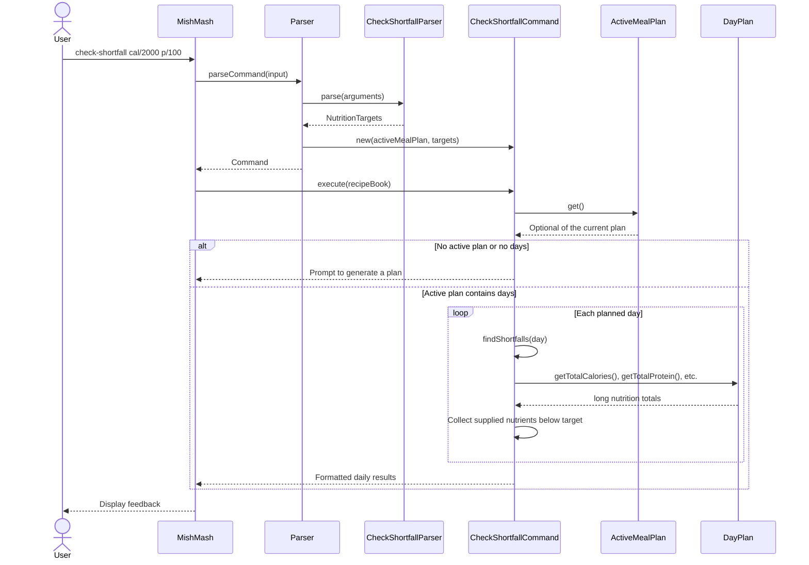

# Developer Guide

## Acknowledgements

{list here sources of all reused/adapted ideas, code, documentation, and third-party libraries -- include links to the original source as well}

## Design & implementation

### Grocery command integration

`Parser()` shares one `ActiveMealPlan` between meal-plan generation, grocery generation, and viewing.
For deterministic tests or an externally managed plan, use `Parser(MealPlanGenerator, ActiveMealPlan)`.
The supplier-based constructors retain their caller-provided viewing sources; their grocery viewers
do not automatically read the internally generated grocery snapshot.

The parser accepts `generate-list` without arguments and returns `GenerateListCommand` without
reading or modifying the plan. During execution, the command traverses `MealPlan.getDays()`,
`DayPlan.getMeals()`, and each recipe's ingredients. Every meal occurrence contributes its quantities.
The existing `GroceryListGenerator` combines exact name/unit matches with `BigDecimal` arithmetic,
preserving first-appearance order and keeping incompatible units separate.

`ActiveMealPlan.setGroceryList` copies the completed result into a read-only snapshot.
`getGroceryList` returns an optional: absence means no list has been generated for the current plan,
whereas a present empty list is valid. `ViewListCommand` reads this snapshot during execution and
delegates formatting to `GroceryListViewer`; viewing never regenerates data.

Successfully storing a replacement plan clears its old groceries. Failed plan generation or invalid
command syntax leaves the previous state intact. All state is kept in memory for one session.

Grocery parsing and viewing use `FINE` logs, successful generation logs counts at `INFO`, and rejected
generation requests use `WARNING`. These loggers inherit the existing application configuration;
no additional handlers are installed. New diagnostics exclude ingredient names and raw input.

Run `gradlew.bat test checkstyleMain checkstyleTest` on Windows with Java 25 to verify the integration.

### Checking nutrition shortfalls

The `check-shortfall` command helps users identify days whose planned meals fall below
explicit calorie or macronutrient targets. For example, `check-shortfall cal/2000 p/100`
checks calories and protein for every day in the active plan. It does not check recorded
food intake or change the plan. See the [User Guide](UserGuide.md#checking-nutrition-shortfalls)
for command syntax and example output.

#### Responsibilities and data flow

| Component | Responsibility |
| --- | --- |
| `Parser` | Recognises `check-shortfall`, delegates target parsing, and creates the command using its shared `ActiveMealPlan`. Converts validation errors into `MishMashException` with the command's usage instructions. |
| `CheckShortfallParser` | Accepts one or more unique `cal/`, `p/`, `c/`, and `f/` arguments and creates `NutritionTargets`. It does not read or modify the active plan. |
| `NutritionTargets` | Holds optional positive integer targets. A `null` value means that nutrient was omitted and must not be checked. |
| `CheckShortfallCommand` | Reads the latest active plan during execution, compares each day's totals with the supplied targets, and returns formatted feedback. |
| `DayPlan` | Supplies calorie, protein, carbohydrate, and fat totals using its existing `long`-based calculations. |
| `HelpCommand` | Advertises the command and the requirement to supply at least one target. |

`Parser()` and `Parser(MealPlanGenerator, ActiveMealPlan)` connect this check to the same
plan used by generation and grocery commands. The supplier-based parser constructors
retain their separate caller-provided viewing sources; the shortfall check still reads
the parser's `ActiveMealPlan`, rather than those viewing suppliers.

Reading the plan during execution matters because a command may be parsed before a plan
is generated or replaced. The command checks whichever plan is current when it runs.
If generation fails, `GeneratePlanCommand` leaves the previous plan in place, so subsequent
shortfall checks continue to inspect that plan.

The following sequence shows a valid request. The total-getter call represents the four
existing nutrition getters on `DayPlan`; their individual summation steps are omitted.



#### Comparison rules and design choices

For each supplied nutrient, a shortfall exists when `actual < target`. The reported
shortfall is `target - actual`, in kcal for calories and grams for macronutrients.
An exact match or a surplus is not reported as a shortfall. Omitted nutrients are ignored.
Days are compared separately, so one day's surplus cannot conceal another day's deficit.
A day without shortfalls receives an explicit message; that message does not claim there
are no excesses or that omitted nutrients meet any target.

The generator's +/-15% tolerance and this command serve different purposes. Generation
accepts approximate matches; the check reports any deficit against the explicit target.
For example, 1900 kcal is acceptable when generating against 2000 kcal, but the check
reports a 100 kcal shortfall. Reusing `NutritionTargets.isSatisfiedBy` would hide that
deficit and would not identify the deficient nutrients or amounts, so the command uses
the existing getters and a strict comparison instead. The generator's behaviour is unchanged.

Targets belong to each check request. They are not read from an earlier `generate-plan`
request or saved as personal settings. Explicit arguments keep the feature usable before
the separate personal-settings and storage enhancements are implemented. A future saved
settings feature can supply defaults while retaining the same comparison rules.

The command reuses the existing daily totals instead of duplicating the recipe summation
logic. Totals and deficit arithmetic use `long`, avoiding integer wraparound when several
recipes contain large nutrition values. The implementation visits every day's meals a
fixed number of times, so its running time is proportional to the total planned meals.

The command has no confirmation prompt because it is read-only. It does not call setters,
edit recipes, regenerate meals, or clear the grocery snapshot. Its `FINE` log records only
the number of days checked and inherits the existing application logging configuration.

#### Validation and boundary behaviour

| Situation | Behaviour |
| --- | --- |
| No target arguments, including blank input | Parsing fails with a request for at least one target and the command format. |
| Invalid number | Each target must contain digits representing a value from 1 to `Integer.MAX_VALUE`. Zero, signs, decimals, exponent notation, units, non-ASCII digits, and overflow are rejected. Leading zeros are accepted. |
| Unknown, repeated, or malformed arguments | Parsing fails without reading or changing the plan. Each supported prefix can appear once, in any order, with no space between its slash and value. |
| No active plan or a plan containing no days | Execution returns `No active meal plan. Use 'generate-plan' first.` |
| Empty day | Its totals are zero, so each supplied positive target is reported as a full shortfall. |
| Only some targets supplied | Only those nutrients are checked; missing values remain `null`. |
| Plan replaced after command parsing | Execution reads the replacement plan. |
| Failed generation or repeated checks | The previous plan, recipes, and existing grocery snapshot are preserved. |

`CheckShortfallCommand` also rejects a null plan holder, null targets, and a target object
with no supplied values. These constructor checks prevent invalid command objects from
being created by callers outside the parser.

#### Automated verification

- `CheckShortfallCommandTest` checks daily comparisons, exact and omitted targets, empty
  plans and days, large totals, repeated execution, current-plan lookup, and data preservation.
- `CheckShortfallParserTest` checks each prefix, accepted numerical boundaries, argument
  order and whitespace, missing targets, and malformed values for all four nutrients.
- `ParserCheckShortfallTest` checks command dispatch, error wrapping and recovery, both the
  default parser and injected active plan, and checks after failed generation.
- `MishMashTest` exercises the CLI from missing-plan and invalid-target feedback through
  successful generation and checking, then verifies that viewing and help remain available.

Run the full test suite and both Checkstyle tasks with Java 25, as described above.


## Product scope
### Target user profile

{Describe the target user profile}

### Value proposition

{Describe the value proposition: what problem does it solve?}

## User Stories

|Version| As a ... | I want to ... | So that I can ...|
|--------|----------|---------------|------------------|
|v1.0|new user|see usage instructions|refer to them when I forget how to use the application|
|v2.0|user tracking nutrition|detect when my planned meals fall short of my calorie or macronutrient targets|add or adjust meals accordingly|

## Non-Functional Requirements

{Give non-functional requirements}

## Glossary

* *glossary item* - Definition

## Instructions for manual testing

### Checking nutrition shortfalls

Start a fresh application session with Java 25 and enter a name. Recipes and plans are
currently held in memory, so use the following setup in that same session.

1. Before generating a plan, enter `check-shortfall cal/2000`. Expect the no-active-plan
   message and another command prompt.
2. Add three recipes and generate a two-day plan and its grocery list:

   ```text
   add-recipe n/Shortfall A cal/600 p/30 c/50 f/10 i/Rice:100g
   add-recipe n/Shortfall B cal/600 p/30 c/50 f/10 i/Rice:100g
   add-recipe n/Shortfall C cal/600 p/30 c/50 f/10 i/Rice:100g
   generate-plan d/2
   generate-list
   ```

   Both days contain all three recipes, so each day's totals are 1800 kcal, 90 g protein,
   150 g carbohydrates, and 30 g fat, regardless of the random meal order.
3. Enter `check-shortfall cal/2000 p/100 c/200 f/60`. Expect a separate result for Day 1
   and Day 2, each reporting deficits of 200 kcal, 10 g protein, 50 g carbohydrates,
   and 30 g fat.
4. Enter `check-shortfall cal/1800 p/90 c/100`. Expect no shortfalls for either day:
   calories and protein exactly match, carbohydrates exceed the target, and fat is omitted.
5. Enter `check-shortfall cal/1801`. Expect a 1 kcal shortfall on each day, even though
   that difference is within the generator's tolerance.
6. Try `check-shortfall`, `check-shortfall cal/0`, `check-shortfall p/1.5`,
   `check-shortfall cal/2000 cal/2100`, and `check-shortfall d/1`. Each should display an
   error with the command format. Then retry a valid command to confirm recovery.
7. Enter `view-plan` and `view-list`. Verify the plan still has both days with the same
   totals, and the grocery list still contains 600 g of rice. Repeat a check and verify
   these values remain unchanged. Enter `help` and confirm it includes `check-shortfall`.
