# MishMash The Meal Prep Planner Developer Guide

MishMash is a command-line meal prep planner for managing recipes, generating meal plans, and preparing grocery lists. This guide describes the current design, project practices, requirements, use cases, and manual tests.

## Contents

- [Acknowledgements](#acknowledgements)
- [Setting Up, Getting Started](#setting-up-getting-started)
- [Design](#design)
- [Implementation](#implementation)
- [Documentation, Logging, Testing, Configuration and DevOps](#documentation-logging-testing-configuration-and-devops)
- [Appendix A: Product Scope](#appendix-a-product-scope)
- [Appendix B: User Stories](#appendix-b-user-stories)
- [Appendix C: Non-Functional Requirements](#appendix-c-non-functional-requirements)
- [Appendix D: Glossary](#appendix-d-glossary)
- [Appendix E: Instructions for Manual Testing](#appendix-e-instructions-for-manual-testing)

## Acknowledgements

- The project originates from the [NUS CS2113 team-project template](https://github.com/NUS-CS2113-AY2627-S1/tp). The team's shared repository is [AY2627S1-CS2113-W13-4/tp](https://github.com/AY2627S1-CS2113-W13-4/tp).
- The guide structure follows the [AB3 User Guide](https://se-education.org/addressbook-level3/UserGuide.html) and [AB3 Developer Guide](https://se-education.org/addressbook-level3/DeveloperGuide.html), adapted to the [CS2113 deliverable requirements](https://nus-cs2113-ay2627-s1.github.io/website/admin/tp-deliverables.html). Product descriptions refer to MishMash rather than AB3 behaviour.
- [Gradle](https://gradle.org/) provides build automation and dependency management.
- [JUnit Jupiter](https://junit.org/junit5/) provides the automated testing framework.
- [Checkstyle](https://checkstyle.org/) checks Java coding conventions.
- [Shadow](https://gradleup.com/shadow/) packages the application JAR.
- [PlantUML](https://plantuml.com/) generates the UML diagrams from the editable sources under `docs/diagrams`, which has one folder per feature.

<!-- TEAM: Add any further sources of reused or adapted code, ideas, and documentation before submission. -->

## Setting Up, Getting Started

Refer to [Setting Up and Getting Started](SettingUp.md) for Java 25 prerequisites, importing the project, running tests, packaging the JAR, and troubleshooting.

The JAR currently published on the [team's Releases page](https://github.com/AY2627S1-CS2113-W13-4/tp/releases) is **v2.0**. The team has verified that the published v2.0 JAR matches the current source code described in this guide. Pending v2.0b features are explicitly labelled **Coming soon** in [User Stories](#v20b-follow-up-stories).

## Design

### Architecture

The application separates terminal interaction, command handling, application data, and output formatting. The main application coordinates these components throughout a single command session.

| Area | Current responsibility |
| --- | --- |
| Application and user interaction | Display the greeting, read commands, obtain confirmation when required, and show results or errors. |
| Command handling | Recognise commands, validate their arguments, and perform the requested action. |
| Model | Hold recipes, nutrition information, meal plans, generated groceries, and recorded meals. |
| Generation logic | Produce meal plans and consolidate grocery quantities. |
| Display formatting | Present recipes, meal plans, grocery lists, and recorded meals consistently as text. |

Command names and prefixes are case-sensitive. Invalid commands normally produce an error and allow the user to continue. The application accepts one command per line and ends when the user enters `bye` or console input ends.

### UI Component

`MishMash` owns the terminal input loop, greeting, name prompt, command execution, confirmation prompts, and recoverable error display. Classes in `mishmash.ui` format recipes, plans, groceries, and recorded meals as text. Commands return results to the loop rather than reading console input themselves. This keeps command execution testable without an interactive terminal.

### Logic Component

The logic covers command parsing, application actions, and generation. It supports the following commands:

| Command | Purpose |
| --- | --- |
| `add-recipe` | Add a recipe with nutrition information and ingredients. |
| `list-recipes` | List stored recipes or display one recipe in full. |
| `edit-recipe` | Replace selected fields of a recipe at its displayed index. |
| `delete-recipe` | Remove a recipe by its displayed index after confirmation. |
| `set-diet` | Replace the session dietary profile and repair or clear conflicting planned days. |
| `view-diet` | Display the session dietary profile. |
| `set-targets` | Save, replace, or remove daily calorie, protein, carbohydrate, and fat targets for later plans. |
| `view-targets` | Display the saved daily targets. |
| `generate-plan` | Generate one to seven days of meals, optionally using daily nutrition targets. Saved targets fill in nutrients that the command leaves out. |
| `reset-plan` | Clear the current plan, its generation request, and derived groceries; preserve other session data. |
| `view-plan` | Display the active meal plan or one selected day. |
| `check-shortfall` | Compare each planned day's nutrition with explicit daily targets and report deficits. |
| `generate-list` | Generate groceries for the active meal plan. |
| `view-list` | Display the generated grocery list. |
| `record-meal` | Record the recipe at a displayed index as a meal eaten. |
| `view-meals` | Display the recorded meals with their nutrition and totals. |
| `help` | Display the supported commands and their formats. |
| `bye` | End the session. |

Commands validate their arguments and relevant application state. Requests that fail validation leave the existing data unchanged. Generation and viewing are separate actions: viewing does not create a new plan or grocery list.

### Model Component

| Class | Represents |
| --- | --- |
| `Recipe` | A recipe name, calorie and macronutrient values, and ingredient entries. |
| `RecipeBook` | The session's ordered collection of recipes. |
| `RecipeChanges` | Validated optional edits, applied to the current recipe during execution. |
| `GroceryItem` | An ingredient name, decimal quantity, and unit. |
| `DayPlan` | The meals selected for one day and their nutrition totals. |
| `MealPlan` | The ordered days of a generated plan. |
| `NutritionTargets` | Optional daily calorie, protein, carbohydrate, and fat targets. |
| `Nutrient` | The four nutrients that can have a target, with their command prefix, label, and unit. |
| `TargetChanges` | Validated changes to the saved targets: a new value, or removal, for each nutrient mentioned. |
| `TargetSettings` | The daily targets saved with `set-targets`, shared by the commands that use them during the session. |
| `GeneratePlanRequest` | The requested number of days and nutrition targets. |
| `DietarySettings` | The shared session dietary profile. |
| `DietaryPreferences` | An immutable named diet, avoided tags, and normalized excluded ingredient names. |
| `Diet`, `FoodTag`, `FoodInfo` | Named-diet rules, supported categories, and declared recipe classification. |
| `ActiveMealPlan` | The current meal plan and its generated grocery list, if available. |
| `MealLog` | The recipes the user has recorded as eaten, in the order recorded. |
| `NutritionTotals` | Summed calories, protein, carbohydrates, and fats, held as `long` values. |

There are no separate `Ingredient` or `GroceryList` classes in the current model. Recipe ingredients and generated grocery entries use `GroceryItem`.

Recipes remain in insertion order. Their displayed indexes start at 1 and can change after deletion. Duplicate names are permitted. Editing replaces the recipe at its position without changing indexes. Existing meal plans retain their recipe snapshots when recipes are added, edited, or removed from the recipe book.

Recorded meals are kept in one `MealLog` for the session. The log stores the `Recipe` objects themselves, so each recorded meal keeps the nutrition the recipe had when it was recorded, whatever happens to the recipe book afterwards. The log is separate from the active plan: the plan holds meals the user intends to eat, and the log holds meals the user has eaten.

Saved daily targets are kept in one `TargetSettings` for the session and are read when `generate-plan` runs. A generated plan stores the targets that were applied to it, so later changes to the saved targets do not alter it.

Only one meal plan is active at a time. Successfully generating a replacement plan clears the groceries associated with the previous plan. Failed generation preserves the previous plan and groceries.

### Storage Component

Persistent application-data storage is not implemented. Recipes, saved daily targets, meal plans, grocery lists, and recorded meals are held in memory and are cleared when the application closes. There is no save or load command, save-file format, or application-data recovery process.

Diagnostic logs are written to disk, but they do not save or restore the recipe book or generated data.
## Implementation

This section explains the implemented MVP features, followed by v2.0b plan-management features and generation diagnostics.

<!-- @@author peilingggg -->
### Adding a recipe
*Section author: peilingggg*

`add-recipe` creates a recipe from its name, nutrition, ingredients, and optional food
categories. This supports the user story: **As a first-time user, I want to add a recipe
with its ingredients and quantities so that I can create a personalised meal.** The
[User Guide](UserGuide.md#adding-a-recipe) gives the command rules and examples.

```text
add-recipe n/DISHNAME cal/CALORIES p/PROTEIN c/CARBS f/FATS i/INGREDIENT:QUANTITYUNIT [i/INGREDIENT:QUANTITYUNIT ...] [food/TAG[,TAG...]]
```

All five recipe fields and at least one ingredient are required. Fields may appear in
any order; only `i/` may repeat. Recipes remain in memory for the current session.
Adding a recipe leaves existing recipes, meal plans, groceries, and recorded meals unchanged.

#### Responsibilities

| Component | Responsibility |
| --- | --- |
| `Parser` | Read prefixed fields, validate values, and create a recipe and command without changing the book. |
| `Recipe`, `GroceryItem` | Hold validated recipe data and precise decimal ingredient quantities. |
| `FoodInfo`, `FoodTag` | Represent the optional food-category declaration and validate supported tags. |
| `AddRecipeCommand` | Prepare the confirmation, then append its validated recipe to the supplied book. |
| `RecipeBook` | Store recipes in insertion order, including duplicate names. |
| `RecipeViewer` | Format recipe details consistently with listing and editing. |
| `MishMash` | Parse and execute the command, print its result or error, and continue the input loop. |

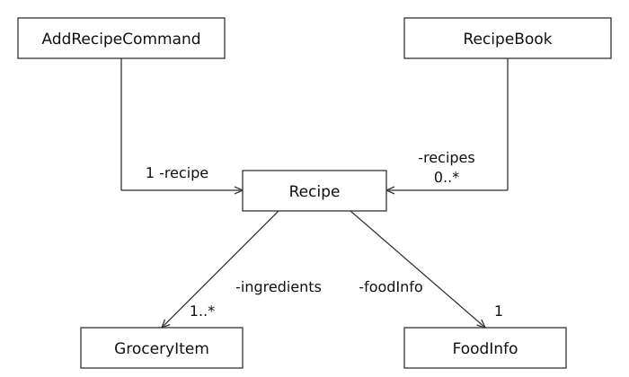

*Figure 1. Selected stored references. Open arrowheads show navigability, with target
multiplicities and private role names. Members, temporary dependencies, and `Command`
realization are omitted; `AddRecipeCommand` implements `Command`.*
[PlantUML source](diagrams/peilingggg/add-recipe/classes.puml)

The command stores one recipe; the book and viewer are supplied or created during execution.
The book and ingredient lists preserve order and allow repeated entries. `Recipe` copies
the ingredient list with `List.copyOf`, protecting its structure without deep-copying the
`GroceryItem` objects. Plain associations allow references to be shared with other features.

#### Parsing and object creation

For example, `add-recipe n/Rice cal/200 p/4 c/45 f/1 i/Rice:150g food/none` creates one
recipe containing a 150 g ingredient and an explicit empty food-category declaration.

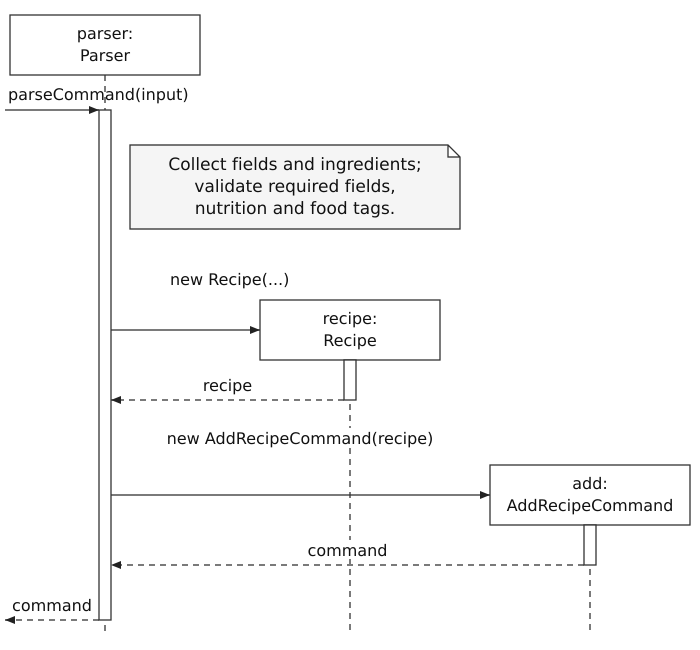

*Figure 2. Successful parsing. Dispatch helpers, ingredient creation, field validation,
and library operations are condensed in the note. Only the recipe and command constructors
are expanded. Parameters abbreviated with `...` are described below; parsing never updates the book.*
[PlantUML source](diagrams/peilingggg/add-recipe/parsing.puml)

1. `collectRecipeArguments` identifies prefixed fields, including unsupported prefixes,
   so an unknown field cannot silently become part of a name. `readArgument` stores
   single-value fields and appends each parsed `i/` item to a local list.
2. `validateRequiredFields` checks `n/`, `cal/`, `p/`, `c/`, `f/`, and at least one ingredient.
   `parseNutrition` then reads calories, protein, carbohydrates, and fats, in that order,
   as non-negative integers. Ingredient quantities use `BigDecimal`.
3. `FoodInfo.parseField` reads the optional declaration. Missing `food/` means unclassified;
   `food/none` means no supported categories apply. Other values are validated tags, never
   inferred from ingredient names.
4. Only after validation succeeds does the parser construct `Recipe` and `AddRecipeCommand`.
   The recipe constructor independently checks its constraints to protect direct Java callers.

#### Execution and output

The inherited `Command.confirmationPrompt` returns an empty `Optional`, so addition does
not ask for confirmation. Figure 3 starts when `MishMash` calls `execute(recipeBook)`.

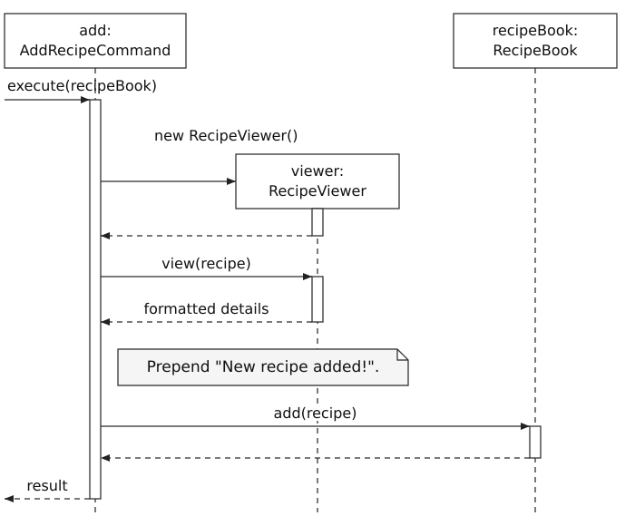

*Figure 3. Successful execution. Calls have filled arrowheads and returns are dashed.
Constructor activations start below the newly created object boxes. Formatting internals,
logging, the confirmation check, and application printing are omitted.*
[PlantUML source](diagrams/peilingggg/add-recipe/execution.puml)

1. `AddRecipeCommand.execute` rejects a null book, creates `RecipeViewer`, and prepares
   the full confirmation before inserting anything. A formatting failure therefore cannot
   leave an addition without a prepared confirmation.
2. `RecipeBook.add` checks the recipe is non-null and appends its reference. Duplicate names
   and repeated ingredients remain separate entries; grocery generation handles aggregation.
3. The command returns the confirmation. `MishMash` prints it and prompts for another command.
   For the Rice example:

```text
New recipe added!
Rice
200 kcal | Protein: 4g | Carbs: 45g | Fats: 1g
Ingredients:
- Rice: 150g
Food tags: None declared
```

Ingredient quantities display as plain decimals without unnecessary trailing zeros.
`RecipeViewer` also displays sorted food tags, or `Unclassified` when `food/` was omitted.

#### Error handling and defensive checks

| Input or condition | Result |
| --- | --- |
| Missing required field, no ingredient, or unprefixed leading text | Reject before creating an addition command. |
| Blank value, unknown prefix, embedded `/`, or repeated single-value field | Reject; repeated `i/` fields remain valid. |
| Nutrition outside `0` to `Integer.MAX_VALUE`, including signs and decimals | Reject; zero and leading zeros are valid. |
| Non-positive quantity, missing unit, malformed decimal, or extra colon | Reject; quantities require digits before and after a decimal point when present. |
| Unit containing characters other than ASCII letters | Reject; accepted units are not converted or checked against a fixed vocabulary. |
| Unsupported, blank, or repeated food tag | Reject; `food/none` cannot be combined with other tags. |
| Null Java dependency or required model argument | Fail with `NullPointerException`, indicating a caller contract violation. |

For example, `i/Rice:0g` is rejected by `parseIngredient` before a `GroceryItem` is created.
`parseAddRecipeCommand` wraps parsing failures in `MishMashException`, preserves the cause,
and adds `ADD_RECIPE_USAGE`. The application displays the error and accepts another command;
existing recipes remain unchanged. Although `GroceryItem` permits zero, recipe parsing and
the `Recipe` constructor enforce a strictly positive ingredient quantity.

#### Alternatives and limitations

| Decision | Alternative | Reason |
| --- | --- | --- |
| Validate before insertion | Add a partial recipe first | Invalid input cannot leave an incomplete book entry. |
| Validate in both parser and model | Trust the parser alone | Syntax checks and model contracts protect different callers. |
| Use `BigDecimal` quantities | Use floating-point quantities | Preserve entered decimal precision. |
| Reuse `RecipeViewer` | Format separately in each command | Keep addition, listing, and editing output consistent. |

Names identify display text rather than unique keys, and repeated names are accepted.
Food categories depend on user declarations. No unit conversion or disk persistence is
provided by addition. To use a newly added recipe in generated data, generate a new plan,
then generate its grocery list.

#### Automated verification

- `AddRecipeBoundaryTest` covers nutrition limits, quantities, whitespace, ordering, and repeated ingredients.
- `AddRecipeEdgeCaseTest` uses `add-recipe-invalid.tsv` to check rejection, unchanged data, and recovery.
- `AddRecipeExceptionTest` checks command usage and preserved causes.
- `AddRecipeCommandTest`, `RecipeTest`, and `RecipeBookTest` cover insertion, output, null contracts, and collection protection.
- `MishMashTest` covers console interaction and continued input after errors.

Run `./gradlew test checkstyleMain checkstyleTest` with Java 25 (Windows:
`.\gradlew.bat test checkstyleMain checkstyleTest`). Sources and SVG maintenance instructions
are in [diagrams/add-recipe](diagrams/peilingggg/add-recipe/README.md).


<!-- @@author -->

<!-- @@author neil0618 -->
### Deleting a recipe

#### Purpose and command contract

This feature implements the story: **As a user managing recipes, I want to confirm the deletion of a selected recipe so that I can check that I am removing the intended entry.**

`delete-recipe INDEX` removes the recipe at the displayed, one-based position. Deletion cannot be undone, so the application first names the recipe and asks `(y/n)`. Only `y` or `yes`, ignoring letter case and surrounding whitespace, deletes the recipe. Any other answer, including a blank line or the end of input, cancels. For example, `delete-recipe 2` followed by `y` removes the second recipe, and every later recipe moves up one position.

The command changes only the `RecipeBook`. It does not use `ActiveMealPlan`, so an existing meal plan and its grocery list keep the recipes they were generated with. No undo is provided.

#### Where the confirmation lives

`Command` declares `confirmationPrompt(RecipeBook)`, a default method that returns an empty `Optional`. A command that needs confirmation overrides it and returns its question. `MishMash.executeCommand` calls it for every command. If it returns a question, `userConfirms` displays it and reads the next input line, and `execute` runs only if the answer agrees.


*Only feature-relevant members are shown. Dashed arrows show dependencies or interface realization; the solid arrow shows the book's stored, ordered list. `RecipeBook.remove` takes a zero-based index, while `DeleteRecipeCommand` stores the one-based number the user typed.*

This keeps all console input and output in `MishMash`. `DeleteRecipeCommand` only builds the question and performs the deletion, so tests can call both methods directly without a `Scanner`. The question contains the index as well as the name, so recipes with the same name can still be told apart.

#### Execution and confirmation

The first sequence starts after parsing and follows a confirmed `delete-recipe 2`.


*The command validates the index once while building the prompt and again immediately before removal.*

An invalid index is a separate scenario. The `confirmationPrompt` activation ends at the exception,
so the diagram does not imply that the method continues after throwing.

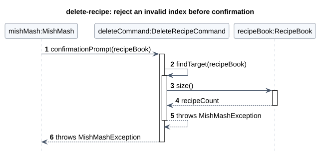

`confirmationPrompt` finds the target through `findTarget`, which throws if the book is empty or the index is too large. An impossible request therefore fails before any question is asked. `execute` calls `findTarget` again instead of trusting an earlier prompt, so it is also safe when called on its own. It then calls `RecipeBook.remove(index - 1)` and returns `Recipe deleted!`, the recipe's name, and `Recipes remaining: N`. `RecipeBook.remove` checks the index itself with `Objects.checkIndex`.

#### Outcomes and invalid input

The activity diagram shows which step decides each outcome.


*Both error paths end before the question is asked. Only the confirmed path changes the recipe book.*

| Input or state | Where it is decided | Result |
| --- | --- | --- |
| Missing, non-numeric, zero, or oversized index | `Parser.parseRecipeIndex` | Error ending with `Format: delete-recipe INDEX`; no question. |
| Empty book, or index above the recipe count | `DeleteRecipeCommand.confirmationPrompt` | Error without a `Format:` line, so every command's format follows; no question. |
| Valid index, answered `y` or `yes` | `MishMash.userConfirms`, then `execute` | Recipe removed and confirmation shown. |
| Valid index, any other answer or end of input | `MishMash.userConfirms` | `Cancelled. Nothing was changed.` |

Syntax errors start as an `IllegalArgumentException`, which `parseDeleteRecipe` wraps in a `MishMashException` that keeps the cause and ends with the delete-recipe usage. After any error or cancellation the session continues with the next command.

#### Design choices and alternatives

| Decision | Alternative | Reason for the current design |
| --- | --- | --- |
| Ask through a default `confirmationPrompt` method on `Command` | Let the delete command read the `Scanner` itself, or pass a context object to `execute` | Commands stay free of console input and output and are easy to test, and every other command is unchanged because of the default. A context object would be worth it if many commands needed shared state. |
| Check the index in `confirmationPrompt`, before asking | Ask first and report the error afterwards | The user is never asked to confirm something that cannot happen. |
| `execute` repeats the checks | Assume the prompt already ran | `execute` is public and must be safe on its own, and the check is only two comparisons. |
| Anything except `y` or `yes` cancels | Ask again until the answer is `y` or `n`, or default to yes | A destructive action must never run by accident, including when input ends. |
| Identify the recipe by position and name it in the question | Delete by name | Recipe names may repeat, so the position is the only unambiguous identifier, and naming the recipe lets the user catch a wrong number. |
| Leave existing plans and groceries unchanged | Remove the recipe from plans or clear them | Plans are snapshots, as for `edit-recipe`, so deleting never silently changes a plan the user is relying on. Automatic repair could be added if it were specified. |

#### Verification and maintenance

`DeleteRecipeCommandTest` checks the confirmation text and removal, the first and last positions, repeated deletion at one index, duplicate names, emptying the book, out-of-range and empty-book errors with the book left unchanged, prompts that never modify the book, and null arguments. `ParserTest` checks a valid index, the question naming the recipe, leading zeros and extra whitespace, invalid arguments showing only the delete-recipe usage, and near-miss command words. `MishMashTest` checks the console flow: a confirmed transcript, a cancellation, end of input cancelling instead of deleting, a missing recipe never producing a question, and a later `edit-recipe` using the renumbered index.

For manual verification, follow [Delete a Recipe](#delete-a-recipe) in the manual-testing appendix, or the User Guide's [Deleting a Recipe](UserGuide.md#deleting-a-recipe) example. The editable diagram sources and rendering instructions are in [`docs/diagrams/delete-recipe`](diagrams/delete-recipe/README.md). When the implementation changes, check method names, message order, and the decision branches against the code, then regenerate and inspect every SVG.

<!-- @@author -->

<!-- @@author neil0618 -->
### Listing recipes

#### Purpose and command contract

This feature implements the story: **As a user managing recipes, I want to list my recipes and inspect a selected recipe so that I can find and check its stored details.**

`list-recipes [INDEX]` has two forms. Without an index it shows every recipe as a numbered line with its name and calories. With an index it shows that one recipe in full: nutrition, ingredients, and food tags. The index is one-based and equals the number shown in the list, which is also the number that `edit-recipe` and `delete-recipe` expect. For example, `list-recipes 2` shows the second recipe. Listing is read-only: it never changes the recipe book, the active plan, or the grocery list.

#### Class responsibilities and relationships

`Parser` validates the optional index and creates a `ListRecipeCommand`. The command keeps only a nullable `Integer index`, where `null` means "list every recipe". The recipe book is supplied only when `execute` runs, so the command reads the recipes as they are at that moment rather than a copy taken during parsing. Recipe details are formatted by `RecipeViewer`, the class that also formats the `add-recipe` and `edit-recipe` confirmations, so a recipe looks the same wherever it is shown.


*Only feature-relevant members are shown. Dashed arrows show dependencies or interface realization; the solid arrow shows the book's stored, ordered list. `RecipeBook.getRecipes` returns a read-only copy, so listing cannot change the book.*

#### Parsing and execution

The successful `list-recipes 2` scenario is separated into parsing and execution. Invalid and
no-index outcomes are described afterwards so both interactions remain readable at guide width.

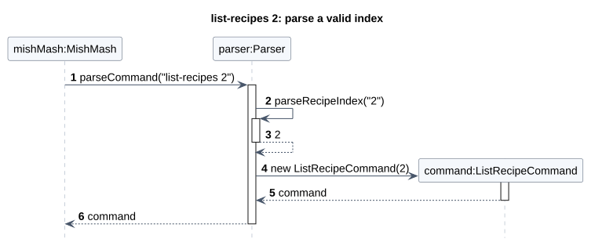


*The no-index form skips index parsing and the viewer.*

`Parser.parseListRecipe` treats blank arguments as the list-all form. Otherwise it calls `parseRecipeIndex`, the helper that `delete-recipe` also uses. The helper accepts digits only and rejects zero and values above `Integer.MAX_VALUE`. Leading zeros and surrounding spaces are accepted, so `list-recipes 01` selects recipe 1.

The parser does not receive the recipe book, so whether the index exists is decided at execution. `execute` reads the book, then either returns the details of `recipes.get(index - 1)` or throws a `MishMashException`. The list-all form returns `Recipes:` followed by one `N. name (calories kcal)` line per recipe, or `No recipes yet. Use 'add-recipe' to add one.` for an empty book. An empty book is therefore an error only when an index was requested.

#### Invalid input and recovery

| Input or state | Where it is caught | Result |
| --- | --- | --- |
| Index that is not digits only (`abc`, `-1`, `1.5`, `1 2`), is `0`, or exceeds `Integer.MAX_VALUE` | `Parser.parseRecipeIndex` | Error ending with `Format: list-recipes [INDEX]`. |
| Valid index, empty book | `ListRecipeCommand.execute` | Error telling the user to add a recipe. |
| Valid index above the recipe count | `ListRecipeCommand.execute` | Error stating the valid range. |
| No index, empty book | `ListRecipeCommand.execute` | Normal message, not an error. |
| Command word with a different case or spelling (`List-Recipes`, `list-recipe`) | `Parser.parseNamedCommand` | `Unknown command` error. |

Syntax errors start as an `IllegalArgumentException`. `parseListRecipe` wraps it in a `MishMashException` that keeps the original cause and ends with the list-recipes usage, so `MishMash.displayError` does not print the general command list. The two execution-time errors carry no `Format:` line, so `displayError` adds the format of every command. In every case the session continues and the recipe book is unchanged.

#### Design choices and alternatives

| Decision | Alternative | Reason for the current design |
| --- | --- | --- |
| One command with an optional index | A separate `show-recipe INDEX` command | There is one command word to learn, and the numbered list shows exactly the numbers that `edit-recipe` and `delete-recipe` need. |
| Look the recipe up when the command executes | Look it up while parsing | The parser stays independent of application data, as for the other recipe commands, and the lookup sees the book as it is when the command runs. |
| A nullable `index` means "list all" | Two command classes, or an `Optional<Integer>` field | It is the simplest option that is sufficient, and both forms share the book access. Two classes would be worth it if the forms diverged. |
| The list shows only names and calories | Show all nutrition for every recipe | A compact list stays readable for a long book, and full details are one command away. |
| Reuse `RecipeViewer` for the details | Format the text inside the command | A recipe is displayed identically after `add-recipe`, `edit-recipe`, and `list-recipes`. |

#### Verification and maintenance

`ListRecipeCommandTest` checks the numbered list, empty and duplicate-name books, the full details of the first, last, and a duplicate-named recipe, out-of-range and empty-book errors with the book left unchanged, repeated calls, and null arguments. `ParserTest` checks both forms, accepted variations such as leading zeros and extra whitespace, invalid arguments showing only the list-recipes usage, the largest index (which parses and fails only at execution), and near-miss command words. `MishMashTest` checks the console flow: the list followed by one recipe in full, an empty book, a bad index followed by recovery, and the numbers matching those used by `delete-recipe`.

For manual verification, follow [List Recipes](#list-recipes) in the manual-testing appendix, or the User Guide's [Listing Recipes](UserGuide.md#listing-recipes) example. The class diagram and sequence diagram have editable sources and rendering instructions in [`docs/diagrams/list-recipes`](diagrams/list-recipes/README.md). When the implementation changes, check method names, message order, and the error paths against the code, then regenerate and inspect both SVGs.

<!-- @@author -->

<!-- @@author GauthamNandi -->
### Generating a meal plan

`GeneratePlanCommand` combines command-specific targets with saved `TargetSettings`, filters recipes through the current dietary profile, and delegates selection to `MealPlanGenerator`. Each day contains three distinct recipes; recipes can recur on other days. With no targets, selection is random. With targets, the generator checks combinations against a 15% tolerance for every supplied nutrient. It examines all combinations when there are at most 5,000, otherwise a bounded random sample. Sampling bounds runtime but can miss a valid combination in a large recipe book.

`ActiveMealPlan` stores the successful plan and its generation request. Replacement generation requires confirmation when a plan exists. Success invalidates previous groceries; failure preserves the prior plan.


<!-- @@author -->

<!-- @@author oilybikechain -->
### Grocery command integration

The grocery structure is divided by responsibility: command integration, source and snapshot state,
and aggregation values.


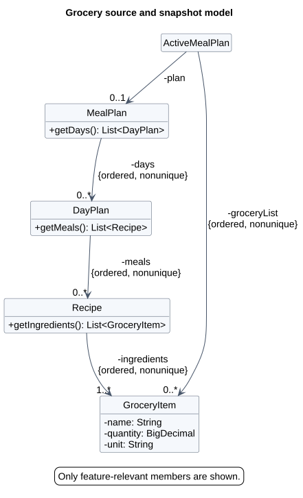

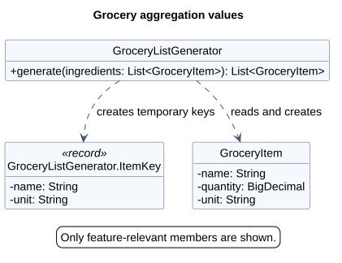

The parser and command retain the same active-plan holder. Plain navigable associations allow shared
model objects; they do not claim exclusive ownership. The optional grocery snapshot distinguishes an
absent snapshot from a present empty list. The temporary aggregation key is a dependency rather than
a stored generator field.

#### Ingredient aggregation

`GroceryItem` holds a trimmed, non-blank ingredient name and unit plus a nonnegative `BigDecimal`
quantity. Recipe input separately requires strictly positive ingredient quantities; zero is supported
by the grocery model and aggregation API. `toString()` uses plain decimal notation and removes
insignificant trailing zeros, for example `Oil: 0.3ml`.

`GroceryListGenerator.generate(List<GroceryItem>)` uses a `LinkedHashMap` keyed by an `ItemKey`
record containing the ingredient name and unit. Each occurrence is merged with `BigDecimal::add`.
Exact decimal addition avoids floating-point rounding, and insertion order preserves the first
appearance of each key. `Rice:200g` and `Rice:100g` combine; `Rice:1kg`, `rice:100g`, and
`Rice:1cups` remain separate. No unit conversion, spelling normalization, or portion scaling occurs.

The method rejects a null list or item, returns an empty list for empty input, and publishes an
unmodifiable result with `List.copyOf`. Inputs remain unchanged, and successive calls do not reuse
previous totals. `GroceryListGeneratorTest` checks exact matching, incompatible units, different
names, decimal precision, zero quantities, ordering, immutable output, repeated calls, and null inputs.

#### Command parsing and shared state

`Parser()` shares one `ActiveMealPlan` between meal-plan generation, grocery generation, and viewing. For deterministic tests or an externally managed plan, use `Parser(MealPlanGenerator, ActiveMealPlan)`. The supplier-based constructors retain their caller-provided viewing sources; their grocery viewers do not automatically read the internally generated grocery snapshot.

The parser accepts `generate-list` without arguments and returns `GenerateListCommand` without reading
or modifying the plan.

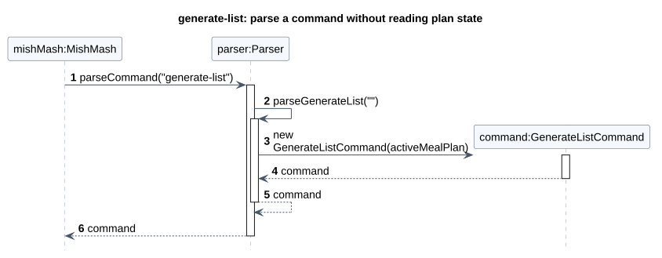

During execution, the command traverses `MealPlan.getDays()`, `DayPlan.getMeals()`, and each recipe's
ingredients. Every meal occurrence contributes its quantities. The existing `GroceryListGenerator`
combines exact name/unit matches with `BigDecimal` arithmetic, preserving first-appearance order and
keeping incompatible units separate.

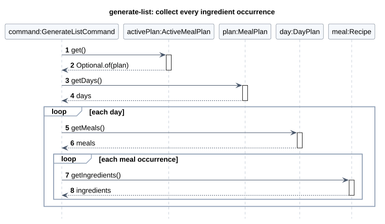

`ActiveMealPlan.setGroceryList` copies the completed result into a read-only snapshot. `getGroceryList` returns an optional: absence means no list has been generated for the current plan, whereas a present empty list is valid. `ViewListCommand` reads this snapshot during execution and delegates formatting to `GroceryListViewer`; viewing never regenerates data.

Successfully storing a replacement plan clears its old groceries. Failed plan generation or invalid command syntax leaves the previous state intact. All state is kept in memory for one session.

The parse step rejects arguments with `generate-list does not accept arguments.` and
`Format: generate-list`; it does not inspect the active plan. The command reads the latest plan
when executed, so a command parsed before generation can use a subsequently generated plan. Without
a plan it returns `No active meal plan. Use 'generate-plan' first.` without publishing a snapshot.
Successful generation returns `Grocery list generated. Use 'view-list' to view it.` Only the finished
result is stored, preserving any previous snapshot if generation fails.


The execution sequence counts every recipe occurrence, then publishes one completed snapshot.
Ingredient-key lookup, decimal merging, and result-item construction happen inside
`GroceryListGenerator.generate` and are described in the ingredient-aggregation section above.

`GenerateListCommandTest`, `ParserGenerateListTest`, and `ActiveMealPlanTest` cover missing plans,
execution-time plan lookup, every recipe occurrence, repeated generation, syntax rejection, copying,
and snapshot replacement. `MishMashGeneratePlanTest` exercises the generation-to-viewing connection
through the console. Grocery-list formatting is supplied by the existing viewer rather than this
aggregation contribution.

Grocery parsing and viewing use `FINE` logs, successful generation logs counts at `INFO`, and rejected generation requests use `WARNING`. These loggers inherit the existing application configuration; no additional handlers are installed. New diagnostics exclude ingredient names and raw input.

Run `gradlew.bat test checkstyleMain checkstyleTest` on Windows with Java 25 to verify the integration.

#### Maintaining the grocery and nutrition diagrams

The class and sequence diagrams above have editable sources and regeneration instructions in
[`docs/diagrams/oilybikechain`](diagrams/oilybikechain/README.md). Generated SVGs are checked in under
`docs/images/oilybikechain`. Use Java 25 and PlantUML 1.2026.9 with the existing shared style and
Smetana class layout. Check method names, retained references, multiplicities, supplier indirection,
message order, and failure paths against current code, then syntax-check, render, and inspect every
image. Keep sources and SVGs synchronized. The contribution history identifies the relevant commits;
teammates' viewing, generation, formatting, and dietary components are shown as integration context.

<!-- @@author -->

<!-- @@author Rixte -->
### Viewing a grocery list

*Section author: Rixte*

`view-list` displays the grocery snapshot already created by `generate-list`. It accepts
no arguments and never aggregates ingredients itself. See the
[User Guide](UserGuide.md#viewing-a-grocery-list) for the output format.

#### Responsibilities

| Component | Responsibility |
| --- | --- |
| `Parser.parseViewList` | Reject arguments and inject the grocery supplier. |
| `ViewListCommand` | Read the current optional snapshot and distinguish absence from an empty list. |
| `GroceryListViewer` | Format items in supplied order, with `[ ]` markers and a total count. |

The normal parser supplies `activeMealPlan::getGroceryList`. The command retains the
supplier rather than a copied list, so later generation or reset is visible on execution.
Grocery aggregation and publication are covered in
[Grocery command integration](#grocery-command-integration).

#### Execution

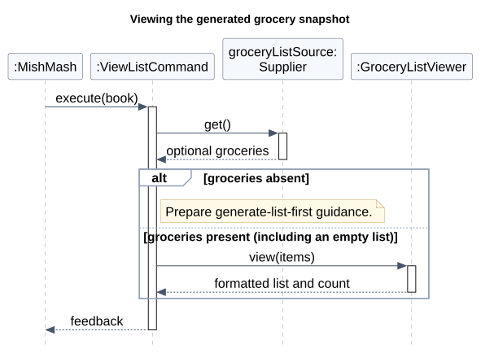

*Both missing and generated snapshots are shown. A present empty list follows the
formatting branch; `items` is the list extracted from the present `Optional`. Supplier
holder access and item formatting are condensed; viewer construction is omitted.
The common return represents either guidance or the formatted list.*
[PlantUML source](diagrams/rixte/view-list/execution.puml)

1. `execute` calls `groceryListSource.get()` to read the latest snapshot.
2. An absent `Optional` returns `No grocery list generated. Use 'generate-list' first.`
3. A present list is passed to `GroceryListViewer.view`, including a list with zero items.

#### Errors and boundaries

| Condition | Result |
| --- | --- |
| Arguments supplied | Reject during parsing with view-list usage. |
| No generated snapshot | Show generate-list-first guidance without creating groceries. |
| Generated empty list | Display the normal heading and `Total items to purchase: 0`. |
| Plan replaced or reset | The normal holder removes the old snapshot; later views show missing-list guidance. |
| Null supplier result or null item | Throw `IllegalStateException` or `NullPointerException`; `MishMash.run` logs and rethrows the failure, ending the session. |

The viewer preserves item order, quantities, and units. Recipe edits or deletions do not
rewrite an existing snapshot; users regenerate the plan and groceries to incorporate them.

#### Design choice and verification

`Optional<List<GroceryItem>>` distinguishes "not generated" from "generated with no items".
Using an empty list for both would lose that distinction. Keeping generation separate
also lets users inspect the saved snapshot without silently replacing it.

`ViewListCommandTest`, `ViewListIntegrationTest`, `ViewListDiagnosticsTest`,
`GroceryListViewerTest`, and `ParserTest` check missing and empty snapshots,
execution-time lookup, formatting, invalid arguments, and preservation of recipes.
Manually generate groceries, view them twice, then replace or reset the plan and verify
the next view asks for `generate-list`.

<!-- @@author -->

<!-- @@author Rixte -->
### Viewing a meal plan

*Section author: Rixte*

`view-plan [d/DAY_NUMBER]` displays all planned days or one selected day, without generating
meals. See the [User Guide](UserGuide.md#viewing-a-meal-plan) for examples.

#### Responsibilities

| Component | Responsibility |
| --- | --- |
| `Parser.parseViewPlan` | Validate the optional positive day and inject the plan and target suppliers. |
| `ViewPlanCommand` | Read the latest meals, check day bounds, and select the viewer overload. |
| `MealPlanViewer` | Return formatted meals, daily totals, and any target warnings. |

The normal parser connects `mealPlanSource` to `ActiveMealPlan.get()` and
`MealPlan.toMealSummaries()`. `targetsSource` reads the retained generation request,
falling back to `NutritionTargets.none()`. Suppliers are invoked during execution,
so a parsed command sees later regeneration or reset. Injected test sources can differ
from the parser's holder; the command does not store a direct `ActiveMealPlan` reference.

#### Execution

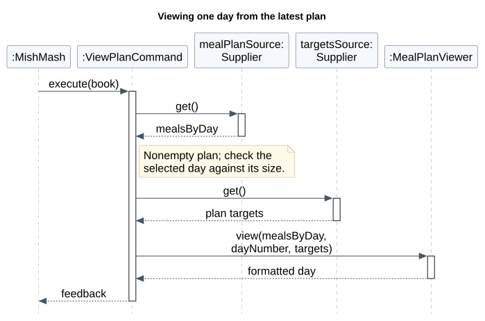

*Successful `view-plan d/1` after parsing, with a nonempty plan. Supplier labels represent
the injected Java functions. Their holder lookups and viewer formatting are condensed;
viewer construction is omitted. With no day, the command calls `view(mealsByDay, targets)`.*
[PlantUML source](diagrams/rixte/view-plan/execution.puml)

1. `execute` calls `mealPlanSource.get()` and creates `MealPlanViewer`.
2. An empty day list returns the generate-first guidance without reading targets.
3. For a selected day, the command checks its upper bound against the current plan.
4. Only then does it read targets and format the selected day; without `d/`, it formats all days.

Nutrition summation and excess warnings are described in
[Combined daily nutrition totals](#combined-daily-nutrition-totals) and
[Detecting exceeded nutrition targets](#detecting-exceeded-nutrition-targets).
Viewing returns text and changes neither planned data nor recipes.

#### Errors and boundaries

| Condition | Result |
| --- | --- |
| Malformed, repeated, non-positive, or overflowing `d/` argument | Reject during parsing with view-plan usage. |
| No active plan or zero days | Return `No active meal plan. Use 'generate-plan' first.`, even if a day was supplied. |
| Selected day exceeds the current plan size | Raise `MishMashException` before reading targets. |
| Valid day contains no meals | Display the day with zero totals. |
| Supplier returns null, or displayed data contains null elements | Throw `IllegalStateException` or `NullPointerException`; `MishMash.run` logs and rethrows the failure, ending the session. |

#### Design choice and verification

Deferred suppliers keep viewing independent of generation and make command reuse and
tests straightforward. Capturing a plan during parsing would display stale data after
regeneration. Keeping formatting in `MealPlanViewer` lets commands return text without
owning terminal output.

`ViewPlanCommandTest`, `ViewPlanIntegrationTest`, `ViewPlanDiagnosticsTest`,
`MealPlanViewerTest`, and the viewing cases in `ParserTest` cover selected days,
missing plans, current-state lookup, large totals, and unchanged groceries and recipes.
Manually generate two days, run `view-plan d/2`, then reset and run the view again;
the second view should report missing data.

<!-- @@author -->

<!-- @@author peilingggg -->
### Applying dietary restrictions
*Section author: peilingggg*

`set-diet` replaces the session's dietary profile and applies it to future meal generation.
If an existing plan conflicts, the command can replace its conflicting days and refresh
its groceries. The [User Guide](UserGuide.md#setting-dietary-preferences) describes the
syntax, supported diets, food tags, and examples.

```text
set-diet [diet/DIET] [avoid/TAG[,TAG...]] [exclude/INGREDIENT[,INGREDIENT...]]
```

Omitted fields return to unrestricted defaults. For example, `set-diet avoid/peanut`
clears a previously selected vegan diet. Profiles and recipe classifications are held
in memory for the current session.

#### Responsibilities

| Component | Responsibility |
| --- | --- |
| `Parser`, `DietaryPreferencesParser` | Validate arguments, build an immutable replacement profile, and create `SetDietCommand` without changing session data. |
| `Diet`, `FoodTag`, `FoodInfo` | Define diet rules, supported categories, and a recipe's declared classification. |
| `DietaryPreferences` | Check recipes against the named diet, avoided categories, and normalized ingredient exclusions. |
| `DietarySettings` | Hold the current profile shared by setting, viewing, and generation commands. |
| `SetDietCommand` | Request confirmation when needed, coordinate repair, and save the resulting session state. |
| `DietaryPlanner` | Filter eligible recipes and replace incompatible days using `MealPlanGenerator`. |
| `ActiveMealPlan` | Hold the current plan, original generation request, and optional grocery snapshot. |
| `GroceryListGenerator` | Rebuild existing groceries from the repaired plan. |

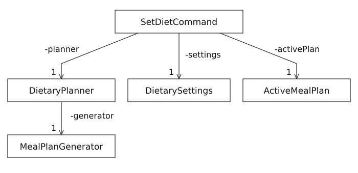

*Figure 6. Stored references used to apply a dietary update. Each arrow points to one
retained object; unrelated members and references are omitted. `SetDietCommand` also
implements `Command` and stores the proposed `DietaryPreferences`.*
[PlantUML source](diagrams/peilingggg/dietary/classes.puml)

The shared holders expose current session data. `DietaryPreferences` copies its exclusion
sets and normalizes ingredient names by trimming, lowercasing with `Locale.ROOT`, and
collapsing whitespace. Collection copies do not deep-copy shared recipes or days.

#### Classifying existing recipes

Recipes added without `food/` are **unclassified**. In contrast, `food/none` explicitly
declares that no supported food categories apply. Any active dietary restriction excludes
unclassified recipes; declarations are not inferred from ingredient names.

Users can classify a recipe they have already added through
[Editing a Recipe](UserGuide.md#editing-a-recipe). For example, if recipe 1 contains soy
and legumes and no other supported categories, enter:

```text
edit-recipe 1 food/soy,legume
```

Use the recipe's current index from `list-recipes`. The `food/` field replaces its complete
category declaration, so include every applicable tag. Omitting other fields preserves
the recipe's name, nutrition, and ingredients. Existing plans and groceries keep their
previous recipe snapshots; run `generate-plan`, then `generate-list` to use the updated
classification in a new plan and grocery list.

#### Parsing and confirmation

`Parser.parseSetDiet` delegates validation to `DietaryPreferencesParser.parse`, then creates
`SetDietCommand` without changing session data. At least one supported field is required;
each prefix may appear once in any order. Unsupported prefixes, unprefixed text, blank
values, embedded slashes, and duplicates are rejected. Diet and tag values ignore case;
aliases and ingredient names are normalized before duplicate detection.

Before execution, `MishMash` calls `confirmationPrompt`. Only a conflicting active plan
requires agreement. Declining skips execution and preserves all state.

#### Repairing conflicting days

Figures 7 and 8 split one confirmed `SetDietCommand.execute` into planning and publication.
This example has conflicting days, a retained generation request, and existing groceries.

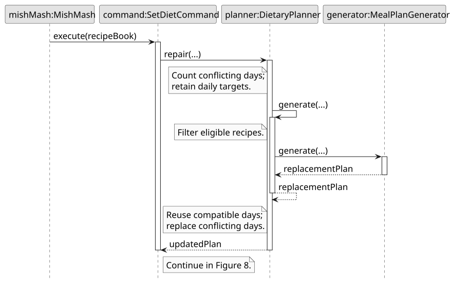

*Figure 7. Building a replacement plan. Parameters are abbreviated with `...`;
compatibility checks, filtering, and day assembly are summarized in notes. The original
plan is unchanged during this sequence. Figure 8 continues the same execution.*
[PlantUML source](diagrams/peilingggg/dietary/repair.puml)

1. The command reads the active plan and its original `GeneratePlanRequest`, then calls
   `DietaryPlanner.repair` with the current recipe pool and proposed preferences.
2. The planner counts incompatible days and requests that many replacements, retaining
   the original daily nutrition targets.
3. `generate` filters recipes through `DietaryPreferences.isAllowed`, then delegates to
   `MealPlanGenerator`. Any active restriction requires classified recipes. A recipe must
   satisfy the named diet, explicit category exclusions, and complete ingredient-name
   exclusions together. Matching does not infer synonyms, substrings, or undeclared tags.
4. The planner reuses compatible `DayPlan` objects at their original positions and replaces
   every conflicting day in full. For example, if only Day 2 conflicts in a three-day plan,
   Days 1 and 3 remain the same objects; all three meals in Day 2 may change.

Generation retains three distinct recipes per day, the +/-15% nutrition tolerance, and
bounded candidate search. Three eligible recipes alone do not guarantee a feasible plan.

#### Updating groceries and saving the result

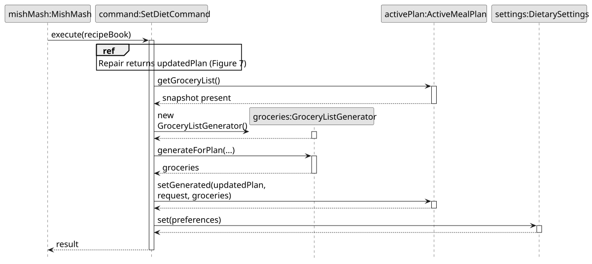

*Figure 8. Continuing Figure 7 when groceries already exist. The grocery generator is
created at its constructor message. Optional handling, validation, and formatting are
omitted and arguments abbreviated with `...`; dashed arrows show returns.*
[PlantUML source](diagrams/peilingggg/dietary/execution.puml)

1. If groceries already exist, `GroceryListGenerator.generateForPlan` rebuilds them from
   every meal occurrence in the updated plan. Otherwise groceries remain absent, and
   the confirmation advises the user to run `generate-list` later.
2. `ActiveMealPlan.setGenerated` validates the plan length and copies the grocery snapshot
   before assigning the new plan, original request, and groceries.
3. `DietarySettings.set` saves the proposed profile, and the command returns its confirmation.

Other outcomes are summarized below:

| Situation | Result |
| --- | --- |
| No active plan | Clear stale generated state and save the profile for future generation. |
| Entire plan is compatible | Save the profile; preserve the plan and groceries. |
| Conflicting plan; user declines confirmation | Skip execution; preserve the profile, plan, and groceries. |
| Repair succeeds | Save the profile and repaired plan; rebuild groceries only if they already existed. |
| No feasible replacement or original request unavailable | Save the profile, clear the plan, request, and groceries, and explain how to generate again. |

`ActiveMealPlan.set(MealPlan)`, used by legacy callers, discards the original request and
groceries. A compatible legacy plan can be preserved, but a conflicting one cannot be
repaired without its original generation settings.

#### Error handling and defensive checks

Parsing failures raise `IllegalArgumentException`. `Parser.parseSetDiet` wraps the error
in `MishMashException`, preserves its cause, and adds usage. For example, `diet/keto`
reports supported diets and aliases. The main loop displays the error and continues
without changing session data.

During repair, `IllegalArgumentException` instead triggers the save-and-clear outcome
above. Null Java dependencies fail with `NullPointerException`. Assertions check plan
length, dietary compatibility, nutrition targets, and exact use of replacement days;
`AssertionError` denotes an internal programming error.

#### Alternatives and limitations

| Decision | Alternative | Reason |
| --- | --- | --- |
| Use complete, explicit food declarations | Infer categories from ingredient text | Avoid unreliable guesses about synonyms and compound ingredients. |
| Replace the whole profile | Merge supplied fields | Each command defines a complete profile with clear defaults for omitted fields. |
| Filter before invoking the existing generator | Add dietary rules throughout the generator | Reuse its nutrition and variety rules. |
| Replace whole conflicting days | Replace individual meals | Reuse daily nutrition checks while preserving compatible days. |
| Clear generated data after failed repair | Keep the incompatible plan | Keep generated data consistent with the saved profile. |

Classification depends on the user's declarations. The application does not detect
undeclared allergens, cross-contact, or certification, and does not persist preferences.

#### Automated verification

- `DietaryPreferencesParserTest` covers syntax, values, aliases, and malformed lists.
- `DietaryPreferencesTest` and `FoodInfoTest` cover restrictions, classification,
  normalized exclusions, and defensive collection ownership.
- `DietaryPlannerTest` covers filtering, original targets, preserved days, infeasible
  requests, and generator invariant failures.
- `DietaryCommandsTest` covers shared state, profile replacement, grocery rebuilding,
  failed-repair invalidation, and recovery. `ActiveMealPlanGeneratedTest` checks retained
  requests and snapshots. `PlanConfirmationTest` covers dietary-update confirmation and cancellation.

Run `./gradlew test checkstyleMain checkstyleTest` with Java 25 (Windows:
`.\gradlew.bat test checkstyleMain checkstyleTest`). Editable sources and SVG maintenance
instructions are in [diagrams/dietary](diagrams/peilingggg/dietary/README.md).

<!-- @@author -->

<!-- @@author peilingggg -->
### Viewing dietary preferences
*Section author: peilingggg*
#### Purpose and implemented scope

`view-diet` displays `DietarySettings.get().describe()` and accepts no arguments.
It works without recipes or an active plan, including an unrestricted fresh session.

#### Parsing and execution

`Parser.parseNamedCommand` calls `requireNoDietArguments` and returns a `Command` lambda.
The lambda captures the shared holder, rather than a profile snapshot, so a command parsed
before a later update displays the settings current at execution time. It does not read or
change the recipe book, active plan, original generation request, or grocery snapshot.
`DietaryPreferences.describe()` prints the named diet and sorted explicit category and
ingredient exclusions on three lines, using `none` for empty lists.

Figure 11 ([source](diagrams/peilingggg/dietary/viewing.puml)) shows parsing and execution-time
profile lookup without changing session data.

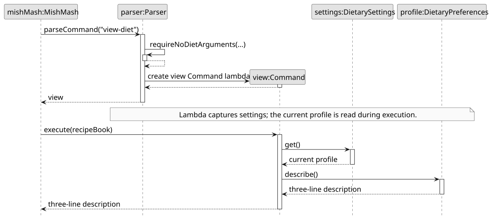

*Figure 11: The lambda captures the shared settings holder and reads its current profile during
execution. Parsing helpers and formatting internals are condensed; no session data is changed.*

#### Invalid input and verification

Extra arguments raise `MishMashException` with the no-arguments message and `Format: view-diet`.
No command executes and all state is preserved. `ViewDietCommandTest` covers unrestricted and
populated profiles, execution-time reads, and argument rejection without profile changes. Parser tests cover
argument rejection. Run the existing Java 25 test suite when changing this behavior.

<!-- @@author -->

<!-- @@author peilingggg -->
### Command help

`HelpCommand` returns the supported command names, purposes, and formats to the application loop. Syntax constants are shared with parsers where available, reducing duplication when a command changes. The command does not read console input or change application data. Invalid commands are handled by the loop, which displays an error and allows another command. See the [User Guide help instructions](UserGuide.md#viewing-available-commands-help).


<!-- @@author -->

<!-- @@author neil0618 -->
### Setting and viewing daily targets

#### Purpose and command contract

This feature implements two stories: **As a user, I want to set a daily calorie target so that my meal plan can meet my desired calorie intake**, and **As a user, I want to set my daily protein, carbohydrate, and fat targets so that my meal plan can meet my desired macronutrient intake.** One command covers both, because calories and macronutrients are the four fields of `NutritionTargets` and are used together.

`set-targets [cal/CALORIES|none] [p/PROTEIN|none] [c/CARBS|none] [f/FATS|none]` saves daily targets for the current session. At least one field is required. A field with a positive whole number replaces that target, `none` removes it, and a field that is not mentioned keeps its saved value. `view-targets` shows the saved targets. For example, `set-targets cal/2000 p/150` followed by `set-targets p/none` leaves only the 2000 kcal target.

The saved targets are used by `generate-plan`. For every nutrient that the `generate-plan` command leaves out, the saved target is used; a target typed in `generate-plan` replaces the saved one for that plan only. Neither command changes an existing meal plan, and `check-shortfall` still requires explicit targets. Targets are held in memory and are lost when the application closes.

#### Class responsibilities and relationships

`Parser` owns one `TargetSettings` object and passes it to `SetTargetsCommand`, `ViewTargetsCommand`, and `GeneratePlanCommand`, in the same way that it shares `DietarySettings`. `TargetSettings` holds one immutable `NutritionTargets`, which is empty at the start. `SetTargetsParser` turns the arguments into a `TargetChanges`, and `Nutrient` names the four nutrients with their prefix, label, and unit, so the parser, the merge, and the display loop over one list instead of repeating four near-identical branches.


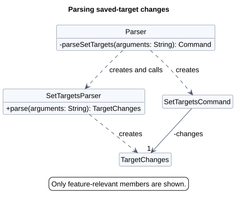

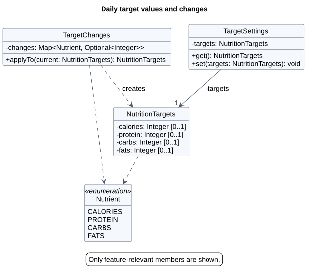

*Only feature-relevant members are shown. Dashed arrows show dependencies or interface realization; solid arrows show stored references.*

`TargetChanges` records, for each nutrient the user mentioned, either a new value or `Optional.empty()` for "remove". Nutrients that were not mentioned are absent from its map. This three-way distinction (keep, replace, remove) cannot be expressed with `NutritionTargets` alone, where `null` already means "no target".

#### Setting targets

The sequence below shows `set-targets cal/2000 p/none`.


*All parsing succeeds before the command updates the shared target settings.*

Invalid parsing is shown separately so both parser activations end at their exception returns.

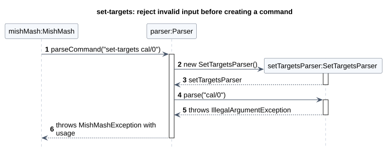

`SetTargetsParser` reads each whitespace-separated token as `PREFIX/VALUE`. Prefixes are case-sensitive, like every other prefix, and `none` is accepted in any letter case, as for `food/none`. A value must consist of digits only and fit in an `int`; zero is rejected. The parser validates all tokens before creating a `TargetChanges`, and `Parser.parseSetTargets` wraps any `IllegalArgumentException` in a `MishMashException` that ends with the set-targets format. A command object is created only if every token is valid, so a bad command can never partly change the saved targets.

Once parsing succeeds, execution reads the saved targets, applies the validated changes, and stores
the replacement value.

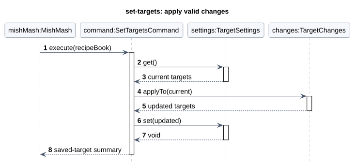

`SetTargetsCommand.execute` reads the saved targets, asks `TargetChanges.applyTo` for the updated targets, and stores them. `applyTo` builds a new `NutritionTargets` and does not modify the old one. The reply lists every target now saved, or says `All daily targets cleared.` when none remain, and reminds the user that an existing plan is unchanged.

#### Using the targets in `generate-plan`

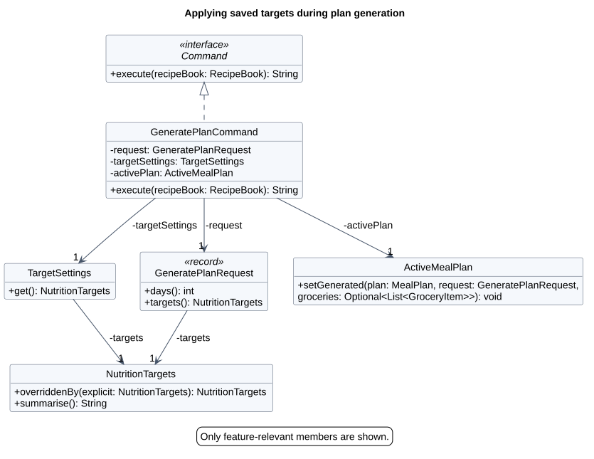


*This scenario shows successful generation with saved targets contributing to the effective request.*

The plan-generation and publication part is shown separately from target merging.

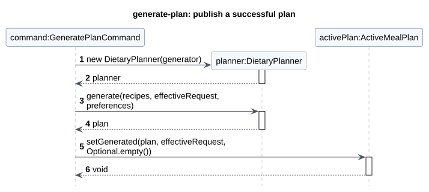

Generation failure is a separate interaction. The planner activation ends when it throws, and
`ActiveMealPlan.setGenerated` is never called.

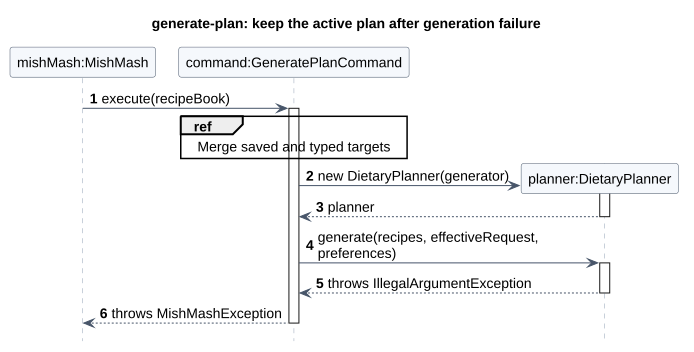

`GeneratePlanCommand` reads `TargetSettings` when it executes, not when it is created, so a `set-targets` entered after parsing but before execution is respected, exactly as for dietary preferences. If nothing is saved, the request is used unchanged, so behaviour without `set-targets` is identical to before. Otherwise `NutritionTargets.overriddenBy` merges the typed targets over the saved ones and the command builds an effective `GeneratePlanRequest`.

The effective request, not the typed one, is passed to `DietaryPlanner` and stored with `ActiveMealPlan.setGenerated`. This matters in two places that read the stored request later: `view-plan` warns about daily totals that exceed the stored targets, and `set-diet` regenerates conflicting days using the stored targets. If the stored request kept only the typed targets, both would ignore the targets that actually shaped the plan.

When a saved target filled a nutrient that the command left out, the confirmation gains a `Daily targets used:` line and a failure message gains a `Daily targets applied:` line, both listing the merged targets. `GeneratePlanCommand.usesSavedTarget` decides this by checking whether any nutrient has a saved target but no typed one. Without these lines, a user who forgot an earlier `set-targets` would see a failure caused by a target they never typed in the command. When nothing is saved, or every saved nutrient is also typed, the messages are exactly as before.

#### Invalid input and recovery

| Input or state | Where it is decided | Result |
| --- | --- | --- |
| No arguments | `SetTargetsParser.parse` | `Supply at least one daily target to set or clear.` followed by the set-targets format. |
| Unknown, malformed, or wrong-case prefix (`x/5`, `2000`, `CAL/5`, `d/3`) | `SetTargetsParser.readToken` | `Unrecognized parameter: TOKEN` and the format. |
| Repeated prefix | `SetTargetsParser.readToken` | `Parameter cal/ was given more than once.` and the format. |
| Missing value (`cal/`) | `SetTargetsParser.parseValue` | `Missing value after cal/` and the format. |
| Zero, negative, decimal, text, signed, or too large value | `SetTargetsParser.parseValue` | An error naming the nutrient, for example `Calories target (cal/) must be a positive whole number from 1 to 2147483647, or 'none'.`, and the format. |
| Arguments after `view-targets` | `Parser.parseViewTargets` | `view-targets does not accept arguments.` and the view-targets format. |
| Saved target that no combination of recipes can meet | `GeneratePlanCommand.execute` | The generator's error plus `Daily targets applied: ... (including your saved targets). Change those with 'set-targets'.`; the previous plan is kept. |

In every case the session continues, and an error leaves the saved targets unchanged.

#### Design choices and alternatives

| Decision | Alternative | Reason for the current design |
| --- | --- | --- |
| One `set-targets` command for calories and macronutrients | A separate command for calories and another for macronutrients | Both stories change the same object, and a single command lets the user set all four values in one line. Two commands would need two parsers and duplicate the validation for no additional capability. |
| Keep the saved targets in a session holder, `TargetSettings` | Store them in `ActiveMealPlan` or in the recipe book | Targets must survive `generate-plan` replacing the plan, and `ActiveMealPlan` is cleared by `set-diet` in some cases. `TargetSettings` copies the proven `DietarySettings` pattern. |
| Update only the mentioned nutrients | Replace all four targets at once, as `set-diet` replaces dietary preferences | The user can set calories today and protein later without retyping. Removing a target is explicit, with `none`. |
| `none` removes a target | A separate `clear-targets` command | One command and the same word the user already knows from `food/none`. A separate command would be worth adding if clearing everything in one step were needed often. |
| Merge saved and typed targets when `generate-plan` executes, per nutrient | Merge when parsing, or let any typed target discard all saved ones | Execution-time merging respects the latest saved targets and keeps parsing free of session data. Per-nutrient merging lets `generate-plan d/3 cal/1800` change one number and still use the saved protein target. |
| Store the effective request in `ActiveMealPlan` | Store only what was typed | `view-plan` and `set-diet` then use the targets that actually produced the plan. |
| Name the merged targets in the `generate-plan` messages when a saved target contributed | Stay silent, or print the targets on every plan | A user who forgot a saved target can see where a number came from, and output is unchanged when nothing is saved. Printing on every plan would add noise for users who type all their targets. |
| No per-command way to ignore saved targets | Accept `cal/none` in `generate-plan` | Ignoring one needs `GeneratePlanParser` and `GeneratePlanRequest` to represent "explicitly no target", which changes shared code and its tests. `set-targets cal/none` already gives the same result. It could be added if users needed it. |
| Changing targets leaves the current plan alone | Regenerate or clear the plan | Plans are snapshots, as after `edit-recipe` and `delete-recipe`, and regenerating would change meals the user may be relying on. |
| `check-shortfall` is unchanged | Fall back on saved targets when none are typed | Its contract is to check the explicit targets given, and existing behaviour and tests stay valid. It would be a small change to add later. |
| Targets are not persisted | Save them to a file | The application has no storage component, and every other piece of session data is also lost when it closes. |

#### Verification and maintenance

`TargetChangesTest` checks setting, keeping, and removing nutrients, that the original targets are never modified, the merge in `NutritionTargets.overriddenBy`, the summary text, and `TargetSettings`. `SetTargetsParserTest` checks every accepted form (any order, extra spaces, `none` in any case, leading zeros, the largest `int`) and every rejection above. `SetTargetsCommandTest` checks the confirmation texts, partial updates, removal, the untouched plan and recipes, `view-targets`, and the interaction with `generate-plan`: saved targets used, typed targets winning per nutrient, saved targets read at execution, removal, a typed target replacing an impossible saved one, a failed generation keeping the previous plan, and the `Daily targets used:` and `Daily targets applied:` lines appearing only when a saved target contributed. `ParserTargetsTest` checks that the parser creates the commands, shares one set of targets between them, reports errors with the set-targets usage only, and lists both commands in the usage and help text.

For manual verification, follow [Set and View Daily Targets](#set-and-view-daily-targets) in the manual-testing appendix, or the User Guide's [Setting Daily Targets](UserGuide.md#setting-daily-targets) example. Editable sources and rendering instructions are in [`docs/diagrams/targets`](diagrams/targets/README.md). When the implementation changes, check method names, message order, and branches against the code, then regenerate and inspect every SVG.

<!-- @@author -->

<!-- @@author GauthamNandi -->
### Recording meals and tracking nutrition

#### Purpose and scope

This V2.0 enhancement supports two user stories:

* **As a returning user, I want to record meals that I have eaten so that I can keep track of my
  actual food intake.**
* **As a user tracking nutrition, I want to calculate the total calories and macronutrients for each
  meal so that I know the nutritional content of what I am eating.**

It adds two commands:

```text
record-meal INDEX
view-meals
```

`INDEX` is the position of a recipe in the `list-recipes` output, counting from 1, as for
`delete-recipe`. `view-meals` lists every recorded meal with its calories (kcal), protein, carbs and
fats (g), followed by the totals for all recorded meals. Unlike `check-shortfall`, which examines the
*planned* meals of the active plan, this feature records meals the user *has eaten*.
The recorded meals are kept in memory for the session only, matching the product's current data boundary.

A meal is one whole recipe, and a recipe stores the nutrition the user entered with `add-recipe`;
nutrition is not derived from ingredients. The nutritional content of one meal is therefore read from
its recipe. The feature calculates the totals across all recorded meals and shows them together with
each meal's stored nutrition values.

#### Architecture-level view

The feature follows the existing command workflow. `MishMash` reads input, asks `Parser` for a
`Command`, executes it, and prints the returned text. Parsing validates syntax and creates the action;
execution reads or changes session data. A new model class, `MealLog`, holds the recorded meals. Like
`ActiveMealPlan`, it is session data shared between commands, but it is separate from the plan: the plan
holds meals the user intends to eat, and the log holds meals the user has eaten.

Figure 17 separates command collaborators from the stored model relationships.


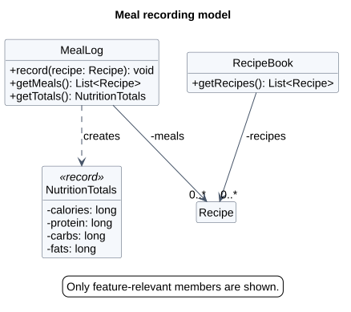

*Figure 17: Only members relevant to this enhancement are shown. Solid arrows are navigable
associations with private role names; dashed arrows show dependencies or interface realization.
`NutritionTotals` is the existing value record that `DayPlan` also uses for daily totals, and `MealLog`
reuses it; its values are `long` so that adding many recipes cannot overflow.*

* `MealLog` stores the recorded meals in the order they were recorded. It offers `record(Recipe)`,
  a read-only `getMeals()`, and `getTotals()`, which sums calories, protein, carbs and fats into a
  `NutritionTotals`, the same record `DayPlan` returns for a day's meals. The commands never add up nutrition values themselves.
* `RecordMealCommand` and `ViewMealsCommand` implement `Command`. Each retains the shared `MealLog`.
* `MealLogViewer` (ui) turns the meals and totals into text, in the same way
  `MealPlanViewer` formats a meal plan. Keeping formatting out of the model and commands lets them be
  tested without comparing layout text.
* `Parser` owns the `MealLog` and passes it to the commands it builds, because `Command.execute` only
  receives the `RecipeBook`. Every `Parser` constructor that is not given a log creates a fresh one, so
  each session starts with no recorded meals. `Parser(MealLog)` and
  `Parser(MealLog, MealPlanGenerator, ActiveMealPlan)` accept one, which lets tests supply and inspect
  the log. The command classes receive the log through their own constructors.

#### Recording a meal

Figure 18 is split into parsing and execution so both remain readable at guide width. Figure 18a
follows the successful parsing of `record-meal 2`; command dispatch is condensed into the parser
lifeline.

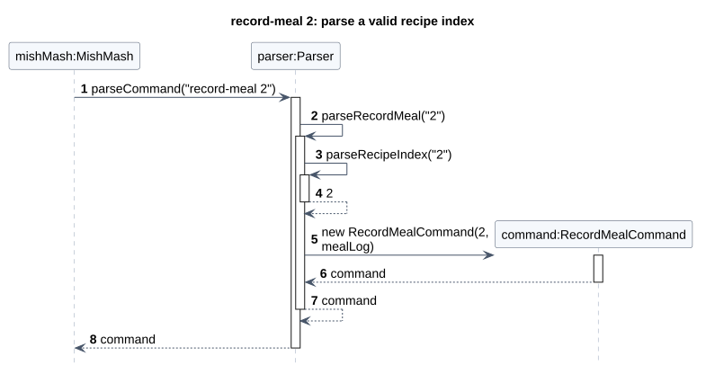

Figure 18b starts with the command returned by parsing and follows its successful execution.


*Figure 18: Parsing returns a command without reading application data. The inherited confirmation
step is omitted because the command returns an empty `Optional`. Invalid indexes are described below
rather than combined with either successful interaction.*

`Parser` checks that the argument is a single positive whole number. A missing, non-numeric, signed,
zero or extra argument is rejected with the usage line `Format: record-meal INDEX`; nothing is read or
changed. The command is created only after validation succeeds.

During execution the command converts the index to a zero-based position, as `DeleteRecipeCommand`
does, and looks the recipe up in the `RecipeBook` passed to `execute`. If the book is empty or the index
exceeds the number of recipes, it throws a `MishMashException` and nothing is recorded. Otherwise it calls
`MealLog.record(recipe)` and `MealLog.getTotals()`, then asks `MealLogViewer.viewRecorded` to format the
recorded meal's calories and macros with the running totals, so the user sees the effect immediately.
Recording a meal needs no confirmation: it is quick to repeat, and it changes only the log.

#### Viewing recorded meals and totals


*Figure 19: Parsing mirrors `record-meal` and is omitted. The sequence follows a non-empty log; the
empty-log result is described below.*

`view-meals` takes no arguments; any argument is rejected with its usage line. `ViewMealsCommand` reads
the meals from the `MealLog`. An empty log is a valid state, not an error, so the command returns
`No meals recorded yet.` Otherwise it asks the log for the totals and delegates formatting to
`MealLogViewer`. Each meal appears with its own calories and macros, followed by one totals line. Viewing
never changes the log.

#### Invalid input and recovery

The recoverable errors reuse the existing path: `Parser` or the command throws `MishMashException`,
`MishMash.executeCommand` catches it, displays the message, and prompts for another command.

| Boundary or invalid condition | Behavior |
| --- | --- |
| `record-meal` with no argument, a non-numeric, signed, zero or decimal index, or an extra token | Reject with the command format; no data is read or changed. |
| Index larger than the number of recipes | Reject with `Recipe index must be between 1 and N.`; nothing is recorded. |
| `record-meal` while the recipe book is empty | Reject with a message that there are no recipes to record; nothing is recorded. |
| `view-meals` with any argument | Reject with the command format. |
| `view-meals` before any meal is recorded | Return `No meals recorded yet.` |
| Recipe deleted, edited with `edit-recipe`, or otherwise changed after a meal was recorded | The recorded meal keeps its original calories and macros. |
| Same recipe recorded twice | Two entries are kept, and both count toward the totals. |
| Recipe with 0 g of protein, carbs and fats | The meal is recorded and contributes zeros for those nutrients. |

#### Rationale and alternatives considered

| Decision | Alternative considered | Reason for the current choice |
| --- | --- | --- |
| Store the `Recipe` itself in the log | Store the recipe's index | `Recipe` is immutable, so the log keeps the nutrition as it was when the meal was eaten. Indexes shift whenever `delete-recipe` runs, so an old entry could silently point to a different recipe. |
| `MealLog.getTotals()` sums the meals on every call | Keep running totals updated by `record` | The meal list is the single source of truth, so totals cannot drift out of step with it. Sessions are small, so the repeated sum costs nothing noticeable. Running totals would need extra care if removing meals is added later. |
| `Parser` owns the `MealLog` and passes it to the commands | Widen `Command.execute` to take a shared context object | `Parser` already owns and shares `ActiveMealPlan`, and this leaves the `Command` interface and every existing command unchanged. Constructors that take a `MealLog` let tests supply their own, as the `ActiveMealPlan` constructors do. A context object becomes worthwhile if many more data holders are added. |
| Pick a meal by recipe index | Type nutrition values in directly | Reusing stored recipes avoids duplicating the input and validation of `add-recipe` and keeps unchecked numbers out of the log. Free-text entry would help when eating out, so it is a possible extension. |
| Return formatted text through `Command.execute`, using a small viewer | Print from the command or the model | The viewer matches `MealPlanViewer` and keeps layout out of the logic, so the model and commands can be tested without comparing layout text. |

#### Limitations and possible extensions

* The log lives in memory for one session and is lost when the application exits.
* All meals form one list. A later version could add `d/DATE` to record meals against a day and show
  daily totals, or compare the totals with the targets given to `check-shortfall`.
* There is no command to remove or correct a recorded meal yet.
* Each meal counts as one whole recipe; portion sizes are not supported, as for meal plans.

#### Verification

The feature is covered by `MealLogTest`, `MealLogViewerTest`, `RecordMealCommandTest`,
`ViewMealsCommandTest`, `ParserRecordMealTest`, and console-workflow tests in `MishMashTest`. They check
the totals (including values beyond the `int` range), the exact output layout, every invalid index in
the table above, the empty-log
and empty-book cases, that failed commands leave the log unchanged, and that the log is separate from the
active plan. The manual checks are under [Record and View Meals](#record-and-view-meals); the use cases are
UC11 and UC12.

#### Diagram maintenance

The five editable diagram sources are under
[`docs/diagrams/record-meal`](diagrams/record-meal/README.md). Rendered SVGs are checked in under
`docs/images/record-meal` so the diagrams display without a plugin. The source README gives the
regeneration commands. Check every depicted call, branch and message against the code after any change, and
update the sources and images together.


<!-- @@author -->

<!-- @@author oilybikechain -->
### Combined daily nutrition totals

The structural view focuses on the combined totals API and the recipe values it sums.


*Nutrition structure: `DayPlan` retains its ordered meals and creates an immutable totals value.
Only members used by this calculation are shown.*

`DayPlan.calculateDailyNutritionTotals()` returns one immutable `NutritionTotals` record containing
`calories()`, `protein()`, `carbs()`, and `fats()`. Calories are measured in kcal; the macronutrients
are measured in grams. It delegates to the existing individual total getters, giving callers a
single result without changing the plan, recipes, or the individual-getter API.

Every meal occurrence contributes its full nutrition, including repeated recipes. Each day is
calculated independently; these are not totals across the entire plan. An empty day returns four
zeros. All four record components use `long`, so sums of valid integer recipe values can exceed
`Integer.MAX_VALUE` without wrapping.

For example, a day containing the User Guide's Protein Oatmeal, Chicken and Rice, and Salmon Salad
has `new NutritionTotals(1650, 127, 150, 55)`. The record represents calculated data; it does not
apply target tolerance, validate a nutrition goal, or introduce a new console command. The existing
plan viewer computes its display totals from `MealSummary` values separately.


*Combined-total calculation: constructor arguments are evaluated in calories, protein, carbohydrates,
and fats order. Each existing getter traverses every meal occurrence using a `long` sum. Stream
internals are condensed, and the caller represents an API client rather than the plan viewer.*

`DayPlanTest` covers ordinary meals, one meal, zero nutrition, an empty day, repeated recipes,
independent days and repeated calls, unchanged meals, and totals above the integer range.

<!-- @@author -->

<!-- @@author oilybikechain -->
### Detecting exceeded nutrition targets

The target-aware viewing structure is kept separate from the combined-totals model so both class
diagrams remain legible at guide width. The supplier interfaces are bindings of Java's existing
`Supplier` type; the dashed dependencies show the default lambdas reading current shared state.

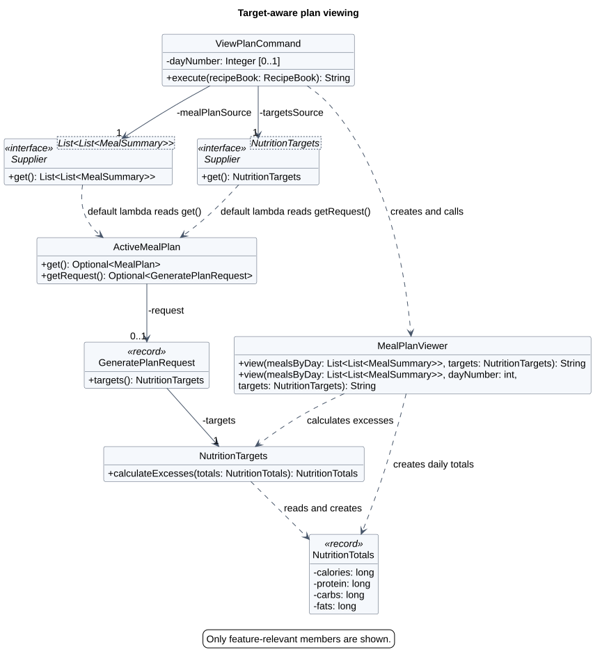

`ActiveMealPlan` already retains the original `GeneratePlanRequest` alongside a generated plan for dietary
repair. Exceedance warnings reuse this request's immutable `NutritionTargets` rather than storing another
copy in `MealPlan`. Successful generation replaces both meals and targets through `setGenerated`; failed
generation preserves them. Dietary repair retains the request, and clearing a plan clears its request.
Legacy plans published with `set(MealPlan)` have no request and therefore no targets for warnings.

`NutritionTargets.calculateExcesses(NutritionTotals)` returns each nutrient's positive excess over its exact
target, or zero if the target is omitted or not exceeded. It uses `long` arithmetic, matching daily totals,
so sums beyond the integer range remain valid. This comparison does not use `TOLERANCE`: generation still
accepts days within ±15%, while viewing warns for any total strictly above the supplied target.

`Parser` supplies the current plan's meals and request targets to `ViewPlanCommand` at execution time.
Commands parsed before generation or replacement therefore display the latest meals and targets.
Legacy supplier-based parser and command constructors default to no targets. The new command constructor
accepts meal and target suppliers plus a nullable day number (null selects every day). The suppliers must
return corresponding meals and targets; omitted targets are represented by `NutritionTargets.none()`.

`MealPlanViewer` provides target-aware overloads for all days and one selected day; its original overloads
delegate with no targets. It sums each day's meals, requests excesses, and places warnings before the day's
closing separator in calories, protein, carbohydrates, and fats order. Warnings include the excess, actual
total, and target, using kcal for calories and g for the macronutrients. They do not change application state.
`check-shortfall` continues to use its explicitly supplied targets independently of this display.

State lookup and warning calculation are shown separately so their messages remain readable. The
first sequence follows a valid selected day: the default meal supplier adapts the current active plan,
then the target supplier reads the request stored with that plan.

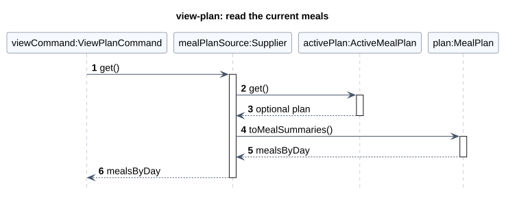

The corresponding targets are read through a separate supplier after the selected day is known to
be valid.

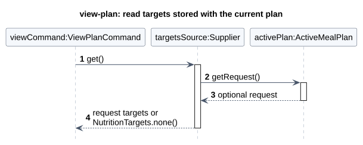

With no active plan, execution returns before reading the target supplier. An out-of-range selected
day is also rejected before targets are read. For a valid selection, the viewer calculates and formats
warnings only for the displayed days.


Tests cover exact comparison boundaries, omitted targets, simultaneous excesses, large totals, exact output,
and day selection. Integration tests verify the generation tolerance, replacement after success or failure,
legacy plans without requests, dietary repair and clearing, and independence from `check-shortfall`.
Run `gradlew.bat test checkstyleMain checkstyleTest` with Java 25.

<!-- @@author -->

<!-- @@author Rixte -->
### Checking nutrition shortfalls

*Section author: Rixte*

`check-shortfall` reports exact daily deficits against one or more explicit targets:

```text
check-shortfall [cal/DAILY_CALORIES] [p/DAILY_PROTEIN] [c/DAILY_CARBS] [f/DAILY_FATS]
```

For example, `check-shortfall cal/2000 p/100` checks only calories and protein. It checks
planned meals, rather than recorded meals, and does not save targets or rebalance the plan.
The [User Guide](UserGuide.md#checking-nutrition-shortfalls) gives examples and expected output.

#### Responsibilities

| Component | Responsibility |
| --- | --- |
| `Parser.parseCheckShortfall` | Coordinate parsing and attach command usage to validation errors. |
| `CheckShortfallParser` | Validate unique target tokens and create `NutritionTargets`. |
| `CheckShortfallCommand` | Read the current plan and report each day's deficits. |
| `DayPlan` | Supply the four existing nutrition totals as `long` values. |

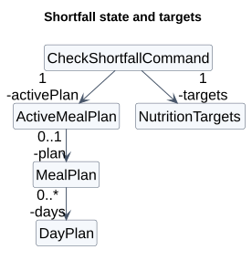

*Selected stored references, with private role names and target multiplicities. The
ordered day list can hold repeated references. Parsing dependencies, recipe internals,
and the command interface are omitted.*
[PlantUML source](diagrams/rixte/shortfall/classes.puml)

The command retains the shared `ActiveMealPlan` and request-specific `NutritionTargets`.
The normal parser shares that holder with generation. Caller-provided viewing suppliers
do not replace this data source. The `RecipeBook` execution parameter is unused.

#### Parsing and daily comparison

`CheckShortfallParser` accepts each of `cal/`, `p/`, `c/`, and `f/` once, in any order.
Values must be digit strings representing 1 to `Integer.MAX_VALUE`; omitted nutrients
remain null. `Parser` wraps validation failures in `MishMashException`, preserving
their cause and attaching shortfall-specific usage.

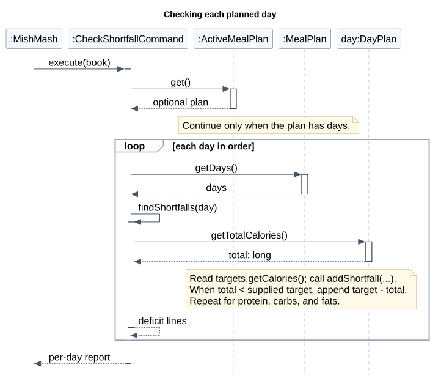

*Successful execution for a plan containing days. One day's calorie lookup illustrates
the repeated comparison. Plan-size checks, target getters, `addShortfall`, report
assembly, and logging are condensed in the note.*
[PlantUML source](diagrams/rixte/shortfall/execution.puml)

1. `execute` reads the current plan; no plan or zero days returns generate-first guidance.
2. For each day, `findShortfalls` reads its calorie, protein, carbohydrate, and fat totals.
3. `addShortfall` appends `target - total` only when a target is supplied and the total is smaller.
4. Output lists each day's deficits, or states that the supplied targets have no shortfalls.

Comparisons use `long` totals and subtraction, so several large recipe values cannot
wrap into false deficits. Days are checked independently; a surplus on one cannot hide
another's deficit. Equality is sufficient, and omitted nutrients are ignored.

#### Errors and boundaries

| Condition | Result |
| --- | --- |
| No targets, unknown or repeated prefix, missing value, extra token, or space after a prefix | Reject before accessing the plan, with shortfall usage. |
| Zero, signed, negative, decimal, unit-suffixed, nonnumeric, or overflowing value | Reject; only positive whole numbers in range are accepted. |
| No active plan or zero days | Return `No active meal plan. Use 'generate-plan' first.` |
| A day contains no meals | Treat totals as zero; report each supplied target as its full deficit. |
| Target omitted or total at/above target | Add no deficit for that nutrient. |

Every check preserves the plan, generation settings, grocery snapshot, recipe book,
and saved personal targets.

#### Design choice and verification

Exact comparison explains the gap; the generator's +/-15% tolerance only decides whether
a candidate is acceptable. A 1900 kcal day can therefore satisfy generation for 2000 kcal
and still show a 100 kcal shortfall. Explicit targets allow a different comparison without
changing saved settings. Automatic rebalancing would need selection rules and grocery updates.

`CheckShortfallParserTest` and `ParserCheckShortfallTest` cover target orders, limits,
wrapped errors, and unchanged state after rejection. `CheckShortfallCommandTest`,
`CheckShortfallIntegrationTest`, and `CheckShortfallDiagnosticsTest` cover daily boundaries,
large totals, repeated execution, and snapshot preservation. Manually check a plan
against higher and lower targets, then use both viewing commands to confirm its data is unchanged.

<!-- @@author -->

<!-- @@author Rixte -->
### Editing a recipe

*Section author: Rixte*

`edit-recipe INDEX` changes selected fields of the recipe at a one-based displayed index.
For example, `edit-recipe 1 p/55 i/Chicken:220g i/Rice:150g` replaces its protein and entire
ingredient list. Omitted fields stay unchanged. The
[User Guide](UserGuide.md#editing-a-recipe) gives the complete syntax.

#### Responsibilities

| Component | Responsibility |
| --- | --- |
| `Parser.parseEditRecipe` | Validate the index and supplied fields using the shared recipe helpers. |
| `RecipeChanges` | Store immutable optional edits and build a validated replacement. |
| `EditRecipeCommand` | Look up the current recipe, format feedback, and then publish the edit. |
| `RecipeBook` | Replace one entry without changing the recipe count or indexes. |
| `RecipeViewer` | Format every field of the edited recipe. |

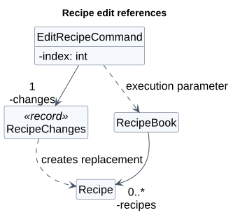

*Selected stored references and temporary dependencies. The book's ordered list permits
repeated references; existing plans may retain the original recipes. Parser creation,
viewer dependencies, and the command interface are omitted.*
[PlantUML source](diagrams/rixte/edit-recipe/classes.puml)

Nullable scalar fields in `RecipeChanges` mean unchanged; an empty ingredient list also
means unchanged. Nullable nutrition distinguishes an omitted field from an explicit zero.
Supplied ingredients replace the complete list. Omitted `food/` preserves the previous
declaration, and changing ingredients does not infer new food categories.

#### Parsing and execution

Parsing reuses `collectRecipeArguments`, `parseOptionalNutrition`, and `parseIngredient`.
Single-value prefixes cannot repeat; ingredient prefixes can. Validation finishes before
a command is created, without looking up or changing any stored recipe.

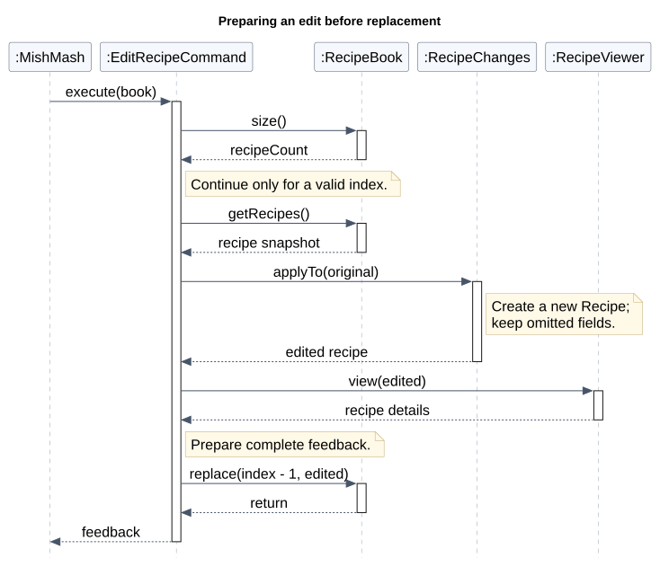

*Successful execution for a valid index. `original` is the snapshot entry at `index - 1`.
Field getters, replacement construction, logging, and assertions are condensed;
viewer construction is omitted. Feedback is complete before replacement.*
[PlantUML source](diagrams/rixte/edit-recipe/execution.puml)

1. `execute` checks the current book size and index, then reads the recipe at `index - 1`.
2. `RecipeChanges.applyTo(original)` creates a new `Recipe` from supplied edits and retained fields.
3. `RecipeViewer.view(edited)` formats the replacement; the command prepares the complete feedback.
4. Only then does `RecipeBook.replace(index - 1, edited)` update the book entry.

#### Errors and snapshot behaviour

| Condition | Result |
| --- | --- |
| Missing fields, malformed index, unknown or repeated single-value prefix, or invalid field | Parsing raises `MishMashException` with edit usage and the validation cause; no edit is applied. |
| Empty book or index beyond the current size | Reject during execution before creating a replacement. |
| Replacement validation or formatting fails | The book entry has not yet been replaced. |
| Edit succeeds | Recipe count and indexes stay the same; existing plans, groceries, and recorded meals retain their old snapshots. |

Commands resolve indexes during execution, including any renumbering caused by earlier
deletions. To incorporate an edit into planned meals and groceries, generate a new plan
and then a new grocery list. Regenerating groceries alone still uses the existing plan.

#### Design choice and verification

Immutable replacement keeps the change local to the recipe book. Mutating the original
would also change references held by planned or recorded meals and could invalidate
groceries. Replacing the whole ingredient list supports quantity changes and removals
without introducing ingredient identifiers or extra subcommands.

`ParserEditRecipeTest`, `RecipeChangesTest`, and `EditRecipeCommandTest` cover validation,
partial edits, current-index lookup, food declarations, and snapshot preservation.
`EditRecipeIntegrationTest` and `EditRecipeDiagnosticsTest` check command integration and
diagnostics. Manually edit a recipe after generating meals and groceries: both views
should keep the old values until their data is regenerated. A rejected `p/-5` must leave
the last valid recipe unchanged.

<!-- @@author -->

<!-- @@author Rixte -->
### Confirming plan changes

*Section author: Rixte*

Users confirm before an existing plan is cleared or replaced. This implements
[#61](https://github.com/AY2627S1-CS2113-W13-4/tp/issues/61). See the
[User Guide](UserGuide.md#confirming-plan-changes) for prompts and examples.

#### Responsibilities

| Component | Responsibility |
| --- | --- |
| `Parser` | Validate syntax and create a command before an answer can be requested. |
| `Command.confirmationPrompt` | Return an optional question based on current state, without changing it. |
| `MishMash` | Read the answer, skip cancelled commands, and display feedback or errors. |

#### Confirmation flow

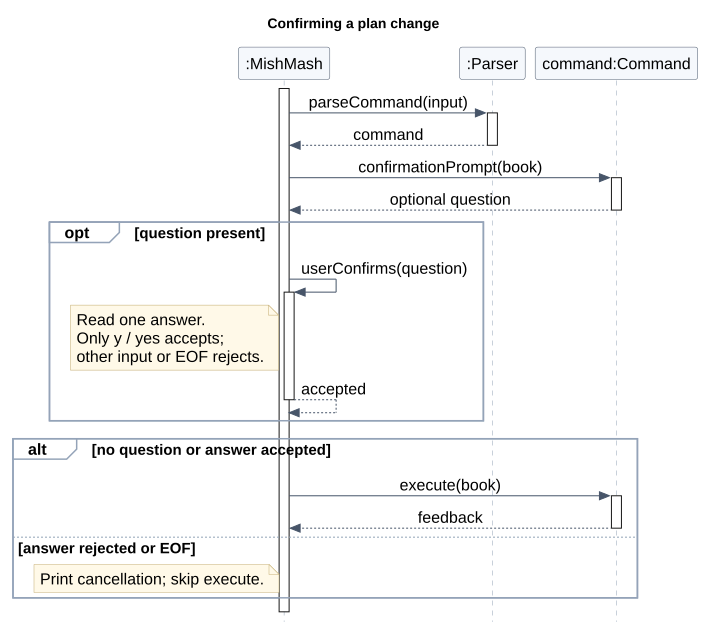

*One shared flow covers acceptance, cancellation, and commands needing no answer.
Scanner operations, printing, and command internals are condensed.*
[PlantUML source](diagrams/rixte/confirm-plan/execution.puml)

1. `MishMash.executeCommand` parses the input, then calls `confirmationPrompt(recipeBook)`.
2. An empty `Optional` allows execution immediately. Otherwise `userConfirms` reads one line.
3. Only `y` or `yes`, ignoring case and surrounding spaces, permits `execute`. Other answers
   and EOF print `Cancelled. Nothing was changed.` and skip execution.

| Command | When a question is needed |
| --- | --- |
| `ResetPlanCommand` | A plan, generation request, or grocery snapshot exists, including an empty snapshot. |
| `GeneratePlanCommand` | A plan already exists. |
| `SetDietCommand` | An existing plan conflicts with the proposed preferences. |

#### Errors and boundaries

Invalid syntax is reported before confirmation. A command typed as an answer is consumed
as that answer; users must enter it again at the command prompt. Prompt lookup reads the
latest holder state and never generates replacements or changes preferences.

Agreement permits execution; it does not guarantee success. Failed replacement generation
preserves the previous plan and groceries. Dietary repair saves the new preferences even
when repair fails and clears the incompatible plan; its question explains that outcome.
Cancelling preserves the old preferences, plan, and groceries.

#### Reset activity

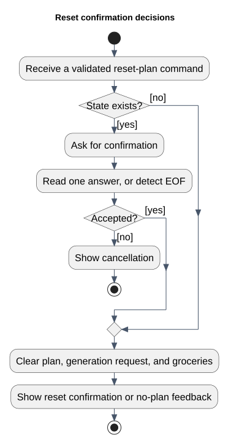

*This activity diagram starts after `reset-plan` arguments have been validated. Diamond
decision nodes and mutually exclusive guards show when confirmation is needed and when
execution is skipped. Answers are trimmed and compared without regard to case; EOF
follows the rejection branch. Cancellation preserves all session data. The execution
path assumes `clear()` and its postcondition checks succeed; recoverable failures are
described in the reset section instead of repeating them here. Recipes, preferences,
saved targets, and recorded meals are not modified.*
[PlantUML source](diagrams/rixte/confirm-plan/reset-activity.puml)

#### Design choice and verification

The existing confirmation hook keeps console input in `MishMash` and commands independently
testable. Putting a scanner inside every command would duplicate interaction logic. Direct
callers of `execute` must perform any required confirmation themselves. Feasibility checks
run after agreement, avoiding speculative generation and cached candidates during prompting.

`PlanConfirmationTest` covers accepted and rejected answers, EOF, invalid syntax,
execution-time state lookup, preservation after cancellation, and confirmed failures.
For a manual check, generate a plan and groceries, cancel `reset-plan`, and verify both
views are unchanged. Repeat with `yes` and verify both report missing data.

<!-- @@author -->

<!-- @@author Rixte -->
### Resetting a meal plan

*Section author: Rixte*

`reset-plan` clears the current planning state while keeping the user's other session
information. It takes no arguments. The [User Guide](UserGuide.md#resetting-a-meal-plan)
describes the confirmation and messages.

#### Responsibilities

| Component | Responsibility |
| --- | --- |
| `Parser.parseResetPlan` | Reject arguments and create a command using the shared holder. |
| `ResetPlanCommand` | Request confirmation, clear planning state, and verify the result. |
| `ActiveMealPlan` | Hold and clear the plan, its generation request, and derived groceries together. |

#### Execution

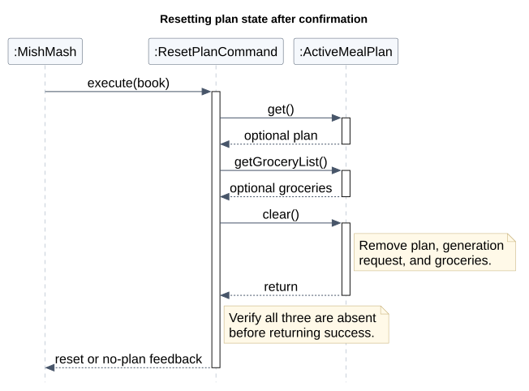

*Successful execution after the [shared confirmation](#confirming-plan-changes).
Postcondition getter calls and logging are condensed in the note.*
[PlantUML source](diagrams/rixte/reset-plan/execution.puml)

1. The command reads whether a plan or groceries were present when execution starts.
2. `ActiveMealPlan.clear()` removes the plan, generation request, and grocery snapshot.
3. The command checks that all three are absent before returning reset or no-plan feedback.

The command holds only `ActiveMealPlan`. Recipes, dietary preferences, personal targets
saved through `set-targets`, and recorded meals are held elsewhere and remain available.
Targets attached to the removed generation request are cleared; saved personal targets
still apply to future generation. Previously returned immutable snapshots remain valid.

#### Errors and boundaries

| Condition | Result |
| --- | --- |
| Arguments supplied | Reject with reset-specific usage before requesting confirmation. |
| No planning state | Clear remains safe; return `No active meal plan to reset.` |
| Groceries remain without a plan, including an empty snapshot | Clear the snapshot as well. |
| `clear()` throws, or any planning state remains afterwards | Raise a recoverable `MishMashException`; keep the original cause when one exists. |

The postcondition is checked even with Java assertions disabled. A failed clear does not
promise rollback of planning state, but the command never changes unrelated session data.

#### Design choice and verification

Reusing `ActiveMealPlan.clear()` keeps clearing in one place. Replacing the holder would
leave the parser and existing commands referring to the old object. Clearing individual
fields in the command would expose model internals and risk leaving stale groceries or targets.

#### Plan-status lifecycle

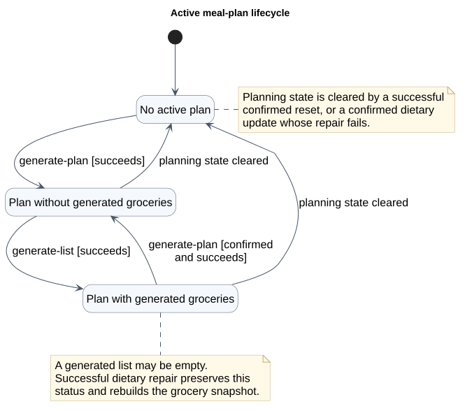

*This state-machine diagram shows the ordinary command-line lifecycle of the shared
`ActiveMealPlan` holder. A generated grocery list can be empty; its presence distinguishes
the bottom state from a plan whose groceries have not been generated.*
[PlantUML source](diagrams/rixte/reset-plan/lifecycle.puml)

Successful replacement generation discards groceries, so a plan with groceries returns
to the plan-only state. A successful confirmed reset clears all planning state. A
confirmed dietary update that cannot repair a conflicting plan also clears planning
state, while retaining the newly saved dietary preferences.

The diagram omits transitions that keep the same status: viewing, invalid input,
cancellation, failed generation, regenerating an existing grocery list, compatible
dietary updates, and successful dietary repair. Repair preserves whether groceries
existed and rebuilds them when present. Replacing a plan without groceries likewise
keeps plan-only status. It omits legacy or injected holders with inconsistent state;
the reset command's defensive checks are described in the boundaries table above.

`ResetPlanCommandTest`, `ParserResetPlanTest`, and `ResetPlanDiagnosticsTest` cover
validation, repeated resets, current-state lookup, and recoverable failures.
`ResetPlanIntegrationTest` and `MishMashResetPlanTest` check retained recipes, preferences,
saved targets, recorded meals, and regeneration. Manually reset a targeted plan with
groceries, confirm both views report missing data, and generate again using the saved settings.

<!-- @@author -->

<!-- @@author oilybikechain -->
### Defensive checks and generation diagnostics

`GeneratePlanCommand` retains an `IllegalArgumentException` as the cause when wrapping a generation
failure in `MishMashException`. Parser validation for `generate-plan`, `delete-recipe`, and
`list-recipes` likewise preserves the cause while adding the relevant command usage. Users receive
the existing recoverable error and can retry; developers can inspect the original exception through
`getCause()` or the application's rejection log. This does not add new command syntax.

`MealPlanGenerator` uses assertions to check two internal invariants: the returned number of days
matches the request, and candidate construction starts with enough recipes. Normal argument validation
still handles user mistakes; assertions diagnose programming errors. Tests enable assertions through
the existing Gradle configuration. Enable them in a direct application run with
`java -ea -jar build/libs/MishMash.jar` when investigating invariants.

Generation logs at `FINE` record the requested day count, recipe count, whether targets were supplied,
and how many candidate combinations matched. They use the existing logger configuration and do not
record recipe contents. `ParserTest.parseCommand_invalidArguments_preservesCauseAndUsage` checks
the cause and usage for all three parsing paths; `GeneratePlanCommandTest` verifies the original
generation cause is retained. These changes strengthen diagnostics around teammates' commands rather
than implementing those commands.

The validation and application-recovery interactions are separate so their exception returns and
activation bars remain clear.

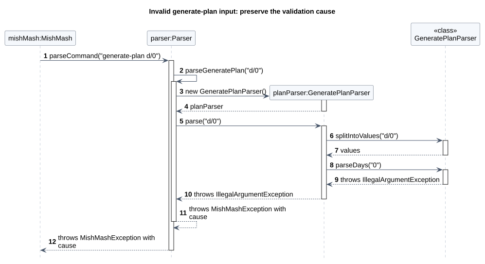

`generate-plan d/0` fails while parsing, so no command is constructed or executed. The outer
exception retains the validation cause. `MishMash` then logs the rejection, displays the recoverable
error, and prompts for another command.


<!-- @@author -->

<!-- @@author oilybikechain -->
### Contribution history: oilybikechain

The following non-merge commits reachable from the current branch establish the scope of these
contributions. Merge authorship does not imply ownership of the merged feature; the original
meal-plan generator, plan viewer, grocery formatter, dietary repair, and shortfall command have
separate contributors. The sections below describe the current integration with those components.

| Commit | Contribution documented here |
| --- | --- |
| `667d642` | Ingredient quantity model and grocery aggregation by exact name and unit. |
| `c3f6e95` | Grocery aggregation regression tests and API documentation. |
| `6b960ad` | `generate-list` parsing, command execution, and shared grocery snapshot integration. |
| `ba80853` | Preserved exception causes, generator assertions, and generation diagnostics. |
| `4c82e81` | Combined daily nutrition totals through `DayPlan` and `NutritionTotals`. |
| `f81dc10` | Daily warnings when planned nutrition exceeds exact generation targets. |

Earlier implementations on other branches are not additional features: `5ff6c3f` is the earlier
grocery integration, and `b814afb` is the pre-update nutrition-warning implementation. The current
guide describes their integrated replacements above. Profile and README edits are not product features.

<!-- @@author -->

## Documentation, Logging, Testing, Configuration and DevOps

### Documentation

The project documentation is maintained in Markdown under `docs`. The main documents are `DeveloperGuide.md` and `UserGuide.md`

Keep command formats, examples, prerequisites, and expected results consistent with the code. Document planned behaviour separately from available behaviour.

#### Claiming and correcting authorship with RepoSense

RepoSense normally uses Git history to identify contributions. Use `@@author` tags when necessary to credit your work or restore the original author's credit after moving or refactoring content. These tags change RepoSense attribution, not Git commit history.

Use the comment syntax appropriate to the file:

| File type | Start tag | End tag |
| --- | --- | --- |
| Java | `// @@author oilybikechain` | `// @@author` |
| Markdown | `<!-- @@author oilybikechain -->` | `<!-- @@author -->` |

1. Identify the code or documentation belonging to the contributor. Replace `oilybikechain` with the appropriate RepoSense author identifier when crediting someone else.
2. Put the start tag on its own line immediately before that contribution, including its heading or explanatory comments.
3. Put the end tag on its own line immediately after it. Without an end tag, attribution continues to the next start tag or the end of the file.
4. To fix incorrect credit, correct the existing start tag or add a correctly scoped pair around the original contribution. Keep unrelated contributions outside the pair.
5. Commit and push the change to the branch analysed by the tracker, then check the next refreshed report.

Do not add an end tag without a corresponding start tag; it can leave subsequent content unattributed. Markdown HTML comments remain hidden in the rendered guide.

Reference: [RepoSense authorship-tag guide](https://reposense.org/ug/usingAuthorTags.html).

### Logging

The application uses `java.util.logging`. Diagnostics are written to rotating files using the pattern `mishmash.%g.log`, with an approximate limit of 1,000,000 bytes per file and three files retained.

Levels include `FINE` for command diagnostics, `INFO` for lifecycle events and successful grocery-generation counts, `WARNING` for selected rejected operations or logging problems, and `SEVERE` for unexpected application failures. If the log file cannot be opened because of an I/O error, the application continues with its existing logging configuration.

### Testing

The project uses JUnit Jupiter. Tests are under `src/test/java/mishmash` and mirror the production packages. They cover validation, commands, models, generation, display formatting, and full console interactions.

Run verification from the repository root:

```powershell
.\gradlew.bat test checkstyleMain checkstyleTest
```

On Linux or macOS:

```text
./gradlew test checkstyleMain checkstyleTest
```

Use Java 25. JUnit reports appear at `build/reports/tests/test/index.html`, and Checkstyle reports are under `build/reports/checkstyle`. The add-recipe invalid-input dataset is `src/test/resources/add-recipe-invalid.tsv`.

### Configuration

The current application has no user configuration file. Users supply recipe values, plan length, and optional daily nutrition targets through commands.

The supported plan length is 1 to 7 days. Each generated day contains exactly three different stored recipe entries. Generation uses a fixed target tolerance of 15%; users cannot change that tolerance through a command. In contrast, `check-shortfall` reports any amount strictly below the explicit targets supplied to that check.

### DevOps

GitHub Actions runs `./gradlew check` for pushes and pull requests on Ubuntu, macOS, and Windows using Java 25. Check the resulting reports before merging changes.

The Gradle build packages the application as `build/libs/MishMash.jar`. Release documentation should use that filename and describe the features included in the actual release.
## Appendix A: Product Scope

**Target user profile:** Users who prepare meals in advance, want to organise recipes and review calorie or macronutrient totals, and are comfortable entering text commands. Users provide their own recipes and nutrition information.

**Value proposition:** MishMash connects recipe management, meal selection, and grocery preparation in one workflow. It generates plans from user-entered recipes and combines ingredient quantities for the selected meals.

**Current boundaries:** Data lasts for one session. Nutrition is entered by the user rather than calculated from an ingredient database. Plans use whole recipes without portion scaling. Ingredient names and units are matched exactly; automatic unit conversion and grocery-item ticking are not supported.

## Appendix B: User Stories

Priorities follow the AB3 convention: `***` essential, `**` useful, `*` optional. Grey rows are the v1.0 MVP; green rows are the v2.0 MVP. Text labels retain that meaning when colour is unavailable. Owners record the team's planned responsibility, rather than attributing every later integration change.

<table>
<thead><tr><th>Release</th><th>Priority</th><th>As a ...</th><th>I want to ...</th><th>So that I can ...</th><th>Owner</th><th>Current support</th></tr></thead>
<tbody>
<tr style="background-color: #e6e6e6; color: #111111;"><td>v1.0 MVP</td><td>***</td><td>Meal prep user</td><td>Add a recipe</td><td>Use my own dishes in meal plans</td><td>Pei Ling</td><td><code>add-recipe</code></td></tr>
<tr style="background-color: #e6e6e6; color: #111111;"><td>v1.0 MVP</td><td>***</td><td>User managing recipes</td><td>Delete a recipe</td><td>Remove dishes I no longer need</td><td>Neil</td><td><code>delete-recipe</code></td></tr>
<tr style="background-color: #e6e6e6; color: #111111;"><td>v1.0 MVP</td><td>***</td><td>User managing recipes</td><td>List recipes and inspect one recipe</td><td>Choose a dish and check its details</td><td>Neil</td><td><code>list-recipes [INDEX]</code></td></tr>
<tr style="background-color: #e6e6e6; color: #111111;"><td>v1.0 MVP</td><td>***</td><td>Meal prep user</td><td>Generate a random meal plan</td><td>Reduce manual meal selection</td><td>Gautham</td><td><code>generate-plan</code></td></tr>
<tr style="background-color: #e6e6e6; color: #111111;"><td>v1.0 MVP</td><td>***</td><td>Shopper</td><td>Generate a grocery list</td><td>Obtain combined ingredient quantities for my plan</td><td>Justin</td><td><code>generate-list</code></td></tr>
<tr style="background-color: #e6e6e6; color: #111111;"><td>v1.0 MVP</td><td>***</td><td>Shopper</td><td>View the grocery list</td><td>See what to purchase</td><td>Samantha</td><td><code>view-list</code></td></tr>
<tr style="background-color: #e6e6e6; color: #111111;"><td>v1.0 MVP</td><td>***</td><td>Meal prep user</td><td>View my meal plan</td><td>Review the meals selected for each day</td><td>Samantha</td><td><code>view-plan</code></td></tr>
<tr style="background-color: #d9ead3; color: #111111;"><td>v2.0 MVP</td><td>***</td><td>User with dietary requirements</td><td>Set dietary preferences and restrictions</td><td>Generate meals compatible with my declared requirements</td><td>Pei Ling</td><td><code>set-diet</code></td></tr>
<tr style="background-color: #d9ead3; color: #111111;"><td>v2.0 MVP</td><td>***</td><td>New user</td><td>Receive assistance from a help command</td><td>Find available commands and their formats</td><td>Pei Ling</td><td><code>help</code></td></tr>
<tr style="background-color: #d9ead3; color: #111111;"><td>v2.0 MVP</td><td>***</td><td>User tracking nutrition</td><td>Set a daily calorie target</td><td>Plan toward my desired calorie intake</td><td>Neil</td><td><code>set-targets cal/...</code></td></tr>
<tr style="background-color: #d9ead3; color: #111111;"><td>v2.0 MVP</td><td>***</td><td>User tracking nutrition</td><td>Set daily macronutrient targets</td><td>Plan toward my protein, carbohydrate, and fat goals</td><td>Neil</td><td><code>set-targets p/... c/... f/...</code></td></tr>
<tr style="background-color: #d9ead3; color: #111111;"><td>v2.0 MVP</td><td>***</td><td>User tracking intake</td><td>Record meals eaten</td><td>Keep track of my actual food intake</td><td>Gautham</td><td><code>record-meal</code></td></tr>
<tr style="background-color: #d9ead3; color: #111111;"><td>v2.0 MVP</td><td>***</td><td>User tracking nutrition</td><td>Calculate nutrition totals for each meal</td><td>Review each recorded meal's calories and macronutrients</td><td>Gautham</td><td><code>view-meals</code></td></tr>
<tr style="background-color: #d9ead3; color: #111111;"><td>v2.0 MVP</td><td>***</td><td>User tracking nutrition</td><td>Calculate daily nutrition totals</td><td>Review the combined nutrition of each planned day</td><td>Justin</td><td><code>view-plan</code>; recorded totals are session-wide</td></tr>
<tr style="background-color: #d9ead3; color: #111111;"><td>v2.0 MVP</td><td>***</td><td>User tracking nutrition</td><td>Detect meal plans that exceed nutrition targets</td><td>Identify days above my exact generation targets</td><td>Justin</td><td><code>view-plan</code> warnings</td></tr>
<tr style="background-color: #d9ead3; color: #111111;"><td>v2.0 MVP</td><td>***</td><td>User tracking nutrition</td><td>Detect meal plans that fall short of nutrition targets</td><td>Identify deficits against the targets I supply</td><td>Samantha</td><td><code>check-shortfall</code></td></tr>
<tr style="background-color: #d9ead3; color: #111111;"><td>v2.0 MVP</td><td>***</td><td>User managing recipes</td><td>Edit an existing recipe</td><td>Keep its details consistent with how I prepare it</td><td>Samantha</td><td><code>edit-recipe</code></td></tr>
</tbody>
</table>

### v2.0b Follow-up Stories

This is a source-checkout audit against the [v2.0b milestone](https://github.com/AY2627S1-CS2113-W13-4/tp/issues?q=is%3Aissue+milestone%3Av2.0b), not a claim that every milestone item has shipped. An open issue can have partial or existing support.

| Priority | As a ... | I want to ... | So that I can ... | Issue | Support in this checkout |
| --- | --- | --- | --- | --- | --- |
| `**` | Returning user | Reset my active plan and groceries | Start planning again while keeping recipes, settings, and intake records | [#53](https://github.com/AY2627S1-CS2113-W13-4/tp/issues/53) | Implemented: `reset-plan`. |
| `**` | Returning user | Confirm plan removal or replacement | Avoid losing a plan accidentally | [#61](https://github.com/AY2627S1-CS2113-W13-4/tp/issues/61) | Implemented for the documented plan-changing commands. |
| `**` | User with dietary requirements | View my dietary settings | Check which restrictions apply to generation | [#71](https://github.com/AY2627S1-CS2113-W13-4/tp/issues/71) | Implemented: `view-diet`. |
| `**` | User with dietary requirements | Clear my dietary restrictions | Generate meals without restrictions | [#72](https://github.com/AY2627S1-CS2113-W13-4/tp/issues/72) | Available through `set-diet diet/none`; issue remains open. |
| `**` | Meal prep user | Understand unsuccessful generation | Know which recipes or settings to change | [#59](https://github.com/AY2627S1-CS2113-W13-4/tp/issues/59) | Existing diagnostics and dietary-repair recovery; check issue acceptance before closing. |
| `**` | Meal prep user | Replace an individual planned meal | Adapt a plan to what I want to eat | [#57](https://github.com/AY2627S1-CS2113-W13-4/tp/issues/57) | Coming soon (v2.0b); no individual replacement command. |
| `**` | Meal prep user | Adjust a planned meal's portion | Match nutrition and grocery quantities to my serving | [#58](https://github.com/AY2627S1-CS2113-W13-4/tp/issues/58) | Coming soon (v2.0b); whole-recipe portions only. |
| `**` | Meal prep user | Customise one planned meal's ingredients | Adapt that meal without editing the original recipe | [#60](https://github.com/AY2627S1-CS2113-W13-4/tp/issues/60) | Coming soon (v2.0b); recipe editing does not change existing plan snapshots. |
| `**` | User tracking intake | Review recorded meals by date | Understand my intake for a selected day | [#62](https://github.com/AY2627S1-CS2113-W13-4/tp/issues/62) | Coming soon (v2.0b); records have no dates. |
| `**` | User tracking intake | Correct or remove a recorded meal | Keep my intake records accurate | [#63](https://github.com/AY2627S1-CS2113-W13-4/tp/issues/63) | Coming soon (v2.0b); no correction or removal command. |

**Needs clarification:** [#51](https://github.com/AY2627S1-CS2113-W13-4/tp/issues/51) is titled “Retain data between sessions”, but its body repeats the reset-plan story. Persistence is not implemented. Confirm the intended requirement before treating this issue as satisfied. [#77](https://github.com/AY2627S1-CS2113-W13-4/tp/issues/77) tracks team PPP deliverables, rather than a product user story.

### User Stories for Future Consideration

Optional ideas beyond the milestone include searching recipes and estimating grocery costs. These are not implemented or release commitments.

### Use Cases

The actor in each use case is the user. A command session has already started and the user has entered a name. MSS means Main Success Scenario.

#### UC01 Add a recipe

**MSS**

1. The user enters `add-recipe` with a name, nutrition values, and at least one ingredient.
2. MishMash validates the input.
3. MishMash adds the recipe, displays its details, and prompts for another command.

**Extensions**

- 2a. A field is missing, blank, repeated, or invalid: MishMash displays an error and the add-recipe format. Existing recipes remain unchanged. The use case ends.

#### UC02 List recipes

**MSS**

1. The user enters `list-recipes`, optionally selecting an index.
2. MishMash displays the numbered names and calories of all recipes, or the full details of the selected recipe.

**Extensions**

- 1a. The index syntax is invalid: MishMash displays an error and the command format.
- 2a. The book is empty: MishMash displays guidance to add a recipe.
- 2b. The selected index does not exist: MishMash displays an index-range error.

#### UC03 Delete a recipe

**MSS**

1. The user enters `delete-recipe INDEX`.
2. MishMash checks the index and asks for confirmation, naming the selected recipe.
3. The user enters `y` or `yes`.
4. MishMash deletes the entry and displays its name and the remaining recipe count.

**Extensions**

- 1a. The index syntax is invalid: MishMash displays an error.
- 2a. The book is empty or the index does not exist: MishMash displays an error without asking for confirmation.
- 3a. The response is anything other than `y` or `yes`, ignoring case and surrounding whitespace, or input ends: the deletion is cancelled and the book remains unchanged.

#### UC04 Generate a meal plan

**Precondition:** At least three recipe entries are available.

**MSS**

1. The user enters `generate-plan d/DAYS`, optionally including daily nutrition targets.
2. MishMash validates the requested days and targets.
3. MishMash generates exactly three different recipe entries per day, meeting every supplied target within 15%.
4. MishMash makes the new plan active, clears the previous groceries, and displays a confirmation.

**Extensions**

- 2a. Days are outside 1 to 7, a target is not a positive integer, or arguments are malformed: MishMash rejects the command.
- 3a. Fewer than three recipe entries are available, or no acceptable plan is found: MishMash displays an error. The previous plan and groceries remain available.

Recipes may be repeated on different days. With no targets, there are no nutrition constraints on the selection. Targets saved with `set-targets` (UC13) apply to every nutrient that the command leaves out, and a target typed in the command replaces the saved one for that plan.

#### UC05 View a meal plan

**MSS**

1. The user enters `view-plan`, optionally selecting `d/DAY_NUMBER`.
2. MishMash displays all days or the selected day, including each meal's nutrition and daily totals.

**Extensions**

- 1a. The day argument is malformed: MishMash displays an error and the command format.
- 2a. No plan is active: MishMash asks the user to generate one first.
- 2b. The selected day exceeds the active plan's length: MishMash displays a range error.

#### UC06 Generate a grocery list

**Precondition:** A meal plan is active.

**MSS**

1. The user enters `generate-list` without arguments.
2. MishMash combines ingredients from every meal occurrence in the active plan.
3. MishMash stores the completed groceries and confirms that they can be viewed using `view-list`.

**Extensions**

- 1a. Arguments are supplied: MishMash rejects the command without changing the stored list.
- 2a. There is no active plan: MishMash asks the user to generate one first.

Only exact ingredient-name and unit matches are combined. Different units or letter case remain separate entries.

#### UC07 View a grocery list

**MSS**

1. The user enters `view-list` without arguments.
2. MishMash displays the stored entries, their quantities and units, and the total number of entries.

**Extensions**

- 1a. Arguments are supplied: MishMash displays an error.
- 2a. No grocery list has been generated: MishMash asks the user to generate one first.

Viewing does not regenerate groceries. The displayed `[ ]` markers cannot be ticked through a command.

#### UC08 View help or exit

- Entering `help` displays command purposes and formats. Additional arguments produce an error.
- Entering `bye` displays the goodbye message and ends the session. Session data is discarded.

<!-- @@author Rixte -->
#### UC09 Check planned nutrition shortfalls

**MSS**

1. The user enters `check-shortfall` with at least one daily nutrition target.
2. MishMash validates the target arguments and obtains the active plan.
3. MishMash compares each day's planned totals with the supplied targets.
4. MishMash displays each day's deficient nutrients and amounts, or a no-shortfalls
   message for that day, then prompts for another command.

**Extensions**

- 2a. Targets are missing, repeated, unknown, or invalid: MishMash displays an error and
  the check-shortfall format. The use case ends without changing application data.
- 2b. No plan exists or the plan has no days: MishMash asks the user to generate a plan.
  The use case ends.

Omitted nutrients and excesses are not checked. All plan, recipe, and grocery data remains
unchanged. A shortfall is any amount below a target, even within generation's tolerance.

<!-- @@author -->
<!-- @@author oilybikechain -->
#### UC10 Detect exceeded nutrition targets

**Precondition:** An active plan was generated with at least one daily nutrition target.

**MSS**

1. The user enters `view-plan`, optionally selecting a day.
2. MishMash calculates each displayed day's nutrition totals and compares them with the saved generation targets.
3. For each exceeded target, MishMash displays a warning with the excess, actual total, and target below that day's totals.

**Extensions**

- 2a. A target is omitted, equal to the total, or above it: no warning is shown for that nutrient.
- 2b. No generation request is retained, or the plan was generated without targets: only the normal plan display is shown.
- 2c. No plan exists or a selected day is invalid: the existing `view-plan` messages apply.

The comparison is strict and does not apply the generator's 15% tolerance. Viewing leaves the meals,
targets, and groceries unchanged. A successful replacement uses its new targets; failed generation
preserves the previous warnings. Dietary repair recalculates warnings using the repaired meals and
the retained generation targets. Clearing the plan removes the warnings.

<!-- @@author -->
<!-- @@author GauthamNandi -->
#### UC11 Record a meal eaten

**Precondition:** At least one recipe exists.

**MSS**

1. The user enters `record-meal INDEX`, using an index shown by `list-recipes`.
2. MishMash validates the index and finds the recipe at that position.
3. MishMash adds the recipe to the recorded meals.
4. MishMash displays the meal and the totals of all recorded meals, then prompts for another command.

**Extensions**

- 2a. The index is missing, or is not a single positive whole number: MishMash displays an error and the `record-meal` format. The use case ends without recording anything.
- 2b. There are no recipes, or the index is larger than the number of recipes: MishMash displays an error. The use case ends without recording anything.

No confirmation is requested. Recording changes only the recorded meals; recipes, the meal plan, and groceries are unchanged. Recording the same recipe again adds another entry.

#### UC12 View recorded meals

**MSS**

1. The user enters `view-meals`.
2. MishMash reads the recorded meals and sums their nutrition.
3. MishMash displays each meal in the order recorded with its calories and macronutrients, followed by the totals, then prompts for another command.

**Extensions**

- 1a. The user adds an argument: MishMash displays an error and the `view-meals` format. The use case ends.
- 2a. No meal has been recorded: MishMash displays `No meals recorded yet.` The use case ends.

Viewing leaves the recorded meals unchanged. The totals cover every meal recorded in the session, because meals are not recorded against dates.

<!-- @@author -->
<!-- @@author neil0618 -->
#### UC13 Set daily targets

**MSS**

1. The user enters `set-targets` with one or more of `cal/`, `p/`, `c/`, and `f/`, each followed by a positive whole number or `none`.
2. MishMash validates every argument.
3. MishMash replaces the target of each nutrient given a number, removes the target of each nutrient given `none`, and keeps the targets of the other nutrients.
4. MishMash displays the targets now saved, or `All daily targets cleared.` if none remain, then prompts for another command.

**Extensions**

- 2a. No argument is given, a prefix is unknown or repeated, a value is missing, or a value is neither `none` nor a positive whole number up to 2147483647: MishMash displays an error and the `set-targets` format. The use case ends and the saved targets are unchanged.

The command does not change the recipe book or an existing meal plan. The saved targets are used by later `generate-plan` commands (UC04) and last until the application closes.

#### UC14 View daily targets

**MSS**

1. The user enters `view-targets`.
2. MishMash displays the saved target of each nutrient, with `not set` for a nutrient that has none, then prompts for another command.

**Extensions**

- 1a. The user adds an argument: MishMash displays an error and the `view-targets` format. The use case ends.
- 2a. No target is saved: MishMash displays `No daily targets saved. Use 'set-targets' to set them.` The use case ends.

<!-- @@author -->
<!-- @@author peilingggg -->
#### UC15 Set dietary preferences

**MSS**

1. The user enters `set-diet` with at least one supported prefixed field.
2. MishMash validates the complete replacement profile.
3. If any planned day conflicts, MishMash asks for confirmation. After agreement, it preserves compatible planned days and replaces conflicting days using the original targets.
4. MishMash rebuilds existing groceries after repair, saves the profile, and displays the outcome.

**Extensions**

- 2a. Syntax or values are invalid: display an error and usage; preserve all data.
- 3a. No active plan exists: save the profile for future generation.
- 3b. The complete plan is compatible: preserve the plan and groceries.
- 3c. The user declines confirmation: preserve the profile, plan, and groceries.
- 3d. Replacement fails or the original request is unavailable: save the profile, clear
  the plan and groceries, and explain how to generate again.

#### UC16 View dietary preferences

**MSS**

1. The user enters `view-diet` without arguments.
2. MishMash reads the current session profile and displays the diet and both exclusion lists.

**Extensions**

- 1a. Arguments are supplied: display an error and `Format: view-diet`; preserve all data.
- 2a. No restrictions are active: display `none` for the diet and both lists.

Viewing never changes the profile or generated data.

<!-- @@author -->

#### UC17 Edit a recipe

**MSS**

1. The user lists recipes and chooses an index.
2. The user enters `edit-recipe INDEX` with at least one replacement field.
3. MishMash validates the input, replaces the recipe at that index, and displays its updated details.

**Extensions**

- 2a. The index or a supplied field is invalid, or no edits are supplied: MishMash displays an error and leaves the recipe unchanged. The use case ends.
- Existing meal plans and recorded meals keep their previous recipe snapshots.

## Appendix C: Non-Functional Requirements

- The application requires Java 25 and provides a command-line interface.
- The project targets Windows, macOS, and Linux, with verification configured on all three operating systems.
- Ordinary invalid command input must allow the session to continue and preserve existing data.
- Decimal ingredient quantities must retain their numeric precision.
- Generating meals and groceries must leave the stored recipe entries unchanged.
- The normal application workflow does not require a network connection or an external database.

## Appendix D: Glossary

| Term | Meaning |
| --- | --- |
| Recipe | A named entry with calorie and macronutrient values and required ingredients. |
| Recipe book | The ordered recipes available in the current session. |
| Recipe index | A recipe's current displayed position, starting at 1. |
| Meal plan | Recipes assigned to one or more numbered days. |
| Active plan | The single plan currently available for viewing and grocery generation. |
| Macronutrient | Protein, carbohydrate, or fat, measured in grams. |
| Daily target | An optional desired daily total for calories or a macronutrient. |
| Grocery list | The combined ingredient quantities generated from the active plan. |
| Session | One running instance of the application; application data is not retained after it ends. |

## Appendix E: Instructions for Manual Testing

These checks cover current behaviour. Testers may explore additional inputs. Each subsection is independent: start a fresh session and load the sample recipes where needed so earlier tests do not change later preconditions.

### Launch

1. Install Java 25 and download the published **v2.0 JAR** from the team's [Releases page](https://github.com/AY2627S1-CS2113-W13-4/tp/releases). Save it in an empty folder and open a terminal in that folder.
2. Run `java -ea -jar "MishMash.jar"`, replacing `MishMash.jar` with the downloaded file's actual name if it differs. The `-ea` option enables the application's internal assertion checks during manual testing.
3. Confirm that the banner and name prompt appear. Enter a name and check that a command prompt follows.

### Sample Recipes

Enter each command on one line:

```text
add-recipe n/Chicken Rice cal/600 p/40 c/70 f/15 i/Chicken:200g i/Rice:150g
add-recipe n/Tofu Rice cal/500 p/25 c/60 f/12 i/Tofu:200g i/Rice:100g
add-recipe n/Oats cal/400 p/15 c/50 f/10 i/Oats:80g i/Milk:200ml
```

With exactly these three entries, each generated day contains all three. Meal order may vary. Daily totals are 1500 kcal, 80g protein, 180g carbs, and 37g fats.

### Add a Recipe

- **Valid input:** Enter the first sample recipe. Expect one addition, its nutrition and ingredients, and another prompt.
- **Missing ingredient:** Omit both `i/` fields. Expect an error requiring at least one ingredient and no addition.
- **Invalid nutrition:** Replace `cal/600` with `cal/abc` or `cal/2147483648`. Expect an integer or range error.
- **Boundary value:** Replace `cal/600` with `cal/0`. Expect successful addition; zero nutrition is allowed.
- **Invalid quantity:** Use `i/Chicken:0g`. Expect rejection because recipe ingredient quantities must be positive.
- **Decimal quantity:** Use `i/Chicken:200.5g`. Expect the decimal quantity to be preserved.
- **Repeated field:** Add a second `n/` field. Expect rejection. Repeated `i/` fields remain valid.

For rejected commands, check that existing recipes remain unchanged and a subsequent valid addition succeeds.

### List Recipes

After loading the samples:

- Enter `list-recipes`. Expect three numbered entries in insertion order, showing names and calories.
- Enter `list-recipes 2`. Expect Tofu Rice's full nutrition and ingredients.
- Enter `list-recipes 4`. Expect an out-of-range error.
- In a fresh empty session, enter `list-recipes`. Expect guidance to add a recipe.

### Delete a Recipe

After loading the samples:

- Enter `delete-recipe 2`. Expect a confirmation naming Tofu Rice. Answer `n`; verify that nothing changed.
- Repeat and answer `yes`. Expect deletion, a remaining count of 2, and renumbering of the later recipe.
- Enter `delete-recipe 0` or an index larger than the current book size. Expect an error without deletion.

### Generate a Meal Plan

Use a fresh session containing exactly the three sample recipes:

- Enter `generate-plan d/3`. Expect confirmation of a three-day plan. Check with `view-plan` that each day has exactly three meals.
- Enter `generate-plan d/2 cal/1500 p/80 c/180 f/37`. Expect success. Each day's totals match the sample totals exactly.
- Enter `generate-plan d/8`. Expect rejection because the day limit is 1 to 7.
- Enter `generate-plan d/1 cal/1`. Expect failure to find acceptable meals. Verify that the previous plan remains available.
- In a separate session containing fewer than three recipes, try `generate-plan d/1`. Expect a minimum-recipe error.

### View a Meal Plan

After generating a two-day plan:

- Enter `view-plan`. Expect both days, meal nutrition, and daily totals.
- Enter `view-plan d/1`. Expect only Day 1.
- Enter `view-plan d/3`. Expect a day-range error and another prompt.
- In a fresh session with no plan, enter `view-plan`. Expect the generate-first message.

<!-- @@author oilybikechain -->
### Combined Daily Nutrition Totals

Using exactly the three [sample recipes](#sample-recipes), run `generate-plan d/2` and `view-plan`.
Both days must show `Daily Totals: 1500 kcal | Protein: 80g | Carbs: 180g | Fats: 37g` regardless
of meal order. Run `view-plan d/2`: its totals must match the second day's previous display, rather
than adding the two days together. Repeating the command must not change the plan or totals.

The combined `NutritionTotals` API's empty-day, repeated-meal, and integer-overflow cases are tested
by `DayPlanTest`; ordinary generation always supplies three distinct recipes per day.

### Nutrition Target Warnings

In a fresh session with no dietary restrictions, enter:

```text
add-recipe n/A cal/500 p/20 c/50 f/10 i/Rice:100g
add-recipe n/B cal/600 p/30 c/60 f/15 i/Rice:100g
add-recipe n/C cal/700 p/40 c/70 f/20 i/Rice:100g
generate-plan d/2 cal/1700 p/85 c/180 f/45
view-plan
view-plan d/2
```

Each day must total 1800 kcal, 90 g protein, 180 g carbohydrates, and 45 g fats, regardless of meal order.
Expect exactly these warnings below each displayed day's totals:

```text
Warning: Calories exceed target by 100 kcal (1800 kcal actual; 1700 kcal target).
Warning: Protein exceeds target by 5 g (90 g actual; 85 g target).
```

`view-plan d/2` must show only day 2. Then try `generate-plan d/1 cal/1`: generation must fail and
`view-plan` must still display the previous two days and their warnings. Run `check-shortfall cal/1900`
and verify that a subsequent `view-plan` retains those warnings. Finally run `generate-plan d/1` and
`view-plan`: the replacement must show one day with no warnings because no targets were supplied.

<!-- @@author -->
<!-- @@author Rixte -->
### Check Nutrition Shortfalls

1. In a fresh session, enter `check-shortfall cal/2000` before generating a plan. Expect
   `No active meal plan. Use 'generate-plan' first.` and another command prompt.
2. Load exactly the three [sample recipes](#sample-recipes), enter `generate-plan d/2`,
   and then `generate-list`. Each day's planned totals are 1500 kcal, 80 g protein,
   180 g carbohydrates, and 37 g fat.
3. Enter `check-shortfall cal/2000 p/100 c/200 f/60`. Both Day 1 and Day 2 should report
   deficits of 500 kcal, 20 g protein, 20 g carbohydrates, and 23 g fat. For each day,
   verify that the displayed total and target are included alongside the deficit.
4. Enter `check-shortfall cal/1500 p/80 c/100`. Both days should display
   `No shortfalls for the supplied targets.` Calories and protein exactly match,
   carbohydrates exceed the target, and fat is omitted.
5. Enter `check-shortfall cal/1501`. Expect a 1 kcal deficit for each day even though
   that difference is within the generation tolerance.
6. Try `check-shortfall`, `check-shortfall cal/0`, `check-shortfall p/1.5`,
   `check-shortfall cal/2000 cal/2100`, and `check-shortfall d/1`. Each should produce a
   recoverable error with the check-shortfall format. Retry a valid check afterwards.
7. Enter `view-plan` and `view-list`. The two-day plan and all five grocery entries should
   be unchanged. Their quantities should match the table in
   [Generate a Grocery List](#generate-a-grocery-list). Repeat a check to verify that
   results are stable, and enter `help` to confirm the new command is listed.

The CLI cannot generate an empty day or an empty plan; those defensive cases, null
dependencies, and integer-overflow boundaries are covered by the automated tests.
<!-- @@author -->

### Generate a Grocery List

With exactly the sample recipes, generate a two-day plan and enter `generate-list`. Expect:

```text
Grocery list generated. Use 'view-list' to view it.
```

Then enter `view-list` and verify:

| Ingredient | Quantity for two days |
| --- | --- |
| Chicken | 400g |
| Rice | 500g |
| Tofu | 400g |
| Oats | 160g |
| Milk | 400ml |

There should be five displayed entries. Their order follows the meals' first appearances and may vary. The generation confirmation itself does not display an item count.

- Run `generate-list` again. Expect unchanged quantities rather than doubled totals.
- Enter `generate-list extra`. Expect rejection without changing the stored list.
- In a fresh session without a plan, enter `generate-list`. Expect guidance to generate a plan first.

<!-- @@author oilybikechain -->
For aggregation edge cases, use the User Guide's [ingredient combining example](UserGuide.md#ingredient-combining-example)
in a fresh session. Expect exactly `Rice: 0.6g`, `Rice: 2kg`, and `rice: 100g`, with no rounding,
unit conversion, or case normalization. Repeat `generate-list` and check that quantities stay the same.
Then enter `generate-list extra` and `view-list`: syntax rejection must leave those entries unchanged.
Generate a replacement plan and confirm that groceries must be regenerated before viewing.

### Defensive Diagnostics and Recovery

With a plan and grocery list already generated, enter `generate-plan d/0`, `list-recipes 0`, and
`delete-recipe 0`. Each must display its own command format, then allow another command. Verify
with valid viewing commands that no recipes, meals, or groceries changed. Attempt
`generate-plan d/1 cal/1` with the standard sample recipes and confirm that generation fails while
the previous plan and grocery list remain available.

Exception causes and assertion invariants are developer diagnostics, not extra console output.
Verify cause preservation with `ParserTest` and `GeneratePlanCommandTest` under Java 25 with
assertions enabled. Inspect `FINE` generation records only when that level is enabled in the
existing logging configuration; absence of a `FINE` record at a higher log level is expected.
<!-- @@author -->

### View a Grocery List

- Enter `view-list` after grocery generation. Expect ingredient quantities, units, `[ ]` markers, and the total entry count.
- Enter `view-list extra`. Expect a format error.
- Successfully generate a replacement meal plan, then enter `view-list`. Expect a generate-list-first message because the previous groceries were cleared.
- Generate groceries again, then attempt `generate-plan d/1 cal/1`. After that failure, verify that the previous grocery list is still available.

<!-- @@author GauthamNandi -->
### Record and View Meals

1. In a fresh session, enter `record-meal 1`. Expect `Error: There are no recipes to record. Use 'add-recipe' to add one.`, the list of command formats, and another prompt. Enter `view-meals` and expect `No meals recorded yet.`
2. Load exactly the three [sample recipes](#sample-recipes). Enter `record-meal 1`. Expect:

   ```text
   Meal recorded!
   Chicken Rice (600 kcal | P: 40g, C: 70g, F: 15g)
   Total so far: 600 kcal | Protein: 40g | Carbs: 70g | Fats: 15g
   ```

3. Enter `record-meal 2`. Expect Tofu Rice and `Total so far: 1100 kcal | Protein: 65g | Carbs: 130g | Fats: 27g`.
4. Enter `view-meals`. Expect the header, `Meal 1: Chicken Rice ...` and `Meal 2: Tofu Rice ...`, then a divider, `Total: 1100 kcal | Protein: 65g | Carbs: 130g | Fats: 27g`, and the footer.
5. Enter `record-meal 1` again, then `view-meals`. Expect a third entry, `Meal 3: Chicken Rice ...`, and `Total: 1700 kcal | Protein: 105g | Carbs: 200g | Fats: 42g`.
6. Enter `add-recipe n/Black Coffee cal/5 p/0 c/0 f/0 i/Coffee:1cup`, then `record-meal 4`. Expect 0g for each macronutrient and a total that grows by 5 kcal only.
7. Try `record-meal`, `record-meal 0`, `record-meal 5`, `record-meal two`, `record-meal -1`, `record-meal 1 2`, `view-meals now`. Each should produce a recoverable error. Enter `view-meals` afterwards and confirm that the recorded meals are unchanged.
8. Enter `edit-recipe 2 cal/100`, then `delete-recipe 1` and confirm. Enter `view-meals`. Every recorded meal should keep the calories and macros it had when recorded.
9. Enter `generate-plan d/1`, then `view-meals` and `view-plan`. The recorded meals should be unchanged by plan generation, and the plan should be unaffected by the recorded meals.
10. Enter `help` and confirm that both commands are listed. Enter `bye`, restart, and enter a name. `view-meals` should report `No meals recorded yet.`
<!-- @@author -->

<!-- @@author peilingggg -->
### Dietary Preferences and Plan Repair

1. In a fresh session, use the [restricted-plan example in the User Guide](UserGuide.md#updating-an-existing-plan).
   Confirm two days of classified vegan meals and 400 g each of Rice, Beans, and Tofu in groceries.
2. Enter `view-diet`. Expect vegan with `none` for both explicit exclusion lists.
3. Enter `set-diet diet/keto`. Expect invalid diet, supported values, aliases, and usage.
   Confirm the profile, plan, and groceries remain unchanged.
4. Add `add-recipe n/Lentils cal/600 p/10 c/20 f/5 i/Lentils:200g food/legume`,
   then enter `set-diet diet/vegan avoid/soy` and answer `yes` to the confirmation. Expect repaired days with Rice, Beans, and Lentils.
   Confirm each day still totals 1800 kcal and groceries contain 400 g of each ingredient.
5. Enter `set-diet exclude/Beans,Tofu` and answer `yes` to the confirmation. This replaces the previous profile and leaves only Rice
   and Lentils eligible. Expect saved preferences and a cleared plan and grocery list.
   Confirm with `view-diet`, `view-plan`, and `view-list`.
6. Restart in a fresh session and enter `view-diet`. Expect `none` for all three lines.
   Return to the restricted-plan example before continuing.
7. Enter `set-diet avoid/milk,dairy`, `set-diet exclude/Beans, beans`, and `view-diet extra`
   separately. Expect errors and no profile change.
8. Enter `set-diet diet/vegan` to re-enable restrictions, then add an unclassified recipe by
   omitting `food/`. Generate a new plan and confirm that it excludes the unclassified recipe.
   Automated partial-repair tests cover mixed compatible/conflicting days deterministically.

<!-- @@author -->

<!-- @@author neil0618 -->
### Set and View Daily Targets

Use a fresh session containing exactly the three [sample recipes](#sample-recipes).

1. Enter `view-targets`. Expect `No daily targets saved. Use 'set-targets' to set them.`
2. Enter `set-targets cal/1500 p/80`. Expect `Daily targets saved: 1500 kcal, 80 g protein.` and a reminder that the current plan is unchanged.
3. Enter `set-targets f/37`. Expect `Daily targets saved: 1500 kcal, 80 g protein, 37 g fats.`, which shows that earlier targets are kept. Enter `view-targets` and expect Calories `1500 kcal`, Protein `80 g`, Carbs `not set`, and Fats `37 g`.
4. Enter `generate-plan d/1`. Expect success followed by `Daily targets used: 1500 kcal, 80 g protein, 37 g fats.` Enter `view-plan` and expect all three recipes, daily totals of 1500 kcal, 80g protein, and 37g fats, and no warnings.
5. Enter `generate-plan d/1 cal/1400`. Expect `Daily targets used: 1400 kcal, 80 g protein, 37 g fats.`, which shows that the typed calories replaced the saved 1500 while protein and fats still apply. Enter `view-plan` and expect `Warning: Calories exceed target by 100 kcal (1500 kcal actual; 1400 kcal target).` Enter `view-targets` and confirm that the saved calories are still `1500 kcal`.
6. Enter `set-targets p/200`, then `generate-plan d/1`. Expect `Error: Could not find 3 recipes that meet your daily targets within 15%. ...` followed by `Daily targets applied: 1500 kcal, 200 g protein, 37 g fats (including your saved targets). Change those with 'set-targets'.` Enter `view-plan` and verify that the plan from step 5 is still available. Enter `generate-plan d/1 p/80`. Expect success with `Daily targets used: 1500 kcal, 80 g protein, 37 g fats.`
7. Enter `set-targets cal/none c/none f/none p/none`. Expect `All daily targets cleared.` Enter `view-targets` and expect the `No daily targets saved` message. Enter `generate-plan d/1` and confirm that there is no `Daily targets used:` line.
8. Try `set-targets`, `set-targets cal/0`, `set-targets cal/-5`, `set-targets cal/abc`, `set-targets cal/1.5`, `set-targets cal/`, `set-targets x/5`, `set-targets 2000`, `set-targets cal/1 cal/2`, `set-targets p/5 f/oops`, and `view-targets now`. Each should produce a recoverable error that ends with the matching format line. After `set-targets p/5 f/oops`, enter `view-targets` and confirm that protein was not saved.
9. Enter `set-targets cal/NONE`. Expect it to be accepted. Enter `set-targets CAL/5` and `Set-Targets cal/5`. Expect `Unrecognized parameter: CAL/5` and `Unknown command: Set-Targets`.
10. Enter `set-targets cal/2000`, then `bye`, restart, and enter a name. `view-targets` should report that no targets are saved.
<!-- @@author -->

### Help and Recovery

- Enter `help`. Expect all supported command names, purposes, and formats.
- Enter `help extra`, a blank line, or an unknown command. Expect an error followed by another prompt.
- After an invalid command, enter a valid command and verify that it executes normally.

### Session Data

Add recipes, generate a plan and groceries, then enter `bye`. Restart and enter a name. Verify that the recipe book is empty and no plan or grocery list is available. Recipes from the earlier session should not reappear.

There is no application-data save file to delete or corrupt for a storage-recovery test.

<!-- @@author Rixte -->
### Confirmation answers in manual workflows

For every manual workflow above, answer `yes` when reset, replacement generation, or an incompatible
dietary change asks for agreement, unless that step explicitly tests cancellation. This also applies
to replacement requests expected to fail generation. The first generation and malformed commands
need no answer. Use [Confirming plan changes](#confirming-plan-changes) for cancellation checks.
<!-- @@author -->

<!-- @@author Rixte -->
### Edit a Recipe

1. With the sample recipes loaded, enter `edit-recipe 1 cal/700 p/55`, then `list-recipes 1`. Check that calories and protein change while the omitted fields remain unchanged.
2. Enter `edit-recipe 1`. Expect an error requiring at least one edit; the recipe stays unchanged.
3. If a plan or log already contains that recipe, check it still shows its earlier snapshot. Regenerate to use edited recipe values in a plan.

<!-- @@author -->

<!-- @@author peilingggg -->
### Set, View, and Clear Dietary Preferences

1. In a fresh session after entering a name, enter `view-diet`. Expect `none` for the diet and both exclusion lists.
2. Enter `set-diet diet/vegetarian avoid/peanut exclude/Olive Oil`, then `view-diet`. Check that all three restrictions appear.
3. Enter `set-diet diet/invalid`. Expect an error listing supported diets; `view-diet` must still show the previous profile.
4. Enter `set-diet diet/none`, then `view-diet`. Check that all restrictions are cleared, including the omitted category and ingredient exclusions.
5. Test plan repair and grocery refresh using the separate classified recipes below. The general sample recipes above are unclassified and cannot exercise successful dietary repair.

#### Successful repair and grocery refresh

Start a fresh session and enter your name. Do not load the general sample recipes or save daily targets. Enter these commands one line at a time:

```text
add-recipe n/Chicken A cal/400 p/30 c/0 f/10 i/Chicken:100g food/poultry
add-recipe n/Chicken B cal/400 p/30 c/0 f/10 i/Chicken:100g food/poultry
add-recipe n/Chicken C cal/400 p/30 c/0 f/10 i/Chicken:100g food/poultry
generate-plan d/2
generate-list
view-plan
view-list
```

Each day must contain all three chicken recipes, in any order. The grocery list contains `Chicken` with a total of 600g. Now add three recipes suitable for a vegetarian plan:

```text
add-recipe n/Rice Bowl cal/400 p/10 c/70 f/5 i/Rice:100g food/none
add-recipe n/Potato Bowl cal/400 p/10 c/70 f/5 i/Potato:200g food/none
add-recipe n/Oat Bowl cal/400 p/10 c/70 f/5 i/Oats:50g food/oat
set-diet diet/vegetarian
n
view-diet
view-plan
view-list
```

Check that cancellation preserves the unrestricted profile, both chicken-plan days, and the 600g chicken grocery entry. Adding recipes alone must not change those snapshots. Apply the change again and agree:

```text
set-diet diet/vegetarian
y
view-diet
view-plan
view-list
```

Expect confirmation that conflicting days were replaced and the grocery list was updated. Both days now contain Rice Bowl, Potato Bowl, and Oat Bowl, in any order. The refreshed groceries contain Rice 200g, Potato 400g, and Oats 100g, with no Chicken entry. Do not run `generate-list` again here: `view-list` must demonstrate that dietary repair refreshed the existing groceries automatically.

Generating the original plan before adding the vegetarian recipes makes the conflict certain; having exactly three compatible recipes makes the repaired contents predictable despite random meal ordering.

#### Failed repair clears the incompatible plan and groceries

Continue from the successfully repaired plan above:

```text
set-diet diet/vegetarian avoid/oat
y
view-diet
view-plan
view-list
```

Expect the new vegetarian profile with avoided category `oat` to be saved. Only two recipes now satisfy it, so repair must fail with an explanation that at least three compatible, classified recipes are required. Both the plan and groceries must be cleared; the view commands should report that no plan or generated grocery list is available. The recipe book must still contain all six recipes. This checks the failure path separately from the successful-repair path.
<!-- @@author -->
