# MishMash The Meal Prep Planner Developer Guide

MishMash is a command-line meal prep planner for managing recipes, generating meal plans, and preparing grocery lists. This guide describes the current design, project practices, requirements, use cases, and manual tests.

## Acknowledgements

- The project originates from the [NUS CS2113 team-project template](https://github.com/NUS-CS2113-AY2627-S1/tp). The team's shared repository is [AY2627S1-CS2113-W13-4/tp](https://github.com/AY2627S1-CS2113-W13-4/tp).
- [Gradle](https://gradle.org/) provides build automation and dependency management.
- [JUnit Jupiter](https://junit.org/junit5/) provides the automated testing framework.
- [Checkstyle](https://checkstyle.org/) checks Java coding conventions.
- [Shadow](https://gradleup.com/shadow/) packages the application JAR.
- [PlantUML](https://plantuml.com/) generates the UML diagrams from the editable sources under `docs/diagrams`, which has one folder per feature.

<!-- TEAM: Add any further sources of reused or adapted code, ideas, and documentation before submission. -->

## Design

### Architecture

The application separates terminal interaction, command handling, application data, and output formatting. The main application coordinates these components throughout a single command session.

| Area | Current responsibility |
| --- | --- |
| Application and user interaction | Display the greeting, read commands, obtain confirmation when required, and show results or errors. |
| Command handling | Recognise commands, validate their arguments, and perform the requested action. |
| Model | Hold recipes, nutrition information, meal plans, generated groceries, and recorded meals. |
| Generation logic | Produce meal plans and consolidate grocery quantities. |
| Display formatting | Present recipes, meal plans, grocery lists, and recorded meals consistently as text. |

Command names and prefixes are case-sensitive. Invalid commands normally produce an error and allow the user to continue. The application accepts one command per line and ends when the user enters `bye` or console input ends.

### Logic Component

The logic covers command parsing, application actions, and generation. It supports the following commands:

| Command | Purpose |
| --- | --- |
| `add-recipe` | Add a recipe with nutrition information and ingredients. |
| `list-recipes` | List stored recipes or display one recipe in full. |
| `edit-recipe` | Replace selected fields of a recipe at its displayed index. |
| `delete-recipe` | Remove a recipe by its displayed index after confirmation. |
| `set-targets` | Save, replace, or remove daily calorie, protein, carbohydrate, and fat targets for later plans. |
| `view-targets` | Display the saved daily targets. |
| `generate-plan` | Generate one to seven days of meals, optionally using daily nutrition targets. Saved targets fill in nutrients that the command leaves out. |
| `reset-plan` | Clear the current plan, its generation request, and derived groceries; preserve other session data. |
| `view-plan` | Display the active meal plan or one selected day. |
| `check-shortfall` | Compare each planned day's nutrition with explicit daily targets and report deficits. |
| `generate-list` | Generate groceries for the active meal plan. |
| `view-list` | Display the generated grocery list. |
| `record-meal` | Record the recipe at a displayed index as a meal eaten. |
| `view-meals` | Display the recorded meals with their nutrition, macro split, and totals. |
| `set-diet` | Replace dietary preferences and repair conflicting planned days. |
| `view-diet` | Display the current dietary profile without changing data. |
| `help` | Display the supported commands and their formats. |
| `bye` | End the session. |

Commands validate their arguments and relevant application state. Requests that fail validation leave the existing data unchanged. Generation and viewing are separate actions: viewing does not create a new plan or grocery list.

### Model Component

| Class | Represents |
| --- | --- |
| `Recipe` | A recipe name, calorie and macronutrient values, and ingredient entries. |
| `Diet`, `FoodTag`, `FoodInfo` | Named-diet exclusions and complete recipe category declarations. |
| `DietaryPreferences`, `DietarySettings` | Immutable restriction profile and its shared session holder. |
| `RecipeBook` | The session's ordered collection of recipes. |
| `RecipeChanges` | Validated optional edits, applied to the current recipe during execution. |
| `GroceryItem` | An ingredient name, decimal quantity, and unit. |
| `DayPlan` | The meals selected for one day and their nutrition totals. |
| `MealPlan` | The ordered days of a generated plan. |
| `NutritionTargets` | Optional daily calorie, protein, carbohydrate, and fat targets. |
| `Nutrient` | The four nutrients that can have a target, with their command prefix, label, and unit. |
| `TargetChanges` | Validated changes to the saved targets: a new value, or removal, for each nutrient mentioned. |
| `TargetSettings` | The daily targets saved with `set-targets`, shared by the commands that use them during the session. |
| `GeneratePlanRequest` | The requested number of days and nutrition targets. |
| `ActiveMealPlan` | The current meal plan and its generated grocery list, if available. |
| `MealLog` | The recipes the user has recorded as eaten, in the order recorded. |
| `NutritionTotals` | Summed calories, protein, carbohydrates, and fats, held as `long` values. |
| `MacroSplit` | The whole-number share of a meal's macronutrient energy from protein, carbohydrates, and fats. |

There are no separate `Ingredient` or `GroceryList` classes in the current model. Recipe ingredients and generated grocery entries use `GroceryItem`.

Recipes remain in insertion order. Their displayed indexes start at 1 and can change after deletion. Duplicate names are permitted. Editing replaces the recipe at its position without changing indexes. Existing meal plans retain their recipe snapshots when recipes are added, edited, or removed from the recipe book.

Recorded meals are kept in one `MealLog` for the session. The log stores the `Recipe` objects themselves, so each recorded meal keeps the nutrition the recipe had when it was recorded, whatever happens to the recipe book afterwards. The log is separate from the active plan: the plan holds meals the user intends to eat, and the log holds meals the user has eaten.

Saved daily targets are kept in one `TargetSettings` for the session and are read when `generate-plan` runs. A generated plan stores the targets that were applied to it, so later changes to the saved targets do not alter it.

Only one meal plan is active at a time. Successfully generating a replacement plan clears the groceries associated with the previous plan. Failed generation preserves the previous plan and groceries.

### Storage Component

Persistent application-data storage is not implemented. Recipes, saved daily targets, meal plans, grocery lists, and recorded meals are held in memory and are cleared when the application closes. There is no save or load command, save-file format, or application-data recovery process.

Diagnostic logs are written to disk, but they do not save or restore the recipe book or generated data.

## Implementation

<!-- @@author Rixte -->
### Confirming plan changes

This implements [#61](https://github.com/AY2627S1-CS2113-W13-4/tp/issues/61): users must agree before
an existing plan is cleared or replaced. The existing `Command.confirmationPrompt(RecipeBook)` hook
keeps console interaction in `MishMash` and state decisions in each command.

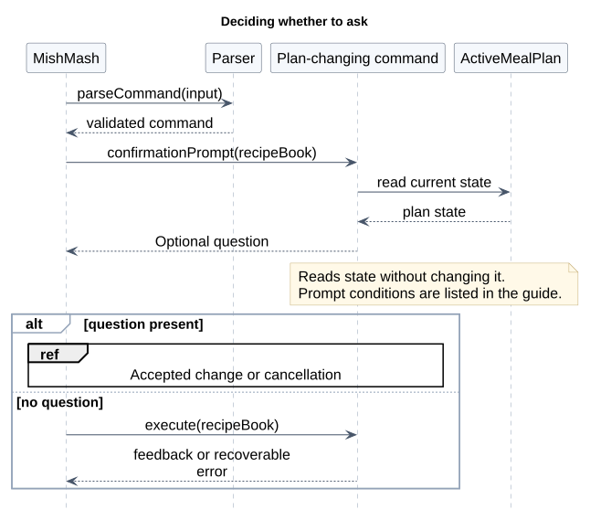

*Prompt lookup after syntax validation; the command-specific conditions are listed below.*

The parser validates syntax first. `MishMash.executeCommand` then requests a prompt before calling
`execute`. An empty `Optional` proceeds directly. Otherwise `userConfirms` reads one line: only `y`
or `yes`, ignoring case and surrounding spaces, permits execution. All other answers and EOF return
`Cancelled. Nothing was changed.` No command execution or state mutation happens on cancellation.
A command entered as an answer is consumed as that answer and must be entered again at the command prompt.

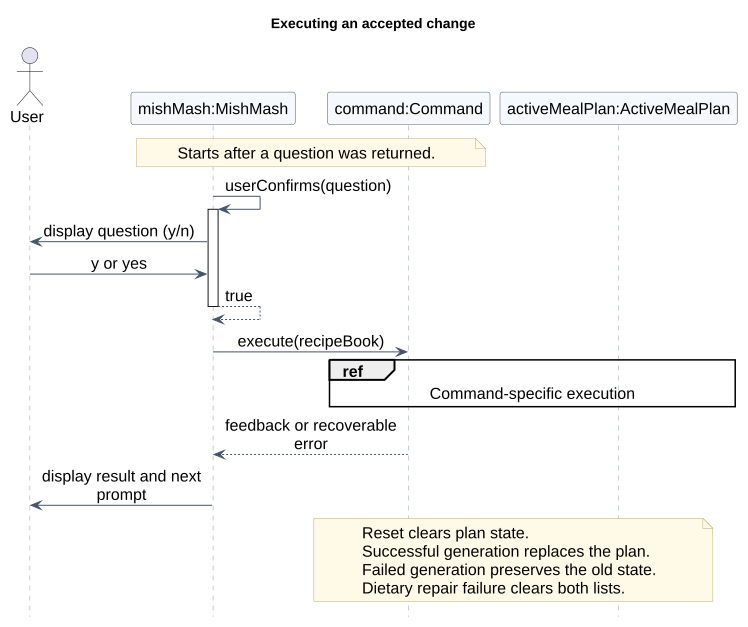

*An accepted answer permits command execution; its result may still be a recoverable error.*

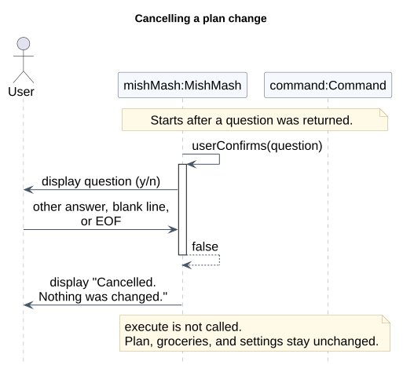

*Other answers and EOF skip execution and preserve the session state.*

| Command | Prompt decision, using current shared state |
| --- | --- |
| `ResetPlanCommand` | Ask if any plan, generation request, or grocery snapshot is present, including an empty snapshot. |
| `GeneratePlanCommand` | Ask if a plan exists; successful generation replaces it and clears groceries. |
| `SetDietCommand` | Ask if an existing plan is incompatible with the proposed preferences. |

Prompts never generate replacements or change settings. They read the holder when called, rather than
capturing state during parsing, so reused commands see the latest plan. A first generation, an empty
reset, and a compatible dietary change need no answer. Dietary confirmation mentions both repair and
clearing on failure because that command saves the new preferences even if repair cannot succeed.
Cancelling it preserves the previous preferences as well as the plan. Failed `generate-plan` execution
continues to preserve the old plan, original request, and grocery snapshot.

**Design choice:** Reusing the existing hook avoids passing scanners into commands or storing a
confirmation flag in the model. Commands remain independently testable. Direct callers of `execute`
must perform confirmation themselves if needed; execution deliberately contains no console I/O.
Generation feasibility is checked after agreement, so an impossible but syntactically valid request
can still ask a question. Pre-generating a candidate would avoid that question but add speculative work
and cached state to the prompt path. This single-threaded console has no concurrent command execution
between asking and executing.

**Testing:** `PlanConfirmationTest` covers accepted and rejected answers, EOF, state preservation,
invalid syntax, current-state lookup, orphaned reset state, and confirmed generation or dietary failures.
Existing console regression transcripts supply explicit answers at new prompts. Run Java 25 with
`./gradlew test check jacocoTestReport`; the HTML report is in `build/reports/jacoco/test/html/index.html`.
`check` requires 100% line and branch coverage for the three affected command classes. That threshold
is feature-specific and does not imply 100% coverage for the entire application.

**Manual verification:** With a plan and groceries present, cancel reset, replacement generation, and
an incompatible dietary change. Check `view-plan`, `view-list`, `view-diet`, `view-targets`, and
`view-meals` afterwards. Confirm reset and check both lists are absent. Generate again, confirm an
impossible replacement, and verify the plan and groceries survive the error. Try malformed syntax
and verify it reports an error without consuming the following command as an answer.
<!-- @@author -->

<!-- @@author Rixte -->
### Resetting a meal plan

#### Purpose and command contract

This enhancement implements #53: **As a returning user, I want to clear my current meal plan and its generated
grocery list while keeping my recipes, personal settings, and food intake records so that I can start planning
again without losing my other information.**

`reset-plan` accepts no arguments. A valid reset removes the active `MealPlan`, its `GeneratePlanRequest`
(including that plan's daily nutrition targets), and its optional grocery snapshot. It preserves the
`RecipeBook`, `DietarySettings`, `TargetSettings`, and `MealLog`. The targets attached to the removed
generation request are cleared; personal targets saved with `set-targets` remain available for later
generation. Repeating a reset on an empty holder returns a no-plan message.

#### Parsing, execution, and ownership

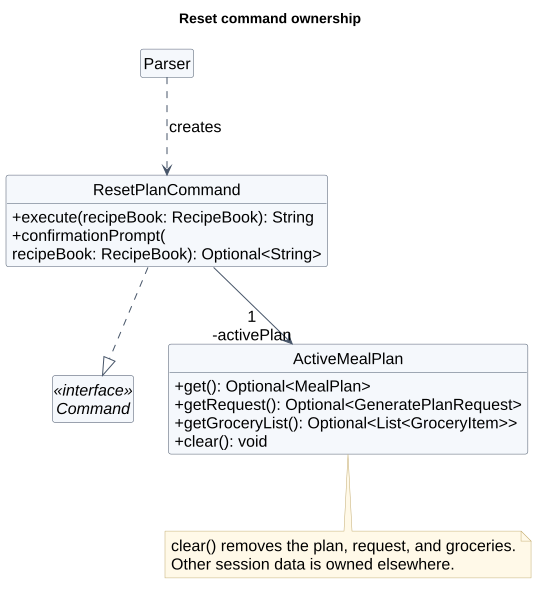

*Only reset dependencies are shown. Recipes, dietary settings, saved targets, and recorded meals
are owned elsewhere; their preservation is described below.*

`Parser.parseResetPlan` validates arguments before constructing `ResetPlanCommand`. Parsing only retains
the shared `ActiveMealPlan` reference; it does not clear state. Arguments produce a `MishMashException` with
reset-specific usage, allowing the user to retry at the next prompt without losing data.

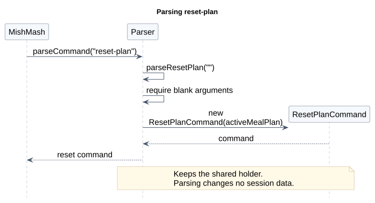

At execution, the command checks whether a plan or groceries were present, then calls the existing
`ActiveMealPlan.clear()`. That method clears the plan, original generation request, and groceries together.
The command verifies the clear postcondition before success is logged or reported. A failed clear or
remaining plan state produces a recoverable `MishMashException`, so the session can continue with its
recipes, dietary settings, and recorded meals. This check runs whether Java assertions are enabled or
disabled. The original cause is retained for diagnostics when clearing throws a runtime exception.
`FINE` logging records only whether plan and grocery state were present, without recipe names or contents.

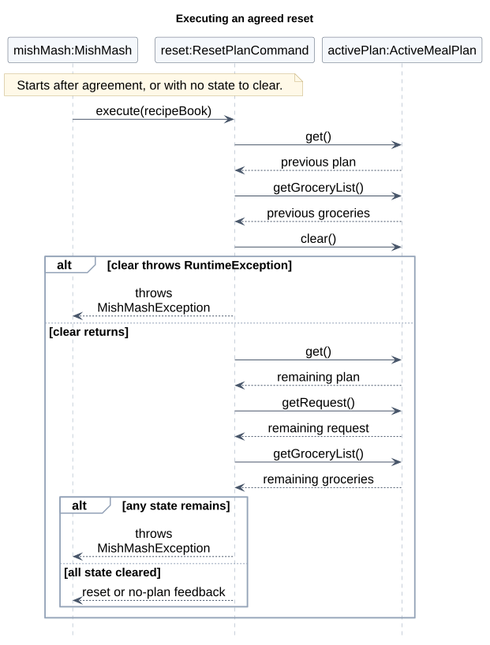

The command only holds the active-plan object. It does not receive dietary settings, saved targets, or the
meal log, and does not read or mutate the recipe-book parameter inherited from `Command.execute`. This limited access
makes preserving unrelated session data straightforward. Existing immutable snapshots held by callers
remain valid after the active holder is cleared.

#### Design choices and boundaries

Reusing `ActiveMealPlan.clear()` avoids duplicating state-clearing logic already used by dietary repair.
Creating a replacement `ActiveMealPlan` instead would break references held by the parser and commands.
Clearing individual fields from the command would expose model internals and risk retaining stale targets
or groceries. Clearing the recipe book or reconstructing the parser would remove unrelated session data.

The command reads state when it executes, so a command parsed before generation also clears a subsequently
generated plan. Legacy plans without a retained generation request and present-but-empty grocery snapshots
are supported. A grocery snapshot remaining without a plan is also removed. No new plan or groceries are
created during reset.

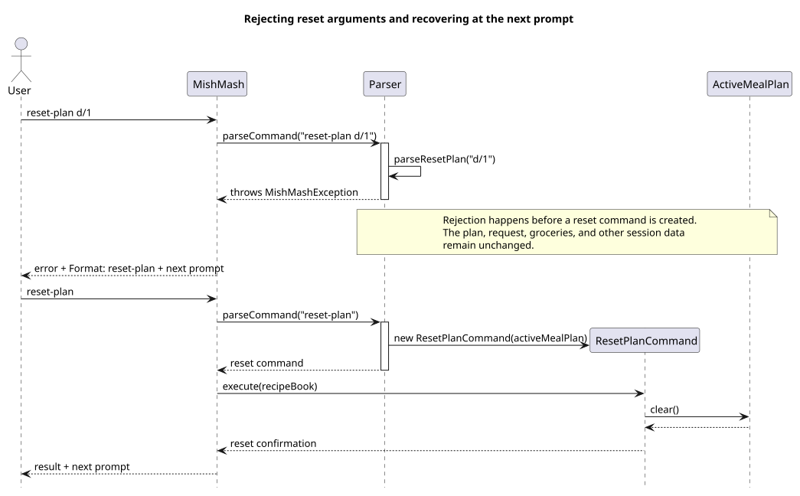

*The retry follows normal parsing and then confirmation when state exists; it does not bypass
the confirmation workflow.*

Reset confirmation is implemented by `ResetPlanCommand.confirmationPrompt`. See
[Confirming plan changes](#confirming-plan-changes) for the shared interaction and replacement paths.

#### Tests and manual verification

`ResetPlanCommandTest` covers plan/request/grocery clearing, repeated resets, legacy and empty plans,
current-state lookup, null dependencies, and recoverable failures. `ResetPlanDiagnosticsTest` captures state
summaries with temporary logging settings and checks failure and retry diagnostics. `ParserResetPlanTest`
covers whitespace, rejected arguments, case sensitivity, deferred execution, and help.
`ResetPlanIntegrationTest` verifies preservation of recipes, dietary restrictions, recorded meals, and old
immutable snapshots, followed by regeneration. It also distinguishes preserved personal targets from
the removed plan's targets and checks generation using saved targets after reset.
`MishMashResetPlanTest` exercises supplied application
sessions, ordered recovery after invalid input or failed reset, and end-of-input behaviour. Failed-reset
cases include an exception with a null message and verify retained data before retrying successfully.
The expanded cases cover one-to-seven-day plans, maximum targets, duplicate
recipe entries, repeated reset cycles, resets after failed generation, and isolation between parser sessions.

For manual verification, add three suitable recipes, record a meal, set compatible dietary preferences,
generate a targeted two-day plan, and generate groceries. Run `reset-plan`, then check `view-plan`,
`view-list`, and `check-shortfall`: each should report missing generated data. Verify `list-recipes`,
`view-diet`, and `view-meals` are unchanged. Generate a new one-day plan and groceries, then verify they
use the retained recipes and dietary settings. Try `reset-plan extra` before a valid reset; rejection
must preserve the existing plan and groceries. Repeat a valid reset and verify the no-plan message.
<!-- @@author -->

<!-- @@author Rixte -->
### Editing a recipe

#### Purpose and command contract

This feature implements the story: **As a returning user, I want to update an existing recipe's ingredients, quantities, and nutrition values so that my recipe information reflects how I prepare the dish.**

`edit-recipe INDEX` takes at least one optional recipe field: `n/`, `cal/`, `p/`, `c/`, `f/`, repeated `i/`, or `food/`. Nutrition and ingredient syntax use the same validation as `add-recipe`. Omitted fields are preserved, and supplied ingredients replace the complete list. For example, `edit-recipe 1 p/55 i/Chicken:220g i/Rice:150g` replaces protein and ingredients, preserving the name, calories, carbs, fats, and food declaration.

The index is one-based, matching `list-recipes` and `delete-recipe`. Duplicate names do not affect selection. Editing neither inserts nor removes entries. No persistent storage or undo history is introduced.

#### Class responsibilities and relationships

The class diagram shows how parsing, edit data, execution, storage, and formatting fit together.
`Parser` creates `RecipeChanges` and `EditRecipeCommand`. The command retains the requested changes
and a displayed index; the recipe book is supplied only when `execute` runs.

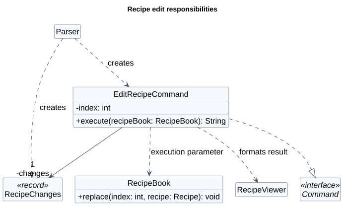

*Only feature-relevant members are shown. Solid arrows identify stored references; dashed arrows
show dependencies or interface realization. The book is an execution parameter rather than a stored command field.
Its ordered list permits repeated references; existing plans can retain the same recipe objects.*

`RecipeChanges` is an immutable record containing only the requested changes. Nullable scalar fields mean unchanged; an empty ingredient list means unchanged. Its constructor rejects an empty edit, blank names, negative nutrition, and invalid ingredient quantities, and defensively copies ingredients. Nullable nutrition distinguishes an omitted value from a requested zero.

#### Successful command parsing

`Parser.parseEditRecipe` splits the index from the prefixed fields. It reuses `collectRecipeArguments`, `parseNutrition`, and `parseIngredient` rather than duplicating recipe syntax rules. Single-value prefixes cannot repeat; ingredients may repeat. Unknown prefixes, blank values, invalid numbers, zero ingredient quantities, and malformed indexes fail before a command is created. Parsing wraps validation errors in `MishMashException` with edit-specific usage and the original cause.

The parsing sequence uses `edit-recipe 2 p/55 i/Chicken:220g i/Rice:150g`. Ingredient fields
become a local replacement list, protein becomes 55, and omitted scalar fields remain null.
Only after validation succeeds are the immutable changes and command constructed. The parser
does not look up recipe 2; the recipe book may change before the command executes.

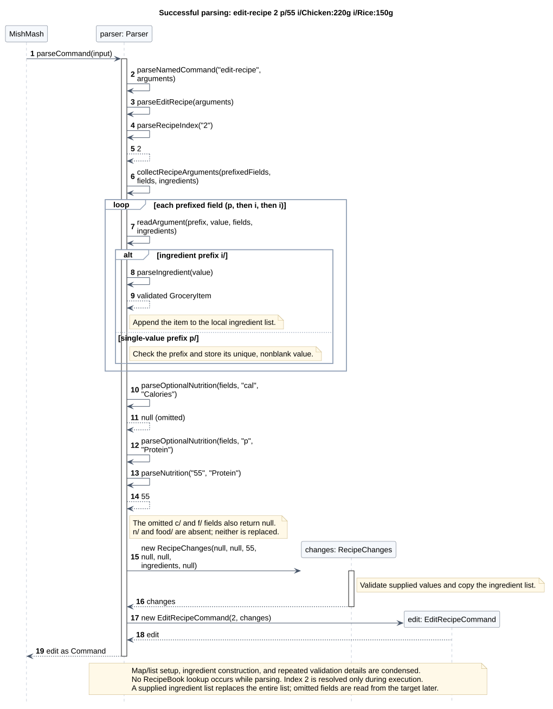

*Map/list creation, ingredient construction, dispatch, and repeated validation calls are condensed.
The reference frame summarizes validation through the shared argument and ingredient helpers.
The diagram shows nutrition parsing separately from collecting the prefixed values. Omitted food information
is preserved later; it is not inferred or reset during parsing.*

#### Execution and replacement

`EditRecipeCommand` retains the displayed index and changes. It resolves the recipe from the book during execution, so omitted fields come from the current recipe rather than a stale parsing-time copy. It checks the book and index before calling `RecipeChanges.applyTo(original)`. That method builds a new `Recipe` through its existing constructor. The command formats confirmation with `RecipeViewer` before calling `RecipeBook.replace(index - 1, edited)`, so validation or formatting failure cannot leave a partially applied edit. `replace` validates both index and replacement before updating one list element.

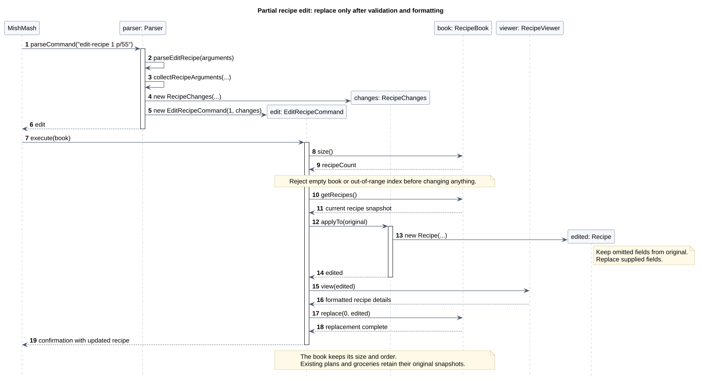

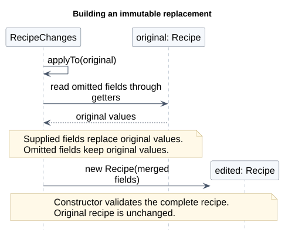

*Execution is split between command coordination and replacement construction. The replacement
view expands `RecipeChanges.applyTo(original)` for an edit such as index 1 and `p/55`. Most getter calls, repeated
size checks, logging, and formatting details are condensed. Empty books and out-of-range indexes
raise `MishMashException` before replacement. The current index is resolved at execution time,
including any renumbering caused by earlier deletions.*

#### Invalid input and recovery

For `edit-recipe 1 n/Changed p/-5`, collecting the local fields succeeds, but `parseNutrition`
rejects the negative protein value. `parseEditRecipe` wraps the `IllegalArgumentException` in
`MishMashException`, retaining its cause and attaching edit-specific usage. `MishMash` displays
the error and then prompts for another command.

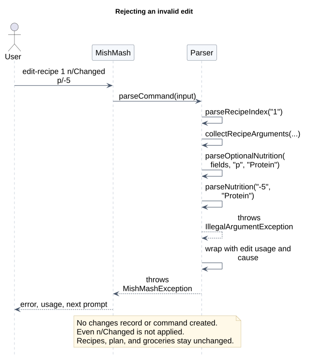

*Dispatch and the omitted calorie field are condensed. No changes record, command, or replacement
recipe is created for this input, so even the otherwise valid `n/Changed` field is never applied.
The recipe book, active meals, and groceries remain unchanged. A later valid command follows
the normal parsing and execution paths.*

#### Snapshots and dietary information

`Recipe` objects remain immutable. Replacing the book entry preserves references already held by `DayPlan`, earlier recipe-book snapshots, and the original recipe itself. The command does not access `ActiveMealPlan`; active meals, original generation settings, nutrition totals, and generated groceries therefore remain consistent. Even regenerating groceries from an existing plan uses that plan's old recipes. Users must generate a new plan and then groceries to incorporate edits; confirmation explains this.

Future generation reads the edited book entry, including its food tags and ingredients for dietary filtering. Omitted `food/` preserves its previous declaration. Ingredient edits do not infer food categories; users provide a complete updated declaration when needed. Existing plans do not undergo dietary repair as a side effect of recipe editing.

#### Design choices and alternatives

Replacing an immutable recipe keeps editing local to the recipe book and avoids silently changing previously planned meals or invalidating a saved grocery list. Mutating recipes in place would require coordinating nutrition, dietary compatibility, and grocery regeneration throughout active plans. Automatic plan repair could be added separately if its behavior is specified.

Complete ingredient-list replacement provides addition, quantity changes, and removal without inventing ingredient identifiers or separate subcommands. Requiring every recipe field would be simpler but would make small corrections tedious. The changes record keeps optional edits separate from the complete, validated `Recipe` model.

#### Verification and maintenance

`ParserEditRecipeTest` checks single-field edits, all-field edits in a different order, ingredient replacement, food declarations, whitespace, nutrition boundaries, help, and invalid input. `EditRecipeCommandTest` covers duplicate names, first/middle/last positions, missing targets, execution-time lookup, dietary filtering, and snapshot preservation through plan and grocery regeneration. `RecipeChangesTest` checks defensive copying and model validation. `RecipeBookTest` checks replacement failure and snapshot behavior. `MishMashTest` checks CLI recovery and subsequent detailed listing.

For manual verification, run the User Guide's [editing example](UserGuide.md#editing-a-recipe), inspect `list-recipes 1`, and try `edit-recipe 1 p/-5`. The failed command must preserve the last valid recipe. With three recipes, generate meals and groceries, edit one recipe, and verify that viewing still shows the original plan. Generate the plan and groceries again to see the edited recipe.

The class diagram and three sequence diagrams have editable sources and rendering instructions in
[`docs/diagrams/edit-recipe`](diagrams/edit-recipe/README.md). When updating the implementation,
check method names, object creation, message order, exception paths, and relationship multiplicities
against the code, then regenerate and visually inspect all four SVGs.
<!-- @@author -->

<!-- @@author peilingggg -->
### Adding a recipe

#### Purpose and implemented scope

This feature supports the following user story: **As a first-time user, I want to add a recipe with its ingredients and quantities so that I can create a personalised meal.**

The command accepts all five recipe fields and at least one ingredient:

```text
add-recipe n/DISHNAME cal/CALORIES p/PROTEIN c/CARBS f/FATS i/INGREDIENT:QUANTITYUNIT [i/INGREDIENT:QUANTITYUNIT ...]
```

For example, `add-recipe n/Rice cal/200 p/4 c/45 f/1 i/Rice:150g` adds one
recipe. Calories use kcal; protein, carbohydrates, and fats use grams.
Single-value fields may appear in any order, but each must appear exactly once.
Each ingredient uses a separate `i/` field. Recipes are stored in memory for the
current session; adding a recipe does not regenerate an existing plan or grocery list.

#### Architecture-level view

Figure 1 places the feature within the existing command workflow. `MishMash`
reads input and asks `Parser` for a `Command`. Parsing validates the request and
constructs the recipe; execution adds that recipe to the session's `RecipeBook`.
`RecipeViewer` formats the successful addition for display.

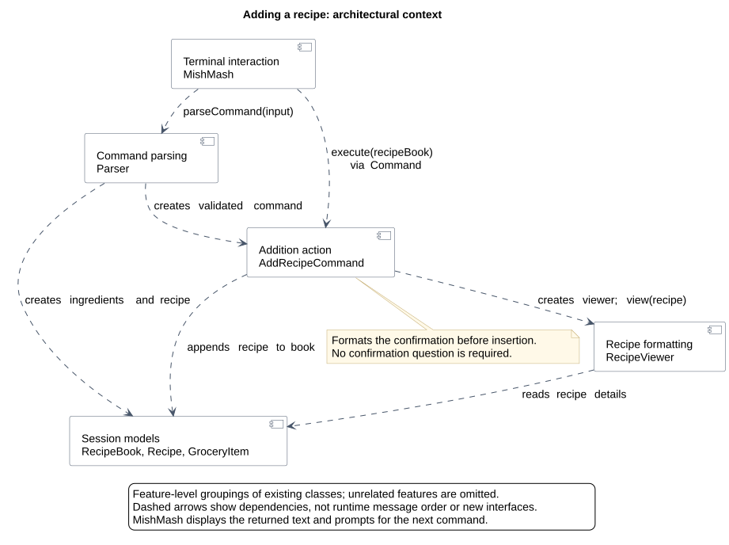

*Figure 1: Dependencies between existing responsibilities. The boxes group the
named implementation classes; arrows do not represent runtime message order.*

The parser does not receive or modify the recipe book when parsing this command.
`MishMash` supplies the book later through `Command.execute(recipeBook)`.

#### Class-level responsibilities and relationships

Figure 2 shows the selected classes used for recipe addition.

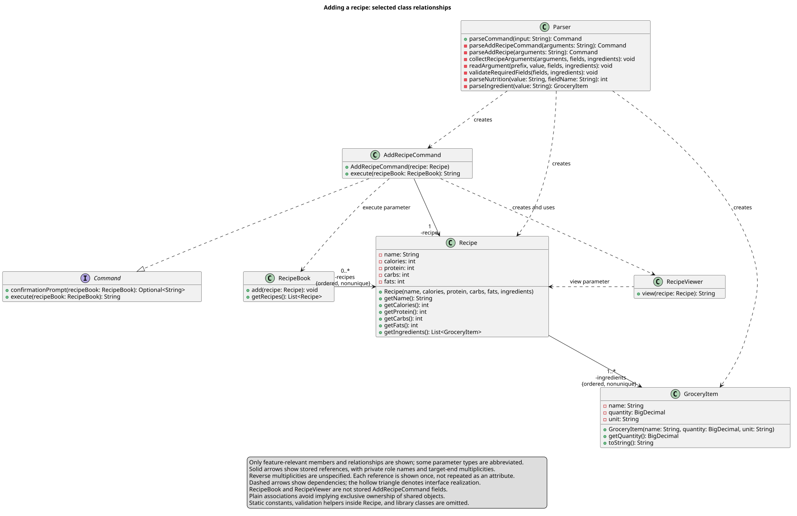

*Figure 2: Only relevant members and relationships are shown; some parameter
types are abbreviated. Solid arrows show stored references with private role
names and target-end multiplicities. Dashed arrows show dependencies or interface
realization. Reverse multiplicities are unspecified.*

`Parser` collects single-value fields in a local map and ingredients in a local
list. `AddRecipeCommand` implements `Command` and retains one validated `Recipe`.
The recipe book is an execution parameter, and the viewer is created locally;
neither is stored in the command.

`Recipe` holds the name, four integer nutrition values, and an ordered,
non-empty list of `GroceryItem` references. It validates its constructor arguments
and uses `List.copyOf` to protect its ingredient list from external changes.
`GroceryItem` represents an ingredient's name, `BigDecimal` quantity, and unit;
there is no separate `Ingredient` class.

Plain associations are used because these objects can be shared. A recipe can
also appear in a meal plan, and copying an ingredient list does not copy its
items. The list ends are ordered and nonunique: duplicate recipe names and
repeated ingredients are allowed. Stored references are shown as association
ends rather than duplicated as attributes.

#### Successful command parsing

Figure 3 follows the example command through validation and object creation.
Dispatch through `parseNamedCommand` and `parseAddRecipeCommand` is condensed.

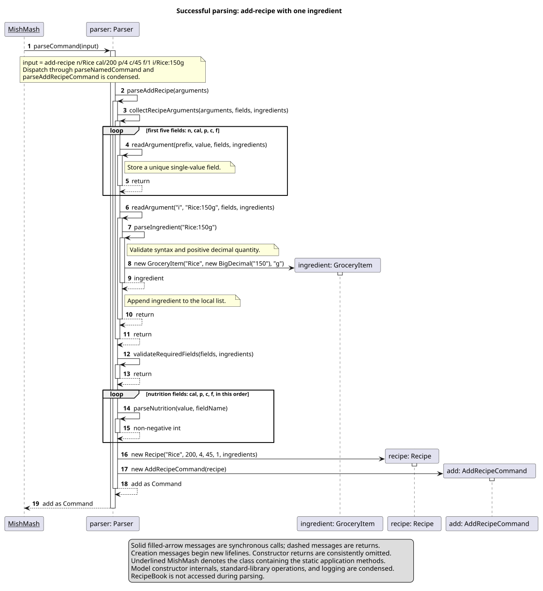

*Figure 3: Dashed arrows represent returns, and constructor messages begin new
lifelines. Constructor internals, library operations, and logging are condensed.
The underlined `MishMash` participant represents the class containing the static
application methods.*

`parseAddRecipe` creates the local collections and calls
`collectRecipeArguments`. The prefix matcher identifies field boundaries,
including unknown prefixes, so an unsupported field cannot silently become part
of a dish name. `readArgument` rejects blank values, embedded slashes, unknown
prefixes, and repeated single-value fields. Repeated `i/` fields are parsed by
`parseIngredient` and appended in input order.

`validateRequiredFields` checks for `n/`, `cal/`, `p/`, `c/`, `f/`, and at least
one ingredient. `parseNutrition` then converts the four nutrition values in the
order calories, protein, carbohydrates, and fats. Each must contain ASCII digits
and fit within a non-negative Java `int`.

Only after these checks succeed does the parser construct `Recipe` and
`AddRecipeCommand`. The `Recipe` constructor independently checks the model's
constraints, protecting callers that bypass command parsing. Parsing returns a
command without changing application data, even if some local ingredient
objects were created before a later validation failure.

#### Execution and confirmation output

Figure 4 starts after parsing. The inherited `confirmationPrompt` method returns
an empty `Optional`, so the addition proceeds without a confirmation question.

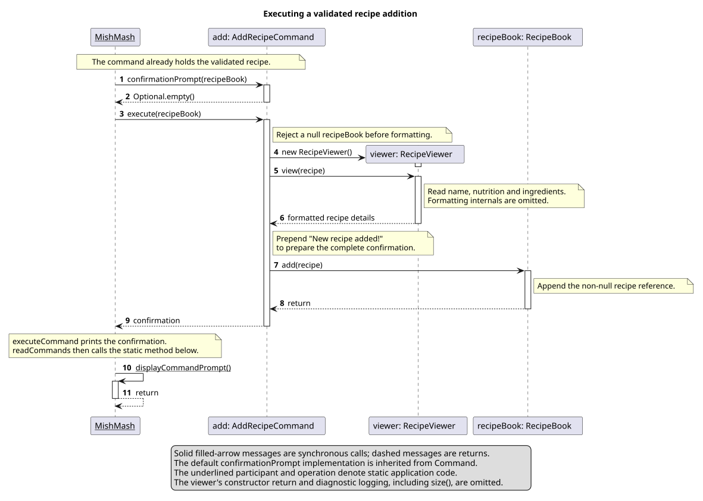

*Figure 4: Formatting is treated as a black box. Diagnostic logging, including
the recipe-count read, is omitted. The next command prompt belongs to the
application's read loop.*

`AddRecipeCommand.execute` rejects a null recipe book, then creates a
`RecipeViewer` and prepares the complete confirmation before calling
`RecipeBook.add(recipe)`. This ordering prevents a formatting failure from
leaving an addition whose confirmation could not be prepared. `RecipeBook.add`
rejects null and appends the recipe reference without replacing existing entries.

The command returns:

```text
New recipe added!
Rice
200 kcal | Protein: 4g | Carbs: 45g | Fats: 1g
Ingredients:
- Rice: 150g
```

`MishMash` prints this result and displays the next command prompt. Ingredient
quantities use plain decimal notation without unnecessary trailing zeros.
Repeated ingredients remain separate entries; consolidation belongs to grocery
generation. The parser and addition command record counts at `FINE` level
without including the full recipe contents in their success messages.

#### Invalid input and recovery

Figure 5 shows the example with `i/Rice:0g`. `parseIngredient` rejects the
non-positive quantity before constructing a `GroceryItem`.

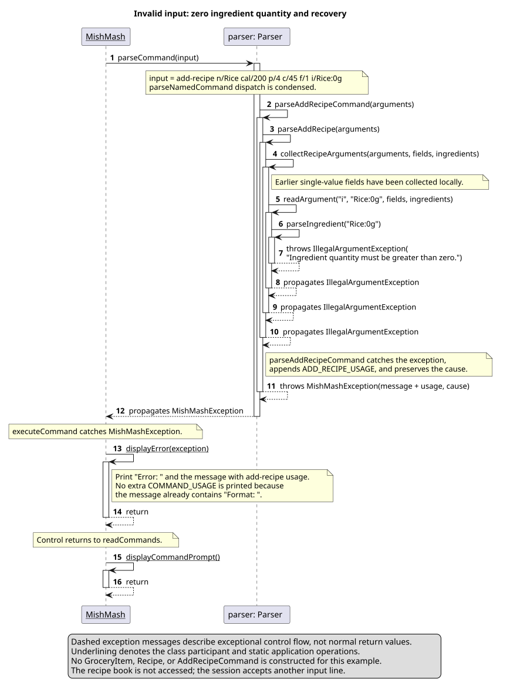

*Figure 5: Dashed messages labelled as exceptions show exceptional control
flow. No recipe or addition command is constructed for this request, and the
recipe book is not accessed.*

`parseAddRecipeCommand` catches `IllegalArgumentException`, appends
`ADD_RECIPE_USAGE`, and wraps it in `MishMashException` while preserving the
cause. `MishMash.executeCommand` catches this recoverable exception and calls
`displayError`. Because the message already contains `Format: `, general command
usage is not printed again. The read loop then prompts for another command.

| Boundary or invalid condition | Implemented behavior |
| --- | --- |
| Missing arguments, unprefixed leading text, missing required field, or no ingredient | Reject with an error and the add-recipe format. |
| Blank value, unknown prefix, repeated `n/`, `cal/`, `p/`, `c/`, or `f/` | Reject; repeated `i/` fields are allowed. |
| Nutrition value from 0 to `Integer.MAX_VALUE` | Accept; leading zeros are allowed. |
| Signed, negative, decimal, non-numeric, unit-suffixed, or overflowing nutrition value | Reject. |
| Positive integer or decimal ingredient quantity | Accept using `BigDecimal`, preserving decimal precision. |
| Zero or negative quantity, missing unit, malformed decimal, or extra colon | Reject. Quantities require digits before the decimal point and, when present, after it. |
| Ingredient unit containing ASCII letters only | Accept without converting units or checking a fixed unit vocabulary. |
| Spaces within names or around ingredient separators | Accept and trim surrounding name whitespace. Names and field values cannot contain `/`. |
| Duplicate recipe name or repeated ingredient | Accept and preserve insertion order. |
| Null recipe, book, or required model argument supplied by Java code | Reject with `NullPointerException`; this is a programming contract violation, not normal CLI input recovery. |

An invalid command leaves existing recipes unchanged. Nutrition values of zero
are valid, but ingredient quantities must be strictly positive. Although
`GroceryItem` itself permits zero, the parser and `Recipe` apply the stricter
recipe constraint.

#### Rationale and alternatives

| Decision | Alternative | Reason for the current design |
| --- | --- | --- |
| Validate before executing the addition | Insert a partially populated recipe and validate afterwards | Invalid input cannot leave an incomplete recipe in the book. |
| Keep input validation and model validation | Rely only on the parser | The parser enforces command syntax; the model also protects direct Java callers. |
| Use `BigDecimal` for ingredient quantities | Use floating-point values | Decimal quantities retain their precision and match the existing grocery model. |
| Reuse `RecipeViewer` | Build the same output separately in each command | Addition confirmations and detailed recipe listings use consistent formatting. |
| Allow repeated names and ingredients | Reject duplicates or merge automatically | The current book identifies recipes by position; ingredient consolidation is handled during grocery generation. |

#### Verification and diagram maintenance

`AddRecipeBoundaryTest` covers nutrition limits, leading zeros, decimal
precision, units, whitespace, field ordering, and repeated ingredients.
`AddRecipeEdgeCaseTest` uses `add-recipe-invalid.tsv` to check invalid input,
unchanged existing data, and a successful addition after rejection.
`AddRecipeExceptionTest` checks usage messages and preserved exception causes.
`AddRecipeCommandTest`, `RecipeTest`, and `RecipeBookTest` cover insertion,
output, constructor constraints, null arguments, and protection against external
list changes. `MishMashTest` covers console output and continued interaction.

Run the full verification tasks from the repository root using Java 25:

```powershell
.\gradlew.bat test checkstyleMain checkstyleTest
```

Editable diagram sources are under
[`docs/diagrams/add-recipe`](diagrams/add-recipe/README.md). Generate their SVGs
under `docs/images/add-recipe` and commit both sources and images so the guide
displays without a PlantUML plugin. After implementation changes, check the
depicted references, multiplicities, constructors, method order, and failure
paths against the code. Keep the abstraction notes when omitting implementation
details, and visually inspect regenerated diagrams.
<!-- @@author -->

<!-- @@author neil0618 -->
### Listing recipes

#### Purpose and command contract

This feature implements the story: **As a user managing recipes, I want to list my recipes and inspect a selected recipe so that I can find and check its stored details.**

`list-recipes [INDEX]` has two forms. Without an index it shows every recipe as a numbered line with its name and calories. With an index it shows that one recipe in full: nutrition, ingredients, and food tags. The index is one-based and equals the number shown in the list, which is also the number that `edit-recipe` and `delete-recipe` expect. For example, `list-recipes 2` shows the second recipe. Listing is read-only: it never changes the recipe book, the active plan, or the grocery list.

#### Class responsibilities and relationships

`Parser` validates the optional index and creates a `ListRecipeCommand`. The command keeps only a nullable `Integer index`, where `null` means "list every recipe". The recipe book is supplied only when `execute` runs, so the command reads the recipes as they are at that moment rather than a copy taken during parsing. Recipe details are formatted by `RecipeViewer`, the class that also formats the `add-recipe` and `edit-recipe` confirmations, so a recipe looks the same wherever it is shown.

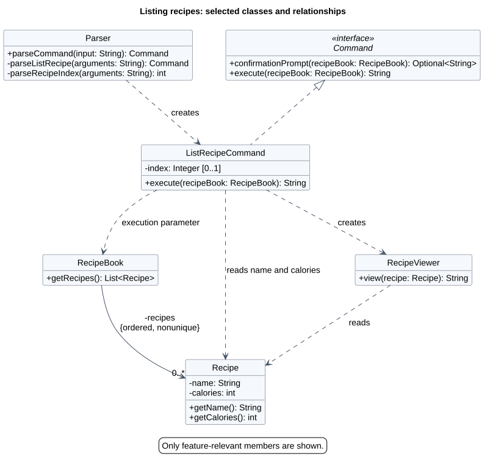

*Only feature-relevant members are shown. Dashed arrows show dependencies or interface realization; the solid arrow shows the book's stored, ordered list. `RecipeBook.getRecipes` returns a read-only copy, so listing cannot change the book.*

#### Parsing and execution

Parsing and execution are drawn together for `list-recipes 2`: the command is small, and both halves end in the same error path.

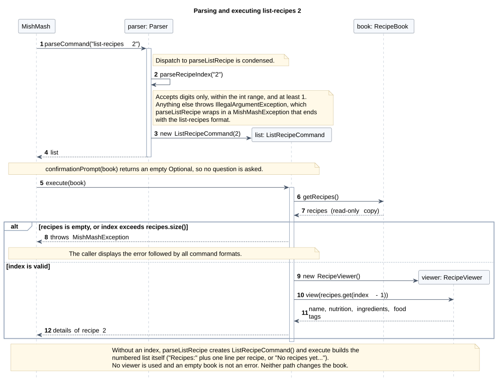

*Dispatch from `parseCommand` to `parseListRecipe` is condensed. The note at the bottom describes the no-index form, which skips index parsing and the viewer.*

`Parser.parseListRecipe` treats blank arguments as the list-all form. Otherwise it calls `parseRecipeIndex`, the helper that `delete-recipe` also uses. The helper accepts digits only and rejects zero and values above `Integer.MAX_VALUE`. Leading zeros and surrounding spaces are accepted, so `list-recipes 01` selects recipe 1.

The parser does not receive the recipe book, so whether the index exists is decided at execution. `execute` reads the book, then either returns the details of `recipes.get(index - 1)` or throws a `MishMashException`. The list-all form returns `Recipes:` followed by one `N. name (calories kcal)` line per recipe, or `No recipes yet. Use 'add-recipe' to add one.` for an empty book. An empty book is therefore an error only when an index was requested.

#### Invalid input and recovery

| Input or state | Where it is caught | Result |
| --- | --- | --- |
| Index that is not digits only (`abc`, `-1`, `1.5`, `1 2`), is `0`, or exceeds `Integer.MAX_VALUE` | `Parser.parseRecipeIndex` | Error ending with `Format: list-recipes [INDEX]`. |
| Valid index, empty book | `ListRecipeCommand.execute` | Error telling the user to add a recipe. |
| Valid index above the recipe count | `ListRecipeCommand.execute` | Error stating the valid range. |
| No index, empty book | `ListRecipeCommand.execute` | Normal message, not an error. |
| Command word with a different case or spelling (`List-Recipes`, `list-recipe`) | `Parser.parseNamedCommand` | `Unknown command` error. |

Syntax errors start as an `IllegalArgumentException`. `parseListRecipe` wraps it in a `MishMashException` that keeps the original cause and ends with the list-recipes usage, so `MishMash.displayError` does not print the general command list. The two execution-time errors carry no `Format:` line, so `displayError` adds the format of every command. In every case the session continues and the recipe book is unchanged.

#### Design choices and alternatives

| Decision | Alternative | Reason for the current design |
| --- | --- | --- |
| One command with an optional index | A separate `show-recipe INDEX` command | There is one command word to learn, and the numbered list shows exactly the numbers that `edit-recipe` and `delete-recipe` need. |
| Look the recipe up when the command executes | Look it up while parsing | The parser stays independent of application data, as for the other recipe commands, and the lookup sees the book as it is when the command runs. |
| A nullable `index` means "list all" | Two command classes, or an `Optional<Integer>` field | It is the simplest option that is sufficient, and both forms share the book access. Two classes would be worth it if the forms diverged. |
| The list shows only names and calories | Show all nutrition for every recipe | A compact list stays readable for a long book, and full details are one command away. |
| Reuse `RecipeViewer` for the details | Format the text inside the command | A recipe is displayed identically after `add-recipe`, `edit-recipe`, and `list-recipes`. |

#### Verification and maintenance

`ListRecipeCommandTest` checks the numbered list, empty and duplicate-name books, the full details of the first, last, and a duplicate-named recipe, out-of-range and empty-book errors with the book left unchanged, repeated calls, and null arguments. `ParserTest` checks both forms, accepted variations such as leading zeros and extra whitespace, invalid arguments showing only the list-recipes usage, the largest index (which parses and fails only at execution), and near-miss command words. `MishMashTest` checks the console flow: the list followed by one recipe in full, an empty book, a bad index followed by recovery, and the numbers matching those used by `delete-recipe`.

For manual verification, follow [List Recipes](#list-recipes) in the manual-testing appendix, or the User Guide's [Listing Recipes](UserGuide.md#listing-recipes) example. The class diagram and sequence diagram have editable sources and rendering instructions in [`docs/diagrams/list-recipes`](diagrams/list-recipes/README.md). When the implementation changes, check method names, message order, and the error paths against the code, then regenerate and inspect both SVGs.
<!-- @@author -->

<!-- @@author neil0618 -->
### Deleting a recipe

#### Purpose and command contract

This feature implements the story: **As a user managing recipes, I want to confirm the deletion of a selected recipe so that I can check that I am removing the intended entry.**

`delete-recipe INDEX` removes the recipe at the displayed, one-based position. Deletion cannot be undone, so the application first names the recipe and asks `(y/n)`. Only `y` or `yes`, ignoring letter case and surrounding whitespace, deletes the recipe. Any other answer, including a blank line or the end of input, cancels. For example, `delete-recipe 2` followed by `y` removes the second recipe, and every later recipe moves up one position.

The command changes only the `RecipeBook`. It does not use `ActiveMealPlan`, so an existing meal plan and its grocery list keep the recipes they were generated with. No undo is provided.

#### Where the confirmation lives

`Command` declares `confirmationPrompt(RecipeBook)`, a default method that returns an empty `Optional`. A command that needs confirmation overrides it and returns its question. `MishMash.executeCommand` calls it for every command. If it returns a question, `userConfirms` displays it and reads the next input line, and `execute` runs only if the answer agrees.

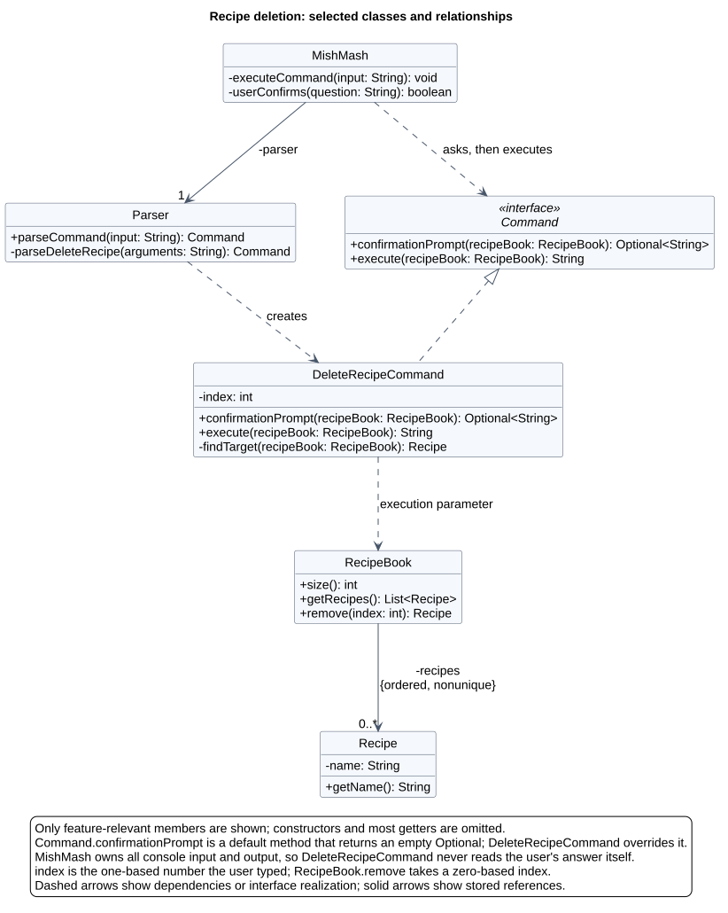

*Only feature-relevant members are shown. Dashed arrows show dependencies or interface realization; the solid arrow shows the book's stored, ordered list. `RecipeBook.remove` takes a zero-based index, while `DeleteRecipeCommand` stores the one-based number the user typed.*

This keeps all console input and output in `MishMash`. `DeleteRecipeCommand` only builds the question and performs the deletion, so tests can call both methods directly without a `Scanner`. The question contains the index as well as the name, so recipes with the same name can still be told apart.

#### Execution and confirmation

The sequence below starts after parsing, for `delete-recipe 2`.

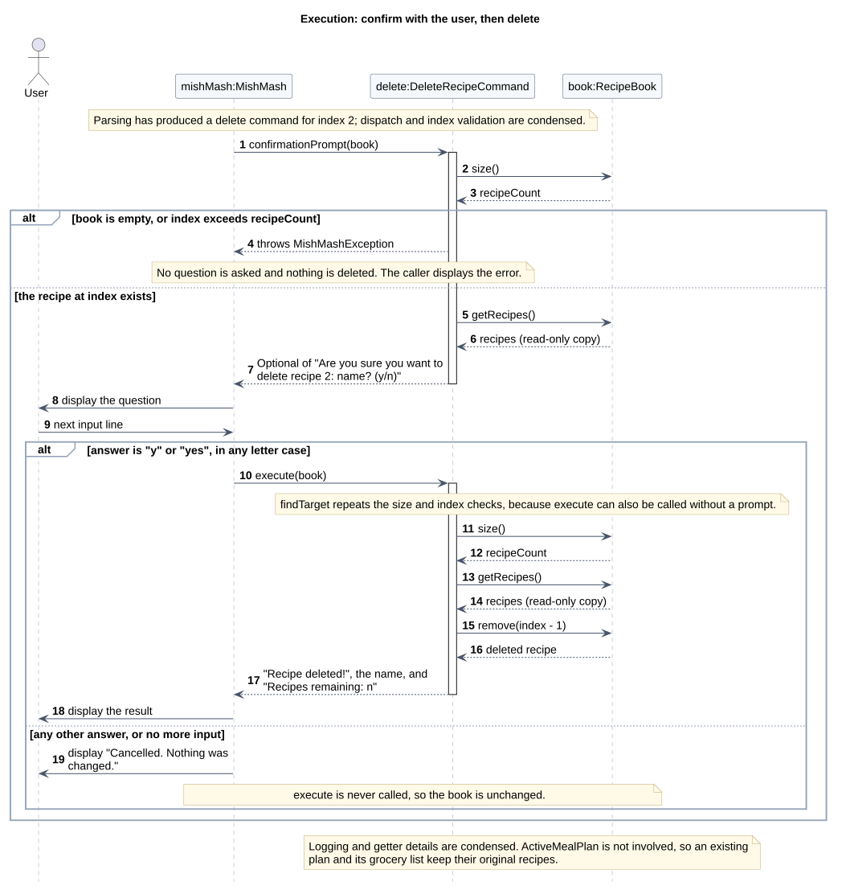

*Dispatch, index validation, and logging are condensed. The inner `alt` shows the two possible answers; the outer one shows an index that cannot be deleted.*

`confirmationPrompt` finds the target through `findTarget`, which throws if the book is empty or the index is too large. An impossible request therefore fails before any question is asked. `execute` calls `findTarget` again instead of trusting an earlier prompt, so it is also safe when called on its own. It then calls `RecipeBook.remove(index - 1)` and returns `Recipe deleted!`, the recipe's name, and `Recipes remaining: N`. `RecipeBook.remove` checks the index itself with `Objects.checkIndex`.

#### Outcomes and invalid input

The activity diagram shows which step decides each outcome.

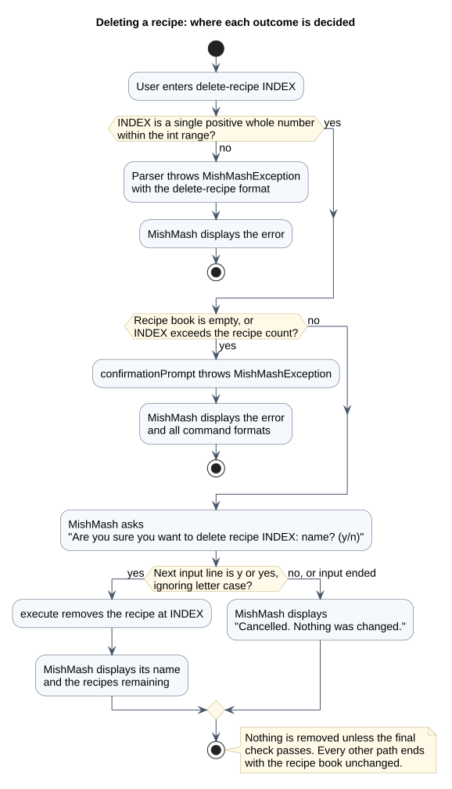

*Both error paths end before the question is asked. Only the confirmed path changes the recipe book.*

| Input or state | Where it is decided | Result |
| --- | --- | --- |
| Missing, non-numeric, zero, or oversized index | `Parser.parseRecipeIndex` | Error ending with `Format: delete-recipe INDEX`; no question. |
| Empty book, or index above the recipe count | `DeleteRecipeCommand.confirmationPrompt` | Error without a `Format:` line, so every command's format follows; no question. |
| Valid index, answered `y` or `yes` | `MishMash.userConfirms`, then `execute` | Recipe removed and confirmation shown. |
| Valid index, any other answer or end of input | `MishMash.userConfirms` | `Cancelled. Nothing was changed.` |

Syntax errors start as an `IllegalArgumentException`, which `parseDeleteRecipe` wraps in a `MishMashException` that keeps the cause and ends with the delete-recipe usage. After any error or cancellation the session continues with the next command.

#### Design choices and alternatives

| Decision | Alternative | Reason for the current design |
| --- | --- | --- |
| Ask through a default `confirmationPrompt` method on `Command` | Let the delete command read the `Scanner` itself, or pass a context object to `execute` | Commands stay free of console input and output and are easy to test, and every other command is unchanged because of the default. A context object would be worth it if many commands needed shared state. |
| Check the index in `confirmationPrompt`, before asking | Ask first and report the error afterwards | The user is never asked to confirm something that cannot happen. |
| `execute` repeats the checks | Assume the prompt already ran | `execute` is public and must be safe on its own, and the check is only two comparisons. |
| Anything except `y` or `yes` cancels | Ask again until the answer is `y` or `n`, or default to yes | A destructive action must never run by accident, including when input ends. |
| Identify the recipe by position and name it in the question | Delete by name | Recipe names may repeat, so the position is the only unambiguous identifier, and naming the recipe lets the user catch a wrong number. |
| Leave existing plans and groceries unchanged | Remove the recipe from plans or clear them | Plans are snapshots, as for `edit-recipe`, so deleting never silently changes a plan the user is relying on. Automatic repair could be added if it were specified. |

#### Verification and maintenance

`DeleteRecipeCommandTest` checks the confirmation text and removal, the first and last positions, repeated deletion at one index, duplicate names, emptying the book, out-of-range and empty-book errors with the book left unchanged, prompts that never modify the book, and null arguments. `ParserTest` checks a valid index, the question naming the recipe, leading zeros and extra whitespace, invalid arguments showing only the delete-recipe usage, and near-miss command words. `MishMashTest` checks the console flow: a confirmed transcript, a cancellation, end of input cancelling instead of deleting, a missing recipe never producing a question, and a later `edit-recipe` using the renumbered index.

For manual verification, follow [Delete a Recipe](#delete-a-recipe) in the manual-testing appendix, or the User Guide's [Deleting a Recipe](UserGuide.md#deleting-a-recipe) example. The class diagram, sequence diagram, and activity diagram have editable sources and rendering instructions in [`docs/diagrams/delete-recipe`](diagrams/delete-recipe/README.md). When the implementation changes, check method names, message order, and the decision branches against the code, then regenerate and inspect all three SVGs.
<!-- @@author -->

<!-- @@author neil0618 -->
### Setting and viewing daily targets

#### Purpose and command contract

This feature implements two stories: **As a user, I want to set a daily calorie target so that my meal plan can meet my desired calorie intake**, and **As a user, I want to set my daily protein, carbohydrate, and fat targets so that my meal plan can meet my desired macronutrient intake.** One command covers both, because calories and macronutrients are the four fields of `NutritionTargets` and are used together.

`set-targets [cal/CALORIES|none] [p/PROTEIN|none] [c/CARBS|none] [f/FATS|none]` saves daily targets for the current session. At least one field is required. A field with a positive whole number replaces that target, `none` removes it, and a field that is not mentioned keeps its saved value. `view-targets` shows the saved targets. For example, `set-targets cal/2000 p/150` followed by `set-targets p/none` leaves only the 2000 kcal target.

The saved targets are used by `generate-plan`. For every nutrient that the `generate-plan` command leaves out, the saved target is used; a target typed in `generate-plan` replaces the saved one for that plan only. Neither command changes an existing meal plan, and `check-shortfall` still requires explicit targets. Targets are held in memory and are lost when the application closes.

#### Class responsibilities and relationships

`Parser` owns one `TargetSettings` object and passes it to `SetTargetsCommand`, `ViewTargetsCommand`, and `GeneratePlanCommand`, in the same way that it shares `DietarySettings`. `TargetSettings` holds one immutable `NutritionTargets`, which is empty at the start. `SetTargetsParser` turns the arguments into a `TargetChanges`, and `Nutrient` names the four nutrients with their prefix, label, and unit, so the parser, the merge, and the display loop over one list instead of repeating four near-identical branches.

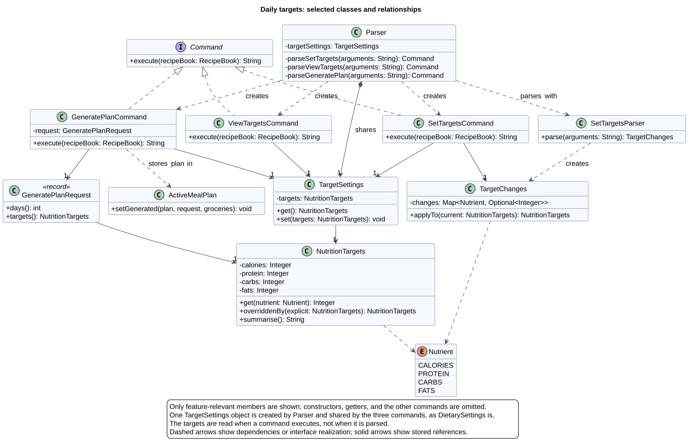

*Only feature-relevant members are shown. Dashed arrows show dependencies or interface realization; solid arrows show stored references.*

`TargetChanges` records, for each nutrient the user mentioned, either a new value or `Optional.empty()` for "remove". Nutrients that were not mentioned are absent from its map. This three-way distinction (keep, replace, remove) cannot be expressed with `NutritionTargets` alone, where `null` already means "no target".

#### Setting targets

The sequence below shows `set-targets cal/2000 p/none`.

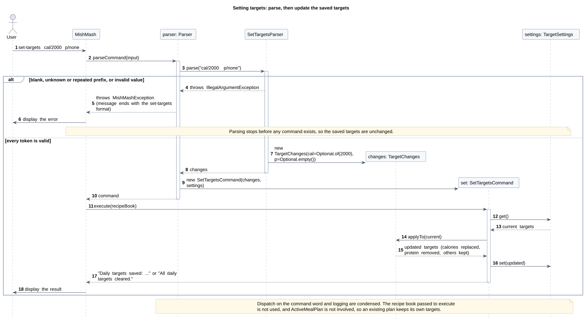

*Dispatch on the command word and logging are condensed. The upper branch of the `alt` is every parsing failure.*

`SetTargetsParser` reads each whitespace-separated token as `PREFIX/VALUE`. Prefixes are case-sensitive, like every other prefix, and `none` is accepted in any letter case, as for `food/none`. A value must consist of digits only and fit in an `int`; zero is rejected. The parser validates all tokens before creating a `TargetChanges`, and `Parser.parseSetTargets` wraps any `IllegalArgumentException` in a `MishMashException` that ends with the set-targets format. A command object is created only if every token is valid, so a bad command can never partly change the saved targets.

`SetTargetsCommand.execute` reads the saved targets, asks `TargetChanges.applyTo` for the updated targets, and stores them. `applyTo` builds a new `NutritionTargets` and does not modify the old one. The reply lists every target now saved, or says `All daily targets cleared.` when none remain, and reminds the user that an existing plan is unchanged.

#### Using the targets in `generate-plan`

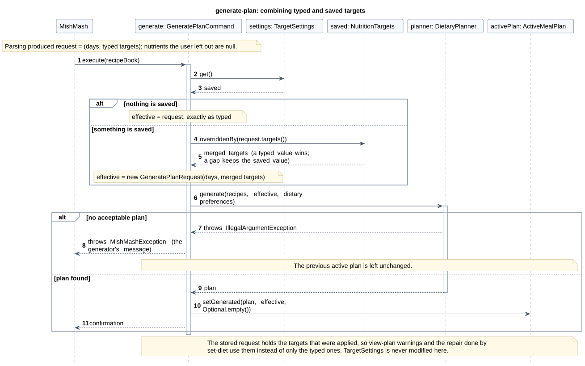

*The first `alt` shows the merge; the second shows the two outcomes of generation.*

`GeneratePlanCommand` reads `TargetSettings` when it executes, not when it is created, so a `set-targets` entered after parsing but before execution is respected, exactly as for dietary preferences. If nothing is saved, the request is used unchanged, so behaviour without `set-targets` is identical to before. Otherwise `NutritionTargets.overriddenBy` merges the typed targets over the saved ones and the command builds an effective `GeneratePlanRequest`.

The effective request, not the typed one, is passed to `DietaryPlanner` and stored with `ActiveMealPlan.setGenerated`. This matters in two places that read the stored request later: `view-plan` warns about daily totals that exceed the stored targets, and `set-diet` regenerates conflicting days using the stored targets. If the stored request kept only the typed targets, both would ignore the targets that actually shaped the plan.

When a saved target filled a nutrient that the command left out, the confirmation gains a `Daily targets used:` line and a failure message gains a `Daily targets applied:` line, both listing the merged targets. `GeneratePlanCommand.usesSavedTarget` decides this by checking whether any nutrient has a saved target but no typed one. Without these lines, a user who forgot an earlier `set-targets` would see a failure caused by a target they never typed in the command. When nothing is saved, or every saved nutrient is also typed, the messages are exactly as before.

#### Invalid input and recovery

| Input or state | Where it is decided | Result |
| --- | --- | --- |
| No arguments | `SetTargetsParser.parse` | `Supply at least one daily target to set or clear.` followed by the set-targets format. |
| Unknown, malformed, or wrong-case prefix (`x/5`, `2000`, `CAL/5`, `d/3`) | `SetTargetsParser.readToken` | `Unrecognized parameter: TOKEN` and the format. |
| Repeated prefix | `SetTargetsParser.readToken` | `Parameter cal/ was given more than once.` and the format. |
| Missing value (`cal/`) | `SetTargetsParser.parseValue` | `Missing value after cal/` and the format. |
| Zero, negative, decimal, text, signed, or too large value | `SetTargetsParser.parseValue` | An error naming the nutrient, for example `Calories target (cal/) must be a positive whole number from 1 to 2147483647, or 'none'.`, and the format. |
| Arguments after `view-targets` | `Parser.parseViewTargets` | `view-targets does not accept arguments.` and the view-targets format. |
| Saved target that no combination of recipes can meet | `GeneratePlanCommand.execute` | The generator's error plus `Daily targets applied: ... (including your saved targets). Change those with 'set-targets'.`; the previous plan is kept. |

In every case the session continues, and an error leaves the saved targets unchanged.

#### Design choices and alternatives

| Decision | Alternative | Reason for the current design |
| --- | --- | --- |
| One `set-targets` command for calories and macronutrients | A separate command for calories and another for macronutrients | Both stories change the same object, and a single command lets the user set all four values in one line. Two commands would need two parsers and duplicate the validation for no additional capability. |
| Keep the saved targets in a session holder, `TargetSettings` | Store them in `ActiveMealPlan` or in the recipe book | Targets must survive `generate-plan` replacing the plan, and `ActiveMealPlan` is cleared by `set-diet` in some cases. `TargetSettings` copies the proven `DietarySettings` pattern. |
| Update only the mentioned nutrients | Replace all four targets at once, as `set-diet` replaces dietary preferences | The user can set calories today and protein later without retyping. Removing a target is explicit, with `none`. |
| `none` removes a target | A separate `clear-targets` command | One command and the same word the user already knows from `food/none`. A separate command would be worth adding if clearing everything in one step were needed often. |
| Merge saved and typed targets when `generate-plan` executes, per nutrient | Merge when parsing, or let any typed target discard all saved ones | Execution-time merging respects the latest saved targets and keeps parsing free of session data. Per-nutrient merging lets `generate-plan d/3 cal/1800` change one number and still use the saved protein target. |
| Store the effective request in `ActiveMealPlan` | Store only what was typed | `view-plan` and `set-diet` then use the targets that actually produced the plan. |
| Name the merged targets in the `generate-plan` messages when a saved target contributed | Stay silent, or print the targets on every plan | A user who forgot a saved target can see where a number came from, and output is unchanged when nothing is saved. Printing on every plan would add noise for users who type all their targets. |
| No per-command way to ignore saved targets | Accept `cal/none` in `generate-plan` | Ignoring one needs `GeneratePlanParser` and `GeneratePlanRequest` to represent "explicitly no target", which changes shared code and its tests. `set-targets cal/none` already gives the same result. It could be added if users needed it. |
| Changing targets leaves the current plan alone | Regenerate or clear the plan | Plans are snapshots, as after `edit-recipe` and `delete-recipe`, and regenerating would change meals the user may be relying on. |
| `check-shortfall` is unchanged | Fall back on saved targets when none are typed | Its contract is to check the explicit targets given, and existing behaviour and tests stay valid. It would be a small change to add later. |
| Targets are not persisted | Save them to a file | The application has no storage component, and every other piece of session data is also lost when it closes. |

#### Verification and maintenance

`TargetChangesTest` checks setting, keeping, and removing nutrients, that the original targets are never modified, the merge in `NutritionTargets.overriddenBy`, the summary text, and `TargetSettings`. `SetTargetsParserTest` checks every accepted form (any order, extra spaces, `none` in any case, leading zeros, the largest `int`) and every rejection above. `SetTargetsCommandTest` checks the confirmation texts, partial updates, removal, the untouched plan and recipes, `view-targets`, and the interaction with `generate-plan`: saved targets used, typed targets winning per nutrient, saved targets read at execution, removal, a typed target replacing an impossible saved one, a failed generation keeping the previous plan, and the `Daily targets used:` and `Daily targets applied:` lines appearing only when a saved target contributed. `ParserTargetsTest` checks that the parser creates the commands, shares one set of targets between them, reports errors with the set-targets usage only, and lists both commands in the usage and help text.

For manual verification, follow [Set and View Daily Targets](#set-and-view-daily-targets) in the manual-testing appendix, or the User Guide's [Setting Daily Targets](UserGuide.md#setting-daily-targets) example. The class diagram and two sequence diagrams have editable sources and rendering instructions in [`docs/diagrams/targets`](diagrams/targets/README.md). When the implementation changes, check method names, message order, and branches against the code, then regenerate and inspect all three SVGs.
<!-- @@author -->

<!-- @@author oilybikechain -->
### Contribution history: oilybikechain

The following non-merge commits reachable from the current branch establish the scope of these
contributions. Merge authorship does not imply ownership of the merged feature; the original
meal-plan generator, plan viewer, grocery formatter, dietary repair, and shortfall command have
separate contributors. The sections below describe the current integration with those components.

| Commit | Contribution documented here |
| --- | --- |
| `667d642` | Ingredient quantity model and grocery aggregation by exact name and unit. |
| `c3f6e95` | Grocery aggregation regression tests and API documentation. |
| `6b960ad` | `generate-list` parsing, command execution, and shared grocery snapshot integration. |
| `ba80853` | Preserved exception causes, generator assertions, and generation diagnostics. |
| `4c82e81` | Combined daily nutrition totals through `DayPlan` and `NutritionTotals`. |
| `f81dc10` | Daily warnings when planned nutrition exceeds exact generation targets. |

Earlier implementations on other branches are not additional features: `5ff6c3f` is the earlier
grocery integration, and `b814afb` is the pre-update nutrition-warning implementation. The current
guide describes their integrated replacements above. Profile and README edits are not product features.

### Combined daily nutrition totals

The structural view connects the combined totals API with the separate target-aware viewing path.
The supplier bindings show how viewing reads the latest shared state rather than capturing a plan
when the command is parsed.

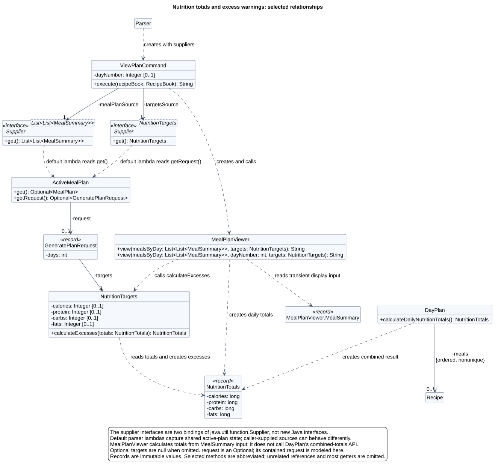

*Nutrition structure: solid associations show retained references, while dashed dependencies show
temporary use. The supplier-to-holder dependencies describe the default parser's lambdas; these
are bindings of Java's existing `Supplier` interface. Unrelated members and plan-to-day links are
omitted here; the grocery class diagram below shows the plan hierarchy.*

`DayPlan.calculateDailyNutritionTotals()` returns one immutable `NutritionTotals` record containing
`calories()`, `protein()`, `carbs()`, and `fats()`. Calories are measured in kcal; the macronutrients
are measured in grams. It delegates to the existing individual total getters, giving callers a
single result without changing the plan, recipes, or the individual-getter API.

Every meal occurrence contributes its full nutrition, including repeated recipes. Each day is
calculated independently; these are not totals across the entire plan. An empty day returns four
zeros. All four record components use `long`, so sums of valid integer recipe values can exceed
`Integer.MAX_VALUE` without wrapping.

For example, a day containing the User Guide's Protein Oatmeal, Chicken and Rice, and Salmon Salad
has `new NutritionTotals(1650, 127, 150, 55)`. The record represents calculated data; it does not
apply target tolerance, validate a nutrition goal, or introduce a new console command. The existing
plan viewer computes its display totals from `MealSummary` values separately.

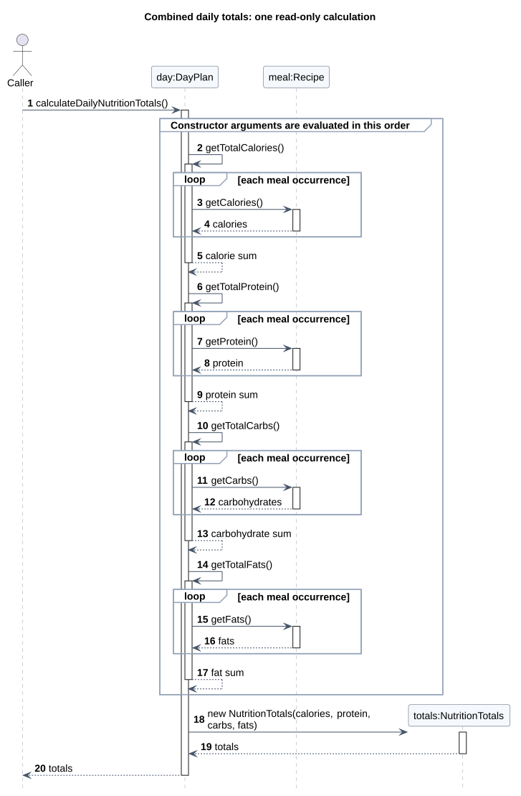

*Combined-total calculation: constructor arguments are evaluated in calories, protein, carbohydrates,
and fats order. Each existing getter traverses every meal occurrence using a `long` sum. Stream
internals are condensed, and the caller represents an API client rather than the plan viewer.*

`DayPlanTest` covers ordinary meals, one meal, zero nutrition, an empty day, repeated recipes,
independent days and repeated calls, unchanged meals, and totals above the integer range.

### Defensive checks and generation diagnostics

`GeneratePlanCommand` retains an `IllegalArgumentException` as the cause when wrapping a generation
failure in `MishMashException`. Parser validation for `generate-plan`, `delete-recipe`, and
`list-recipes` likewise preserves the cause while adding the relevant command usage. Users receive
the existing recoverable error and can retry; developers can inspect the original exception through
`getCause()` or the application's rejection log. This does not add new command syntax.

`MealPlanGenerator` uses assertions to check two internal invariants: the returned number of days
matches the request, and candidate construction starts with enough recipes. Normal argument validation
still handles user mistakes; assertions diagnose programming errors. Tests enable assertions through
the existing Gradle configuration. Enable them in a direct application run with
`java -ea -jar build/libs/MishMash.jar` when investigating invariants.

Generation logs at `FINE` record the requested day count, recipe count, whether targets were supplied,
and how many candidate combinations matched. They use the existing logger configuration and do not
record recipe contents. `ParserTest.parseCommand_invalidArguments_preservesCauseAndUsage` checks
the cause and usage for all three parsing paths; `GeneratePlanCommandTest` verifies the original
generation cause is retained. These changes strengthen diagnostics around teammates' commands rather
than implementing those commands.

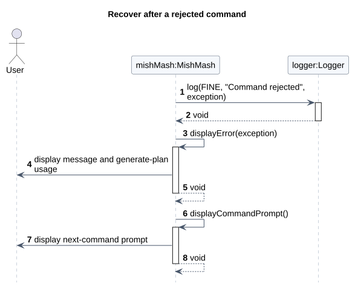

*Diagnostic recovery: `generate-plan d/0` fails while parsing, so no command is constructed or
executed. The outer exception retains the validation cause. Application error display and the next
prompt are integration context; the added generator assertions and diagnostics belong to successful
validation paths and are summarized in the diagram's note.*

### Detecting exceeded nutrition targets

`ActiveMealPlan` already retains the original `GeneratePlanRequest` alongside a generated plan for dietary
repair. Exceedance warnings reuse this request's immutable `NutritionTargets` rather than storing another
copy in `MealPlan`. Successful generation replaces both meals and targets through `setGenerated`; failed
generation preserves them. Dietary repair retains the request, and clearing a plan clears its request.
Legacy plans published with `set(MealPlan)` have no request and therefore no targets for warnings.

`NutritionTargets.calculateExcesses(NutritionTotals)` returns each nutrient's positive excess over its exact
target, or zero if the target is omitted or not exceeded. It uses `long` arithmetic, matching daily totals,
so sums beyond the integer range remain valid. This comparison does not use `TOLERANCE`: generation still
accepts days within ±15%, while viewing warns for any total strictly above the supplied target.

`Parser` supplies the current plan's meals and request targets to `ViewPlanCommand` at execution time.
Commands parsed before generation or replacement therefore display the latest meals and targets.
Legacy supplier-based parser and command constructors default to no targets. The new command constructor
accepts meal and target suppliers plus a nullable day number (null selects every day). The suppliers must
return corresponding meals and targets; omitted targets are represented by `NutritionTargets.none()`.

`MealPlanViewer` provides target-aware overloads for all days and one selected day; its original overloads
delegate with no targets. It sums each day's meals, requests excesses, and places warnings before the day's
closing separator in calories, protein, carbohydrates, and fats order. Warnings include the excess, actual
total, and target, using kcal for calories and g for the macronutrients. They do not change application state.
`check-shortfall` continues to use its explicitly supplied targets independently of this display.

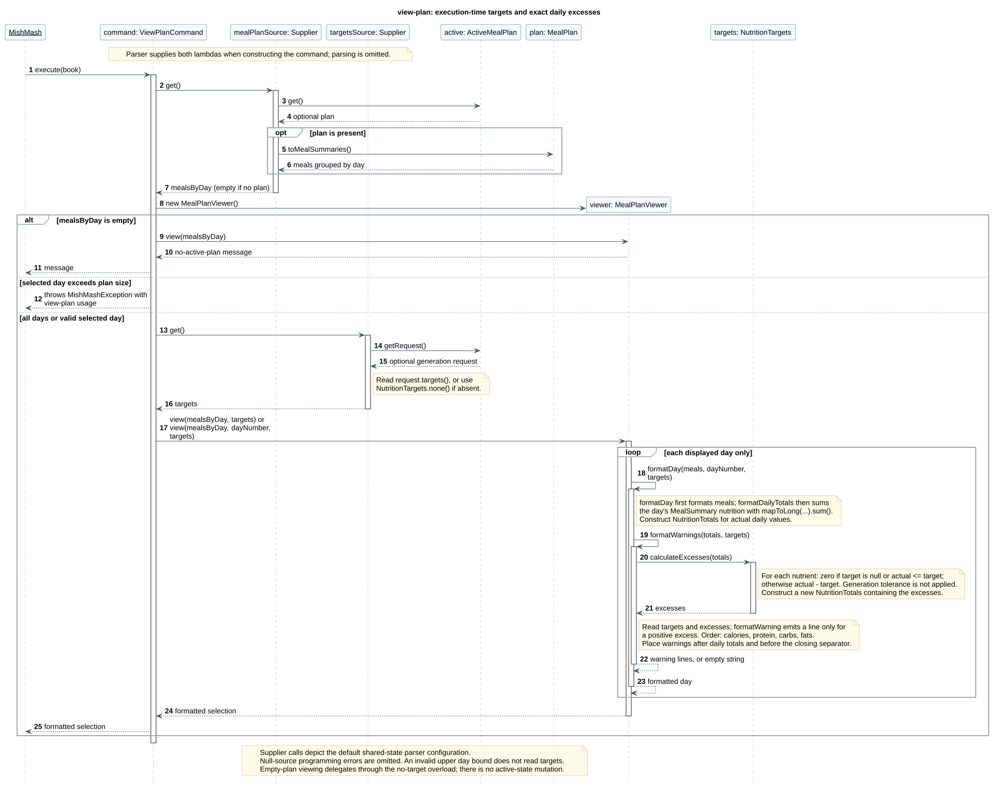

*Warning calculation: the default meal supplier adapts the active plan to summaries; the target
supplier reads the retained generation request. Missing plans bypass the target supplier, and an
out-of-range selected day fails before targets are read. Daily formatting and immutable value
construction are condensed in notes. Only displayed days are compared, using strict excesses.*

Tests cover exact comparison boundaries, omitted targets, simultaneous excesses, large totals, exact output,
and day selection. Integration tests verify the generation tolerance, replacement after success or failure,
legacy plans without requests, dietary repair and clearing, and independence from `check-shortfall`.
Run `gradlew.bat test checkstyleMain checkstyleTest` with Java 25.

### Grocery command integration

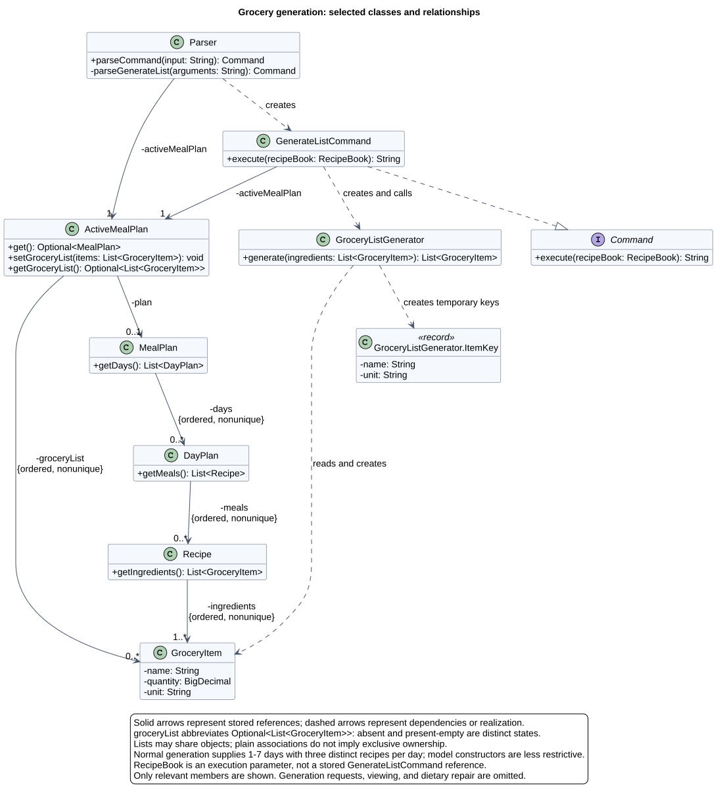

*Grocery structure: the parser and command retain the same active-plan holder. Plain navigable
associations allow shared model objects; they do not claim exclusive ownership. The optional grocery
snapshot is abbreviated as an ordered collection with a note distinguishing absent and empty states.
The temporary aggregation key is a dependency rather than a stored generator field.*

#### Ingredient aggregation

`GroceryItem` holds a trimmed, non-blank ingredient name and unit plus a nonnegative `BigDecimal`
quantity. Recipe input separately requires strictly positive ingredient quantities; zero is supported
by the grocery model and aggregation API. `toString()` uses plain decimal notation and removes
insignificant trailing zeros, for example `Oil: 0.3ml`.

`GroceryListGenerator.generate(List<GroceryItem>)` uses a `LinkedHashMap` keyed by an `ItemKey`
record containing the ingredient name and unit. Each occurrence is merged with `BigDecimal::add`.
Exact decimal addition avoids floating-point rounding, and insertion order preserves the first
appearance of each key. `Rice:200g` and `Rice:100g` combine; `Rice:1kg`, `rice:100g`, and
`Rice:1cups` remain separate. No unit conversion, spelling normalization, or portion scaling occurs.

The method rejects a null list or item, returns an empty list for empty input, and publishes an
unmodifiable result with `List.copyOf`. Inputs remain unchanged, and successive calls do not reuse
previous totals. `GroceryListGeneratorTest` checks exact matching, incompatible units, different
names, decimal precision, zero quantities, ordering, immutable output, repeated calls, and null inputs.

#### Command parsing and shared state

`Parser()` shares one `ActiveMealPlan` between meal-plan generation, grocery generation, and viewing. For deterministic tests or an externally managed plan, use `Parser(MealPlanGenerator, ActiveMealPlan)`. The supplier-based constructors retain their caller-provided viewing sources; their grocery viewers do not automatically read the internally generated grocery snapshot.

The parser accepts `generate-list` without arguments and returns `GenerateListCommand` without reading or modifying the plan. During execution, the command traverses `MealPlan.getDays()`, `DayPlan.getMeals()`, and each recipe's ingredients. Every meal occurrence contributes its quantities. The existing `GroceryListGenerator` combines exact name/unit matches with `BigDecimal` arithmetic, preserving first-appearance order and keeping incompatible units separate.

`ActiveMealPlan.setGroceryList` copies the completed result into a read-only snapshot. `getGroceryList` returns an optional: absence means no list has been generated for the current plan, whereas a present empty list is valid. `ViewListCommand` reads this snapshot during execution and delegates formatting to `GroceryListViewer`; viewing never regenerates data.

Successfully storing a replacement plan clears its old groceries. Failed plan generation or invalid command syntax leaves the previous state intact. All state is kept in memory for one session.

The parse step rejects arguments with `generate-list does not accept arguments.` and
`Format: generate-list`; it does not inspect the active plan. The command reads the latest plan
when executed, so a command parsed before generation can use a subsequently generated plan. Without
a plan it returns `No active meal plan. Use 'generate-plan' first.` without publishing a snapshot.
Successful generation returns `Grocery list generated. Use 'view-list' to view it.` Only the finished
result is stored, preserving any previous snapshot if generation fails.

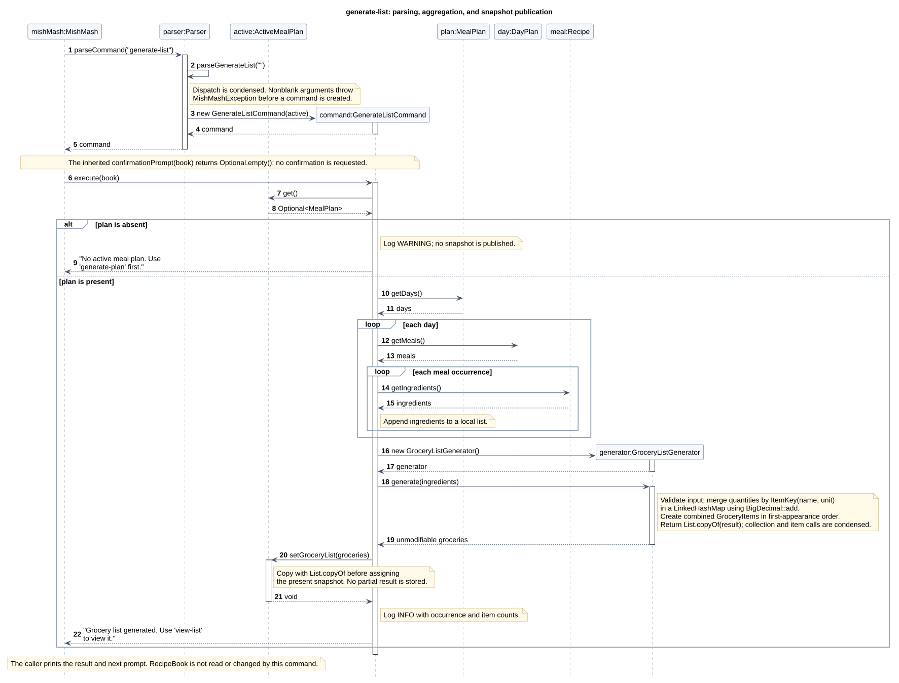

*Grocery execution: parsing validates syntax without reading the plan. Execution counts every
recipe occurrence, then publishes one completed snapshot. Ingredient-key lookup, decimal merging,
and result-item creation are condensed inside the generator note. The existing application supplies
confirmation handling, result display, and the next prompt.*

`GenerateListCommandTest`, `ParserGenerateListTest`, and `ActiveMealPlanTest` cover missing plans,
execution-time plan lookup, every recipe occurrence, repeated generation, syntax rejection, copying,
and snapshot replacement. `MishMashGeneratePlanTest` exercises the generation-to-viewing connection
through the console. Grocery-list formatting is supplied by the existing viewer rather than this
aggregation contribution.

Grocery parsing and viewing use `FINE` logs, successful generation logs counts at `INFO`, and rejected generation requests use `WARNING`. These loggers inherit the existing application configuration; no additional handlers are installed. New diagnostics exclude ingredient names and raw input.

Run `gradlew.bat test checkstyleMain checkstyleTest` on Windows with Java 25 to verify the integration.

#### Maintaining the grocery and nutrition diagrams

The six class and sequence diagrams above have editable sources and regeneration instructions in
[`docs/diagrams/oilybikechain`](diagrams/oilybikechain/README.md). Generated SVGs are checked in under
`docs/images/oilybikechain`. Use Java 25 and PlantUML 1.2026.9 with the existing shared style and
Smetana class layout. Check method names, retained references, multiplicities, supplier indirection,
message order, and failure paths against current code, then syntax-check, render, and inspect every
image. Keep sources and SVGs synchronized. The contribution history identifies the relevant commits;
teammates' viewing, generation, formatting, and dietary components are shown as integration context.
<!-- @@author -->

<!-- @@author peilingggg -->
### Applying dietary restrictions

#### Purpose and implemented scope

This feature lets a user select a named diet, avoid declared food categories, and exclude
complete ingredient names when generating meals. The commands are:

```text
set-diet [diet/DIET] [avoid/TAG[,TAG...]] [exclude/INGREDIENT[,INGREDIENT...]]
view-diet
```

Each valid `set-diet` replaces the complete profile. Omitted fields revert to unrestricted
defaults. Recipes receive optional `food/` metadata during addition; unclassified recipes
are excluded whenever any restriction is active. No ingredient database, allergen inference,
certification checking, or persistence is implemented.

#### Architecture-level view

`Parser` owns a shared `DietarySettings` holder and connects it to `GeneratePlanCommand`
and `SetDietCommand`. Parsing creates commands without changing session state.
`view-diet` is a `Command` lambda reading the current holder at execution time.

Figure 6 shows the feature's architecture; its editable source is
[architecture.puml](diagrams/dietary/architecture.puml).
Its dependencies show command creation, shared session data, and generation delegation;
they do not represent runtime message order.

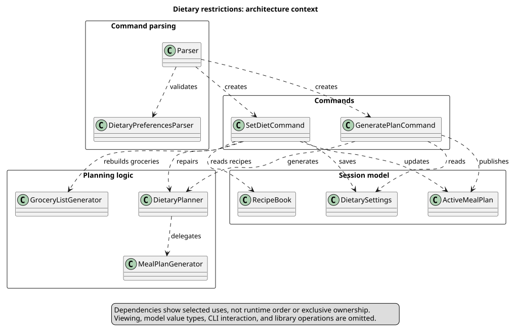

*Figure 6: Dependencies between parsing, commands, planning logic, and shared session data.
Arrows show selected uses rather than runtime message order.*

#### Class-level responsibilities and relationships

| Class | Feature responsibility |
| --- | --- |
| `Diet` | Define named-diet category exclusions and parse supported labels and aliases. |
| `FoodTag` | Define supported recipe categories and validate comma-separated declarations. |
| `FoodInfo` | Store immutable classification state and declared categories. |
| `DietaryPreferences` | Combine diet, category exclusions, and normalized ingredient exclusions. |
| `DietarySettings` | Hold the current immutable profile for one parser session. |
| `DietaryPreferencesParser` | Validate dietary fields and construct a replacement profile. |
| `DietaryPlanner` | Filter recipes, delegate generation, and repair incompatible days. |
| `SetDietCommand` | Save preferences and coordinate plan and grocery updates. |
| `ActiveMealPlan` | Retain the plan, its original request, and an optional grocery snapshot. |

Figure 7 ([source](diagrams/dietary/classes.puml)) shows selected stored references and
dependencies. Associations use private role names and target-end multiplicities; reverse
multiplicities are unspecified. References are not duplicated as attributes. Parameter-only
dependencies and interface realization use dashed arrows. Model collection copying protects
collection structure; shared recipe and day objects are not deep-copied.


*Figure 7: Only feature-relevant members and references are shown; parameter types are abbreviated.
Solid arrows show stored references with private role names and target-end multiplicities.
Dashed arrows show dependencies or interface realization; reverse multiplicities are unspecified.*

#### Successful command parsing

Figure 8 ([source](diagrams/dietary/parsing.puml)) follows `set-diet diet/vegan`.
`Parser.parseSetDiet` delegates to `DietaryPreferencesParser.parse`.
`collectFields` rejects leading unprefixed text, unsupported or repeated prefixes, blank
values, and embedded slashes. Diet and tag parsers normalize case, resolve aliases, and
reject unknown values. Food-tag aliases are resolved before duplicate detection.

The `DietaryPreferences` constructor copies both exclusion sets and normalizes ingredient
names using trimming, `Locale.ROOT` lowercasing, and collapsed whitespace. Blank and repeated
normalized names are rejected. The parser then creates a `SetDietCommand`; neither settings
nor active planning data changes until execution.

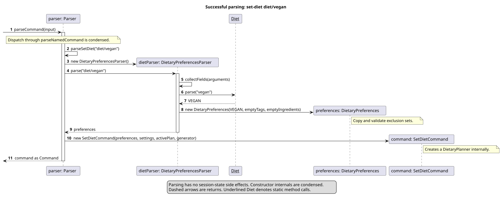

*Figure 8: Parsing creates a command without changing session state. Dashed arrows represent returns,
and constructor messages begin new lifelines. Constructor internals and dispatch helpers are condensed.*

#### Execution and partial plan repair

Figure 9 ([source](diagrams/dietary/execution.puml)) focuses on a conflicting plan with
an existing grocery list and successful repair. The command handles these branches:

1. Without an active plan, clear stale derived state and save the profile.
2. If `DietaryPlanner.isCompatible` accepts the entire plan, save the profile and preserve it.
3. Otherwise, retrieve the original `GeneratePlanRequest` and call `DietaryPlanner.repair`.
4. Count incompatible days and generate that many replacements using the original daily targets.
5. Reuse compatible `DayPlan` objects in their original positions; replace each incompatible day.
6. If groceries already exist, rebuild them with `GroceryListGenerator.generateForPlan`.
7. Publish the validated plan, request, and copied grocery snapshot with `setGenerated`, then save preferences.

Filtering calls `DietaryPreferences.isAllowed` before delegation to `MealPlanGenerator`.
Every active restriction requires classified recipes. All named-diet, explicit-category, and
exact ingredient-name checks apply together. Generation retains three distinct recipes per
day, the original +/-15% target tolerance, and the existing bounded candidate search.

`ActiveMealPlan.set(MealPlan)`, used by legacy callers, clears the retained request and
groceries. A compatible legacy plan can be preserved without a request. A conflicting legacy
plan cannot be repaired without its original settings and follows the failure branch below.

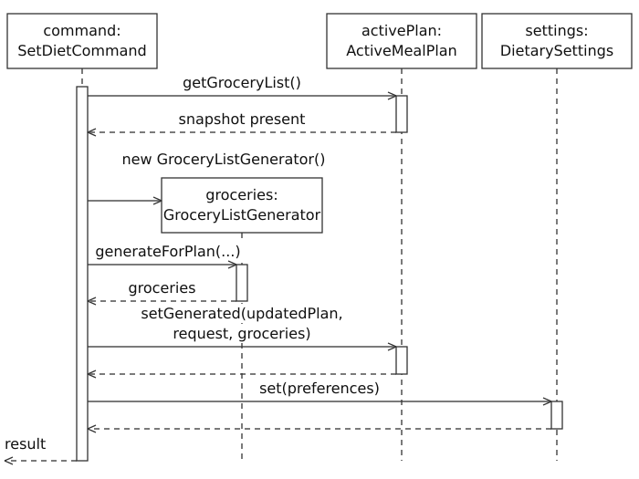

*Figure 9: The successful repair branch with an existing grocery list is shown. Recipe-book lookup,
library operations, and generation internals are condensed; the other branches are described above.*

#### Invalid input and recovery

Figure 10 ([source](diagrams/dietary/invalid-input.puml)) follows the unsupported
value `diet/keto`. `Diet.parse` throws `IllegalArgumentException` with valid diets and
aliases. `Parser.parseSetDiet` appends command-specific usage and wraps it in
`MishMashException`, preserving the cause. The CLI displays the error and continues.

| Condition | Implemented behavior |
| --- | --- |
| Invalid syntax, unsupported value, blank entry, or duplicate | Reject during parsing; preserve all session data. |
| Null Java dependency or required model input | Fail immediately with `NullPointerException`. |
| No compatible replacement or missing original request | Catch `IllegalArgumentException` during execution; save preferences and clear plan, request, and groceries. |
| Successful repair without an existing grocery list | Keep groceries absent and advise the user to generate them later. |
| Internal generator or repair invariant fails | Raise `AssertionError` when assertions are enabled; do not treat it as malformed CLI input. |

Assertions check generated length, dietary compatibility, nutrition targets, repaired length,
and exact consumption of replacement days. Exceptions enforce input contracts even when
assertions are disabled. `setGenerated` validates and copies arguments before assignments.
A failed repair deliberately invalidates old generated data rather than showing an
incompatible plan under newly saved restrictions.

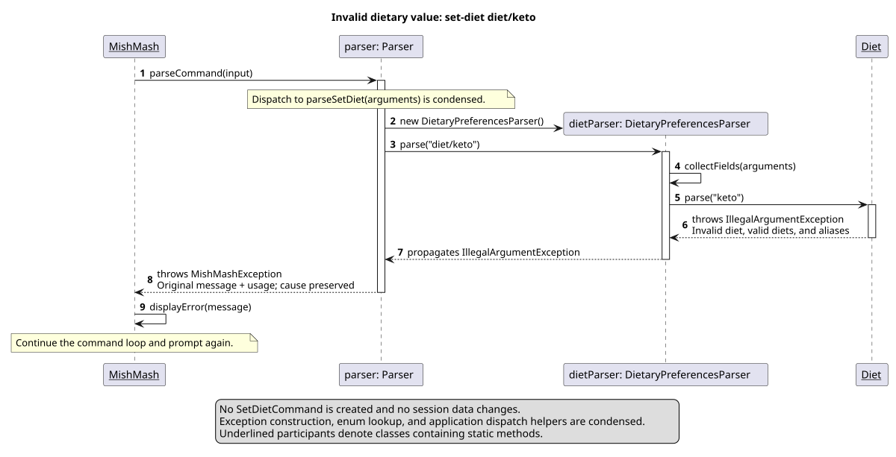

*Figure 10: Exception messages show exceptional control flow. No dietary command is created and no
session data changes. The application displays the error and continues its command loop.*

#### Rationale and alternatives

| Decision | Alternative | Reason for the current design |
| --- | --- | --- |
| Explicit complete category declarations | Infer categories from ingredient text | Avoid unreliable synonym and compound-ingredient guessing. |
| Replace the complete dietary profile | Merge supplied fields silently | Make each command define one complete profile; omitted exclusions are cleared. |
| Filter before using the existing generator | Add dietary checks throughout the generator | Preserve existing nutrition and daily-variety behavior. |
| Regenerate complete conflicting days | Replace individual meals | Reuse daily nutrition checks while preserving unaffected days. |
| Clear generated data after failed repair | Keep an incompatible old plan | Keep the displayed planning state consistent with the newly saved preferences. |

#### Verification and diagram maintenance

`DietaryPreferencesParserTest` covers syntax, valid values, aliases, and malformed lists.
`DietaryPreferencesTest` and `FoodInfoTest` cover diet rules, category declarations,
normalized exclusions, null arguments, and defensive collection ownership.
`DietaryPlannerTest` covers filtering, original targets, day preservation, infeasible requests,
and assertion failures from a deliberately broken generator.
`DietaryCommandsTest` covers shared parser state, replacement semantics, grocery rebuilding,
failed-repair invalidation, and recovery. `ActiveMealPlanGeneratedTest` checks request retention and snapshots.

With Java 25, run:

```powershell
.\gradlew.bat test checkstyleMain checkstyleTest
```

Sources and SVG-generation instructions are in [diagrams/dietary](diagrams/dietary/README.md).
The rendered SVGs under `docs/images/dietary` are embedded as Figures 6 to 11 so the guide
renders without a PlantUML plugin. After changing a source, regenerate and inspect its SVG.
Recheck method names, message order, guards, and relationships after code changes.
<!-- @@author -->

<!-- @@author peilingggg -->
### Viewing dietary preferences

#### Purpose and implemented scope

`view-diet` displays `DietarySettings.get().describe()` and accepts no arguments.
It works without recipes or an active plan, including an unrestricted fresh session.

#### Parsing and execution

`Parser.parseNamedCommand` calls `requireNoDietArguments` and returns a `Command` lambda.
The lambda captures the shared holder, rather than a profile snapshot, so a command parsed
before a later update displays the settings current at execution time. It does not read or
change the recipe book, active plan, original generation request, or grocery snapshot.
`DietaryPreferences.describe()` prints the named diet and sorted explicit category and
ingredient exclusions on three lines, using `none` for empty lists.

Figure 11 ([source](diagrams/dietary/viewing.puml)) shows parsing and execution-time
profile lookup without changing session data.

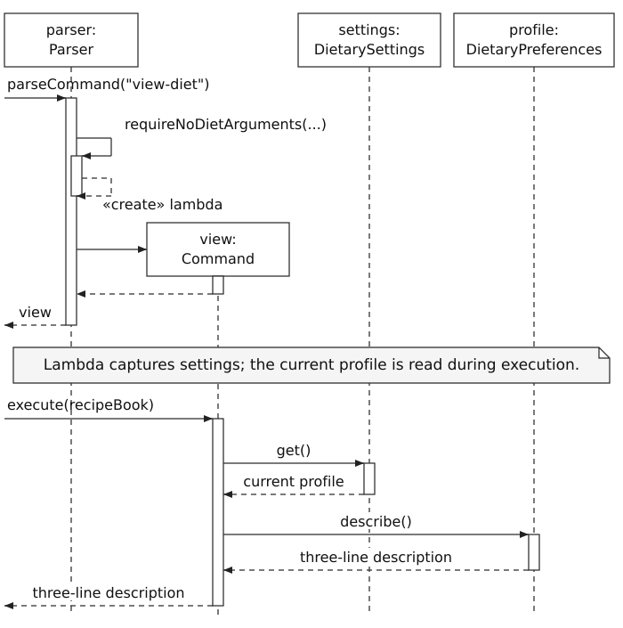

*Figure 11: The lambda captures the shared settings holder and reads its current profile during
execution. Parsing helpers and formatting internals are condensed; no session data is changed.*

#### Invalid input and verification

Extra arguments raise `MishMashException` with the no-arguments message and `Format: view-diet`.
No command executes and all state is preserved. `ViewDietCommandTest` covers unrestricted and
populated profiles, execution-time reads, and argument rejection without profile changes. Parser tests cover
argument rejection. Run the existing Java 25 test suite when changing this behavior.
<!-- @@author -->
<!-- @@author Rixte -->
### Checking nutrition shortfalls

#### Purpose and implemented scope

This V2.0 enhancement supports the following user story: **As a user tracking nutrition,
I want to detect when my planned meals fall short of my calorie or macronutrient targets
so that I can add or adjust meals accordingly.** It reports differences for the user to
act on; it does not automatically rebalance or change meals.

The command accepts one or more explicit daily targets:

```text
check-shortfall [cal/DAILY_CALORIES] [p/DAILY_PROTEIN] [c/DAILY_CARBS] [f/DAILY_FATS]
```

For example, `check-shortfall cal/2000 p/100` checks calories and protein for every day in
the active meal plan. Each target is optional individually, but the request must contain
at least one. Calories use kcal; protein, carbohydrates, and fat use grams. The feature
checks planned meals, not meals recorded as eaten. Targets belong to this request and are
not saved as personal settings or inferred from a previous generation command.

#### Architecture-level view

Figure 12 shows the enhancement in the existing architecture. `MishMash` reads the input,
asks `Parser` for a `Command`, executes it, and displays its returned text. The shortfall
feature follows that command workflow. Parsing validates syntax and creates the action;
execution reads the current session models and performs the comparison.

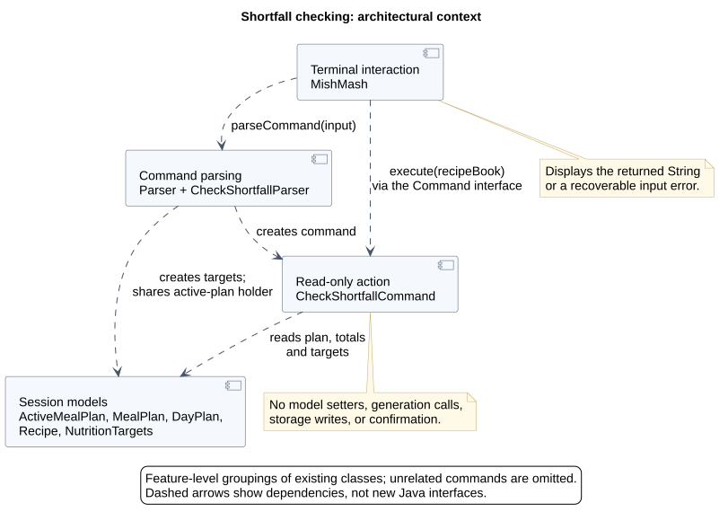

*Figure 12: Dependencies between existing responsibilities. Each box groups the named
implementation classes; it does not introduce a new Java component or service.*

The normal `Parser()` constructor shares its `ActiveMealPlan` between plan generation,
grocery generation, viewing, and shortfall checking. Tests can supply that holder through
`Parser(MealPlanGenerator, ActiveMealPlan)` to control the plan and generator. The
supplier-based parser constructors have separate caller-provided viewing sources; those
sources do not become the shortfall command's data source. Shortfall checks always use
the parser's `ActiveMealPlan`.

#### Class-level responsibilities and relationships

Figures 13a and 7b separate command dependencies from model references so both views remain readable.

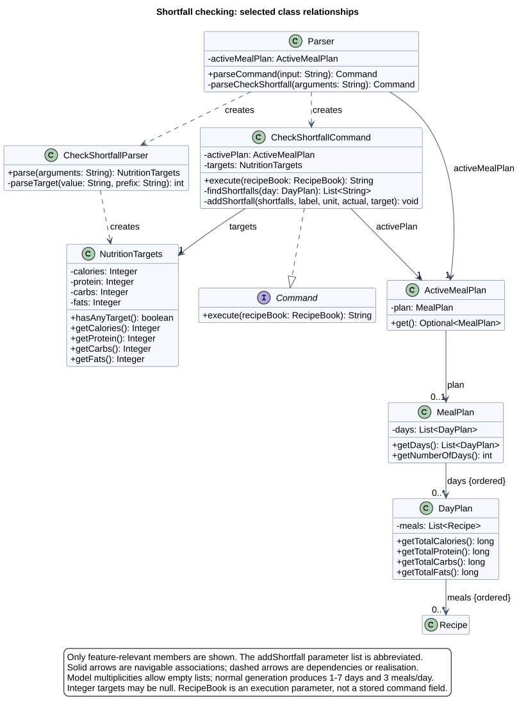

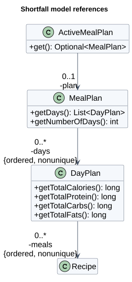

*Figures 13a and 7b: Only members relevant to this enhancement are shown. Solid arrows are
navigable associations with private role names; dashed arrows show dependencies or
interface realization. Each reference is shown either as a typed attribute or as an
association end, without duplication. Helper signatures and target getters are explained in the text rather than
listed in the command class diagram.*

`CheckShortfallParser` converts arguments into `NutritionTargets`. Its `parse` method
coordinates the request while `readTarget` validates and records one token. Named prefix
constants are shared by validation and target construction to keep those rules consistent.
The local map detects duplicate prefixes and keeps the values separate; omitted nutrients
remain `null` in the result. Token syntax is checked before integer conversion, rejecting signs,
decimals, units, and non-ASCII digits consistently. Conversion then detects values beyond
`Integer.MAX_VALUE`. The existing `NutritionTargets` constructor additionally rejects
non-positive values.

`CheckShortfallCommand` implements `Command` and retains two references: the shared
`ActiveMealPlan` holder and the request's `NutritionTargets`. It does not retain or read
the `RecipeBook` passed to `execute`; that parameter comes from the common command
interface. The constructor rejects null dependencies and a target object containing no
targets, protecting callers that construct commands without using the parser.

`MealPlan` supplies ordered `DayPlan` objects. Each day calculates its totals from its
`Recipe` references through four existing getters. The class diagram uses plain
associations rather than composition: the lists copy references, and recipes can occur
in multiple days. Association roles name the actual private fields; the parser's shared
holder is represented as a typed private attribute instead. Target-end
multiplicities are shown; reverse ends are left unspecified. The ordered, nonunique list
ends allow the model to hold repeated object references. An active plan is optional,
and the model permits empty day lists and
empty meal lists. Normal generation applies the stricter limits of one to seven days and
three distinct recipe entries per day.

#### Successful command parsing

Figure 14 follows `check-shortfall cal/2000 p/100` through object creation. The lifelines
"Target parser", "Targets", and "Check command" represent `CheckShortfallParser`, `NutritionTargets`,
and `CheckShortfallCommand`, respectively. The dispatch
from `parseCommand` through `parseNamedCommand` to `parseCheckShortfall` is condensed into
the parser lifeline. A new target parser is created for the request. Its `parse` method
collects values by calling `readTarget` for each supplied token, then constructs
`NutritionTargets(2000, 100, null, null)`.

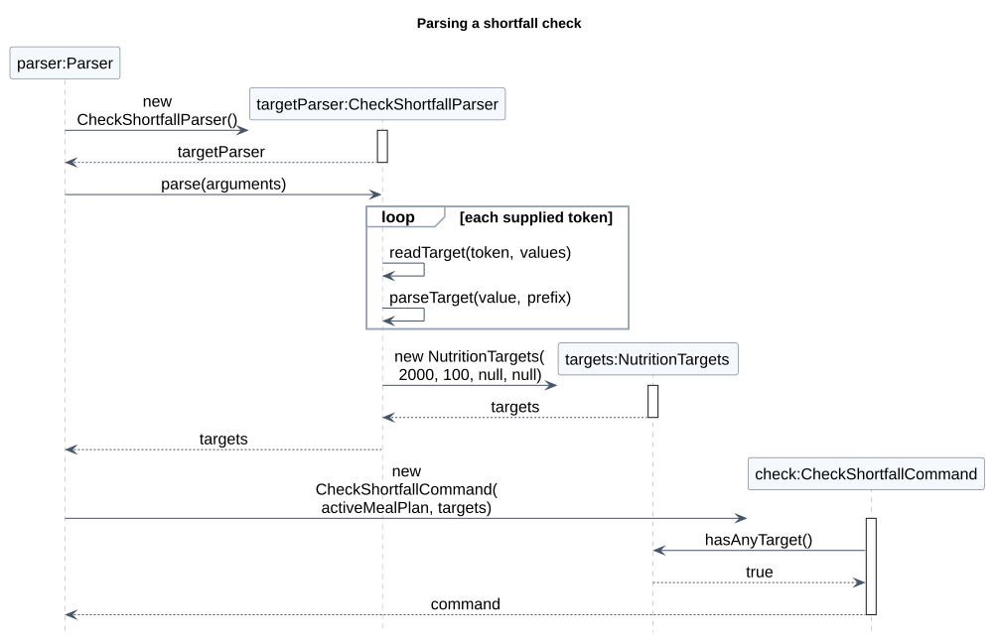

*Figure 14: Parsing returns a command to its caller without reading any plan; the console caller
is omitted to keep the view narrow. Dashed return arrows
represent returned values; constructor messages start the new objects' lifelines.*

The outer parser creates `CheckShortfallCommand` only after argument validation succeeds.
The command's `hasAnyTarget` check ensures the request contains something to compare.
Separating parsing from execution allows the application to validate input without
altering its data and lets tests inspect or defer a command before running it.

#### Execution and daily comparison

Figure 15 starts when `MishMash` calls `execute(recipeBook)` on the parsed command. The
inherited confirmation method returns an empty `Optional`, so this read-only action
requires no confirmation. That common interface step is omitted from the diagram.

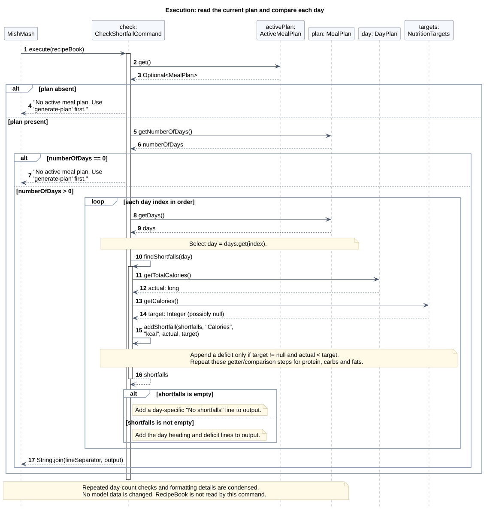

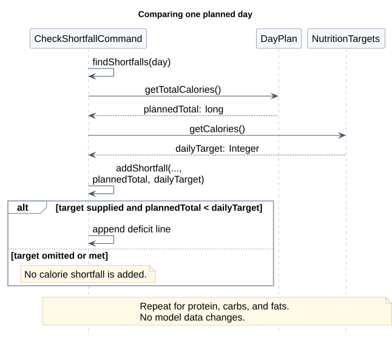

*Figures 15a and 9b: Plan traversal and daily comparison are shown separately. The
reference frame expands the preceding `findShortfalls` call rather than calling it again.
The calorie getter/comparison calls are expanded; the equivalent calls for
protein, carbohydrates, and fat are summarized in the note. Repeated day-count reads,
list indexing, logging, and string-building details are condensed.*

The command looks up the plan during execution, rather than capturing the plan while
parsing. Consequently, a command parsed before generation can inspect a plan created
later. Replacing the active plan before execution also causes the replacement to be
checked. Failed generation preserves the old plan and grocery snapshot, so checks after
such a failure still inspect the previous plan.

If no plan exists, or its day list is empty, execution returns the generate-first message.
Otherwise it visits each day in order. `findShortfalls(day)` obtains the four totals and
corresponding optional targets. `addShortfall` appends a line only when
`dailyTarget != null && plannedTotal < dailyTarget`; the reported deficit is
`dailyTarget - plannedTotal`.
For a day with 1800 kcal and 80 g protein, targets of 2000 kcal and 100 g protein produce:

```text
Day 1:
- Calories: 1800/2000 kcal (short by 200 kcal).
- Protein: 80/100 g (short by 20 g).
```

Each day is compared separately. A surplus on Day 2 therefore cannot hide a deficit on
Day 1. Exact matches and surpluses produce no shortfall lines. A day with no deficits
receives an explicit `No shortfalls for the supplied targets.` message; this does not
claim that excesses or omitted nutrients meet any constraint.

The existing total getters sum into `long`, and the comparison and subtraction keep
that type. Three large recipe values cannot wrap around into a false deficit as they
could with `int` summation. Totals are recomputed from the plan rather than cached.
For D days containing M meal occurrences in total, comparison work is O(D + M), since
each meal is visited a fixed four times. The result contains at most four deficit lines
per day, so the additional output space is O(D).

No setter, recipe mutation, generator, or storage operation is called during this check.
Repeated checks leave the plan, recipe book, and existing grocery snapshot unchanged.
The command's `FINE` log records the number of checked days; it installs no log handler.

#### Invalid input and recovery

Figure 16 shows a rejected zero target. Its "Target parser" lifeline is `CheckShortfallParser`. `CheckShortfallParser.parseTarget` throws
`IllegalArgumentException`; `Parser.parseCheckShortfall` wraps it as `MishMashException`,
preserves its cause, and appends `CHECK_SHORTFALL_USAGE`. `MishMash.executeCommand` catches
that recoverable exception and displays the error. The read loop then prints another
command prompt instead of ending the session.

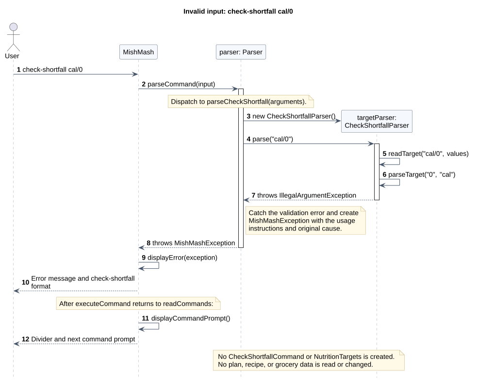

*Figure 16: Exception returns are labeled explicitly. For this invalid request, neither
the target object nor the shortfall command is constructed, and the plan is not accessed.*

An invalid request is an input error, whereas a valid request with no active plan returns
normal guidance from `execute`. Neither path changes application data.

| Boundary or invalid condition | Implemented behavior |
| --- | --- |
| No targets, including blank arguments | Reject with a request for at least one daily target and the command format. |
| Supported prefix with no attached value, such as `cal/` or `cal/ 2000` | Reject with `Missing value after cal/.` and the command format. Each supported prefix is named in its own missing-value message. Unknown and repeated prefixes retain their respective errors. |
| Zero, negative, signed, decimal, non-numeric, unit-suffixed, or overflowing target | Reject. Accepted values are digit strings representing 1 to `Integer.MAX_VALUE`; leading zeros are allowed. |
| Unknown prefix, repeated prefix, extra token, or space after a prefix | Reject without accessing the plan; each supported prefix is allowed once, in any order. |
| Target omitted | Ignore that nutrient, even when its total is zero. |
| Total equal to or above target | Do not report a shortfall for that nutrient. |
| Non-empty plan containing an empty day | Its totals are zero; report the full amount of each supplied target as a deficit. |
| Large daily total exceeding the integer range | Keep the total as `long`; do not wrap around. |
| Missing plan or plan with no days | Return `No active meal plan. Use 'generate-plan' first.` |

#### Rationale and alternatives considered

| Decision | Alternative considered | Reason for the current choice |
| --- | --- | --- |
| Report any amount strictly below a target | Reuse the generator's +/-15% satisfaction test | Generation accepts approximate matches; this feature explains the exact gap. A 1900 kcal plan can be accepted for a 2000 kcal generation target and still have a 100 kcal shortfall. `isSatisfiedBy` also returns only a boolean and cannot explain which nutrients are deficient. |
| Require explicit targets for each check | Read saved personal targets or remember the previous generation request | Saved personal settings are a separate enhancement. Explicit arguments make the current behavior predictable and allow checks against different targets without changing the plan. |
| Reuse the existing per-day `long` totals | Duplicate summation, use `int`, or compare an average across all days | Reuse keeps calculations consistent with the model; `long` prevents integer wraparound, and per-day checks avoid masking deficits through averaging. |
| Report deficits without modifying meals | Automatically regenerate or rebalance the plan | Automatic changes would introduce selection rules and could invalidate groceries. Reporting is sufficient for this user story and keeps the action read-only. |
| Return formatted text through `Command.execute` | Add a new formatter class and a separate shortfall-result model | The output currently has one consumer and four fixed nutrients. The existing command contract is sufficient; a structured result would become useful if another interface or export feature needed to consume it. |

#### Verification and diagram maintenance

`CheckShortfallCommandTest` covers daily comparison boundaries, all 15 non-empty target
combinations, different deficits on different days, a shortfall on the seventh day,
missing and empty plans, empty days between populated days, varied and repeated meals,
large totals, repeated execution, and current-plan lookup. It also checks preservation
of absent, empty, and non-empty grocery snapshots and the recipe book.
`CheckShortfallParserTest` exercises all 24 target orders, every nutrient prefix,
numerical limits, leading zeros, whitespace, duplicate prefixes, malformed values,
specific missing-value messages, and independence between parsing attempts.
`ParserCheckShortfallTest` covers dispatch, wrapped errors and their causes, unchanged
data after rejection, output ordering, explicit targets independent of generation,
checks after recipe deletion, default and injected dependencies, and failed generation.
`MishMashTest` covers the complete console workflow, repeated checks and recovery,
continued use of viewing and help commands, and end-of-input after an invalid check.
Run these with the full Java 25 verification tasks documented under [Testing](#testing).

Maintenance follows the course's [Java conventions](https://se-education.org/guides/conventions/java/index.html),
[code-quality guidance](https://se-education.org/se-book/codeQuality/index.html), and
[Week 8 developer-testing and documentation guidance](https://nus-cs2113-ay2627-s1.github.io/website/schedule/week8/topics.html).
Keep request coordination separate from token validation, use descriptive names and the
shared command/prefix constants, and document method contracts in multiline Javadoc.
Behavioral tests should verify independent expected results, exceptions, and unchanged
data; diagram checks should verify relationships and call order against the implementation.

Editable sources for all five figures are under
[`docs/diagrams/shortfall`](diagrams/shortfall/README.md). Rendered SVGs are checked in so
the diagrams display without a website plugin. The source README records the renderer
version and regeneration commands. Sources and images must be updated together after
changes to methods, references, or control flow. Syntax checks verify that the diagrams
render; accuracy also requires checking every depicted call and branch against the code.

<!-- @@author -->

<!-- @@author GauthamNandi -->
### Recording meals and tracking nutrition

#### Purpose and scope

This V2.0 enhancement supports two user stories:

* **As a returning user, I want to record meals that I have eaten so that I can keep track of my
  actual food intake.**
* **As a user tracking nutrition, I want to calculate the total calories and macronutrients for each
  meal so that I know the nutritional content of what I am eating.**

It adds two commands:

```text
record-meal INDEX
view-meals
```

`INDEX` is the position of a recipe in the `list-recipes` output, counting from 1, as for
`delete-recipe`. `view-meals` lists every recorded meal with its calories (kcal), protein, carbs and
fats (g), and its macro split, followed by the totals for all recorded meals. Unlike `check-shortfall`,
which examines the *planned* meals of the active plan, this feature records meals the user *has eaten*.
The recorded meals are kept in memory for the session only, matching the product's current data boundary.

A meal is one whole recipe, and a recipe stores the nutrition the user entered with `add-recipe`; nutrition
is not derived from ingredients. The nutritional content of one meal is therefore read from its recipe. What
the feature calculates is what the stored values do not give directly: the *totals* across all recorded
meals, and for each meal the *macro split*, which is the share of the meal's macronutrient energy that comes
from protein, carbohydrates and fats. The second user story is satisfied by showing each meal's own values
and macro split together with those totals.

#### Architecture-level view

The feature follows the existing command workflow. `MishMash` reads input, asks `Parser` for a
`Command`, executes it, and prints the returned text. Parsing validates syntax and creates the action;
execution reads or changes session data. A new model class, `MealLog`, holds the recorded meals. Like
`ActiveMealPlan`, it is session data shared between commands, but it is separate from the plan: the plan
holds meals the user intends to eat, and the log holds meals the user has eaten.

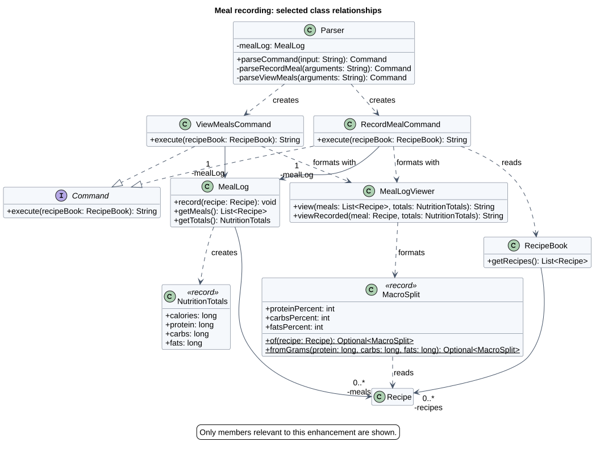

*Figure 17: Only members relevant to this enhancement are shown. Solid arrows are navigable
associations with private role names; dashed arrows show dependencies or interface realization.
`NutritionTotals` is the existing value record that `DayPlan` also uses for daily totals, and `MealLog`
reuses it; its values are `long` so that adding many recipes cannot overflow. `MacroSplit` is new.*

* `MealLog` stores the recorded meals in the order they were recorded. It offers `record(Recipe)`,
  a read-only `getMeals()`, and `getTotals()`, which sums calories, protein, carbs and fats into a
  `NutritionTotals`, the same record `DayPlan` returns for a day's meals. The commands never add up nutrition values themselves.
* `MacroSplit` (model) is an immutable record of three whole-number percentages. `MacroSplit.of(recipe)`
  calculates a recipe's split, and is empty when the recipe has no protein, carbs or fats to divide.
* `RecordMealCommand` and `ViewMealsCommand` implement `Command`. Each retains the shared `MealLog`.
* `MealLogViewer` (ui) turns the meals, their macro splits and the totals into text, in the same way
  `MealPlanViewer` formats a meal plan. Keeping formatting out of the model and commands lets them be
  tested without comparing layout text.
* `Parser` owns the `MealLog` and passes it to the commands it builds, because `Command.execute` only
  receives the `RecipeBook`. Every `Parser` constructor that is not given a log creates a fresh one, so
  each session starts with no recorded meals. `Parser(MealLog)` and
  `Parser(MealLog, MealPlanGenerator, ActiveMealPlan)` accept one, which lets tests supply and inspect
  the log. The command classes receive the log through their own constructors.

#### Recording a meal

Figure 18 follows `record-meal 2`. The dispatch from `parseCommand` through `parseNamedCommand` to
`parseRecordMeal` is condensed into the parser lifeline.

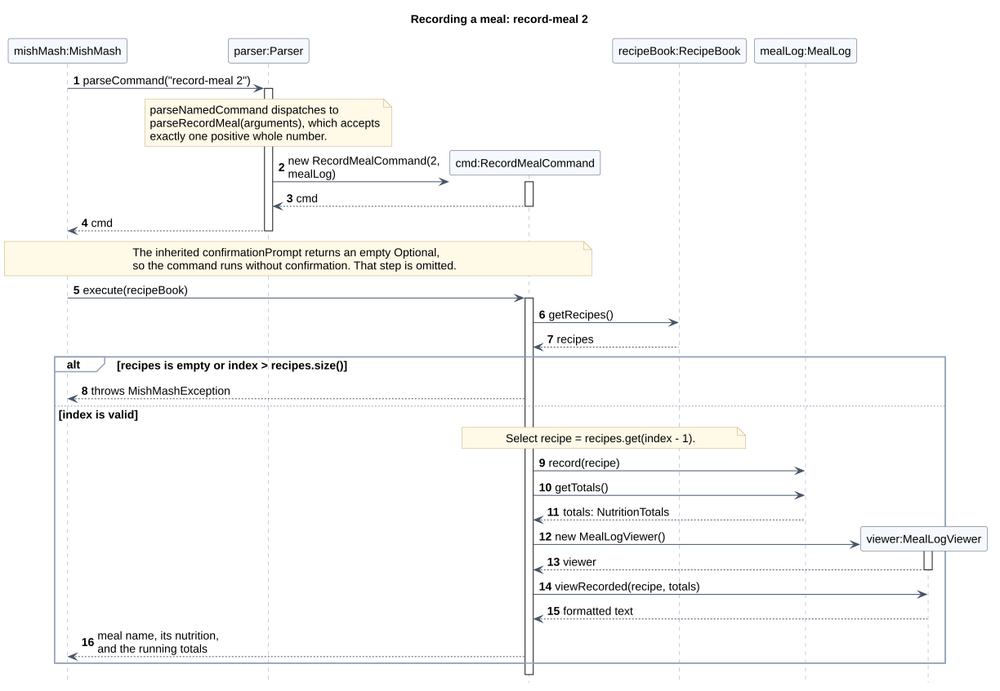

*Figure 18: Parsing returns a command without reading any data. The inherited confirmation step is
omitted because the command returns an empty `Optional`. The invalid-index branch is shown as an
`alt` fragment. The viewer asks `MacroSplit` for the recorded meal's split; its other formatting steps
are omitted.*

`Parser` checks that the argument is a single positive whole number. A missing, non-numeric, signed,
zero or extra argument is rejected with the usage line `Format: record-meal INDEX`; nothing is read or
changed. The command is created only after validation succeeds.

During execution the command converts the index to a zero-based position, as `DeleteRecipeCommand`
does, and looks the recipe up in the `RecipeBook` passed to `execute`. If the book is empty or the index
exceeds the number of recipes, it throws a `MishMashException` and nothing is recorded. Otherwise it calls
`MealLog.record(recipe)` and `MealLog.getTotals()`, then asks `MealLogViewer.viewRecorded` to format the
recorded meal's calories, macros and macro split with the running totals, so the user sees the effect
immediately. Recording a meal needs no confirmation: it is quick to repeat, and it changes only the log.

#### Viewing recorded meals and totals

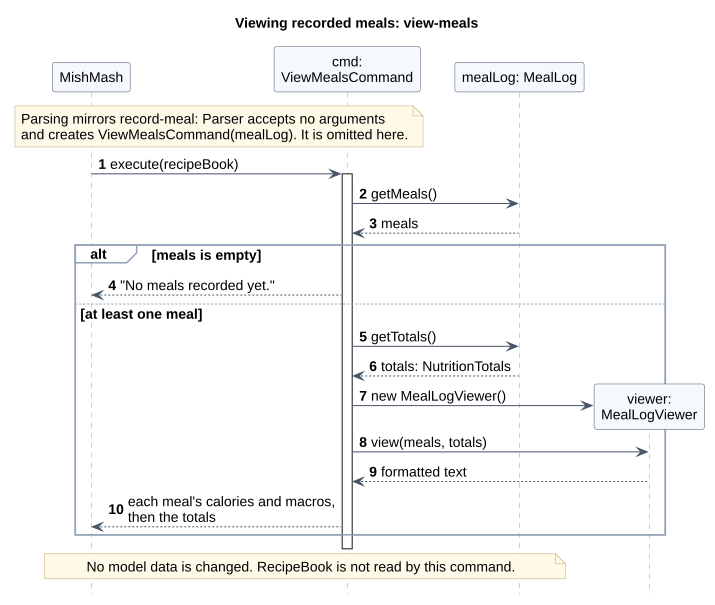

*Figure 19: Parsing mirrors `record-meal` and is omitted. The empty-log case is shown as an `alt`
fragment, and the per-meal macro split lookup as a `loop`.*

`view-meals` takes no arguments; any argument is rejected with its usage line. `ViewMealsCommand` reads
the meals from the `MealLog`. An empty log is a valid state, not an error, so the command returns
`No meals recorded yet.` Otherwise it asks the log for the totals and delegates formatting to
`MealLogViewer`. Each meal appears with its own calories, macros and macro split, which gives the per-meal
nutrition required by the second user story, followed by one totals line. Viewing never changes the log.

#### Macro split calculation

`MacroSplit.fromGrams(protein, carbs, fats)` converts the grams to energy with the standard factors of
4 kcal per gram of protein, 4 kcal per gram of carbohydrate and 9 kcal per gram of fat, then expresses each
nutrient's energy as a percentage of the three nutrients' combined energy. For `Chicken Rice` with 40 g
protein, 70 g carbs and 15 g fat, the energy is 160, 280 and 135 kcal, giving 27.8%, 48.7% and 23.5%.

Whole-number percentages that are each rounded would not always add up to 100. The calculation therefore
rounds every percentage down and gives the remaining points, one each, to the nutrients with the largest
fractional parts, preferring protein, then carbs, then fats on a tie. The example becomes 28%, 49% and 23%.
The three values always add up to 100.

If a recipe has 0 g of all three nutrients there is nothing to divide, so `MacroSplit.of` returns an empty
`Optional` and the viewer shows `Macro split: n/a`. The calculation uses `long` arithmetic, so the largest
values a recipe can hold do not overflow.

#### Invalid input and recovery

The recoverable errors reuse the existing path: `Parser` or the command throws `MishMashException`,
`MishMash.executeCommand` catches it, displays the message, and prompts for another command.

| Boundary or invalid condition | Behavior |
| --- | --- |
| `record-meal` with no argument, a non-numeric, signed, zero or decimal index, or an extra token | Reject with the command format; no data is read or changed. |
| Index larger than the number of recipes | Reject with `Recipe index must be between 1 and N.`; nothing is recorded. |
| `record-meal` while the recipe book is empty | Reject with a message that there are no recipes to record; nothing is recorded. |
| `view-meals` with any argument | Reject with the command format. |
| `view-meals` before any meal is recorded | Return `No meals recorded yet.` |
| Recipe deleted, edited with `edit-recipe`, or otherwise changed after a meal was recorded | The recorded meal keeps its original calories and macros. |
| Same recipe recorded twice | Two entries are kept, and both count toward the totals. |
| Recipe with 0 g of protein, carbs and fats | The meal is recorded and counted in the totals, and its split is shown as `Macro split: n/a`. |

#### Rationale and alternatives considered

| Decision | Alternative considered | Reason for the current choice |
| --- | --- | --- |
| Store the `Recipe` itself in the log | Store the recipe's index | `Recipe` is immutable, so the log keeps the nutrition as it was when the meal was eaten. Indexes shift whenever `delete-recipe` runs, so an old entry could silently point to a different recipe. |
| `MealLog.getTotals()` sums the meals on every call | Keep running totals updated by `record` | The meal list is the single source of truth, so totals cannot drift out of step with it. Sessions are small, so the repeated sum costs nothing noticeable. Running totals would need extra care if removing meals is added later. |
| `Parser` owns the `MealLog` and passes it to the commands | Widen `Command.execute` to take a shared context object | `Parser` already owns and shares `ActiveMealPlan`, and this leaves the `Command` interface and every existing command unchanged. Constructors that take a `MealLog` let tests supply their own, as the `ActiveMealPlan` constructors do. A context object becomes worthwhile if many more data holders are added. |
| Pick a meal by recipe index | Type nutrition values in directly | Reusing stored recipes avoids duplicating the input and validation of `add-recipe` and keeps unchecked numbers out of the log. Free-text entry would help when eating out, so it is a possible extension. |
| Show the share of macronutrient energy as the per-meal calculation | Show the share of the recipe's stated calories, or only grams | The stated calories are entered by the user and need not equal 4/4/9 kcal per gram of the entered macros, so shares of them could add up to more or less than 100%. Shares of the macro energy always add up to 100 and need no extra input. |
| Round down and distribute the remaining points by largest remainder | Round each percentage to the nearest whole number | Plain rounding can give 99% or 101% in total, which looks like an error to a reader. Largest remainder keeps the total at exactly 100 and is deterministic. |
| Return formatted text through `Command.execute`, using a small viewer | Print from the command or the model | The viewer matches `MealPlanViewer` and keeps layout out of the logic, so the model and commands can be tested without comparing layout text. |

#### Limitations and possible extensions

* The log lives in memory for one session and is lost when the application exits.
* All meals form one list. A later version could add `d/DATE` to record meals against a day and show
  daily totals, or compare the totals with the targets given to `check-shortfall`.
* There is no command to remove or correct a recorded meal yet.
* Each meal counts as one whole recipe; portion sizes are not supported, as for meal plans.

#### Verification

The feature is covered by `MealLogTest`, `MacroSplitTest`, `MealLogViewerTest`, `RecordMealCommandTest`,
`ViewMealsCommandTest`, `ParserRecordMealTest`, and console-workflow tests in `MishMashTest`. They check
the totals (including values beyond the `int` range), the macro split for typical, tied, single-nutrient,
zero and very large values, the exact output layout, every invalid index in the table above, the empty-log
and empty-book cases, that failed commands leave the log unchanged, and that the log is separate from the
active plan. The manual checks are under [Record and View Meals](#record-and-view-meals); the use cases are
UC11 and UC12.

#### Diagram maintenance

Editable sources for the three figures are under
[`docs/diagrams/record-meal`](diagrams/record-meal/README.md). Rendered SVGs are checked in under
`docs/images/record-meal` so the diagrams display without a plugin. The source README gives the
regeneration commands. Check every depicted call, branch and message against the code after any change, and
update the sources and images together.

<!-- @@author -->

## Documentation Logging Testing Configuration and DevOps

### Documentation

The project documentation is maintained in Markdown under `docs`. The main documents are `DeveloperGuide.md` and `UserGuide.md`

Keep command formats, examples, prerequisites, and expected results consistent with the code. Document planned behaviour separately from available behaviour.

#### Claiming and correcting authorship with RepoSense

RepoSense normally uses Git history to identify contributions. Use `@@author` tags when necessary to credit your work or restore the original author's credit after moving or refactoring content. These tags change RepoSense attribution, not Git commit history.

Use the comment syntax appropriate to the file:

| File type | Start tag | End tag |
| --- | --- | --- |
| Java | `// @@author oilybikechain` | `// @@author` |
| Markdown | `<!-- @@author oilybikechain -->` | `<!-- @@author -->` |

1. Identify the code or documentation belonging to the contributor. Replace `oilybikechain` with the appropriate RepoSense author identifier when crediting someone else.
2. Put the start tag on its own line immediately before that contribution, including its heading or explanatory comments.
3. Put the end tag on its own line immediately after it. Without an end tag, attribution continues to the next start tag or the end of the file.
4. To fix incorrect credit, correct the existing start tag or add a correctly scoped pair around the original contribution. Keep unrelated contributions outside the pair.
5. Commit and push the change to the branch analysed by the tracker, then check the next refreshed report.

Do not add an end tag without a corresponding start tag; it can leave subsequent content unattributed. Markdown HTML comments remain hidden in the rendered guide.

Reference: [RepoSense authorship-tag guide](https://reposense.org/ug/usingAuthorTags.html).

### Logging

The application uses `java.util.logging`. Diagnostics are written to rotating files using the pattern `mishmash.%g.log`, with an approximate limit of 1,000,000 bytes per file and three files retained.

Levels include `FINE` for command diagnostics, `INFO` for lifecycle events and successful grocery-generation counts, `WARNING` for selected rejected operations or logging problems, and `SEVERE` for unexpected application failures. If the log file cannot be opened because of an I/O error, the application continues with its existing logging configuration.

### Testing

The project uses JUnit Jupiter. Tests are under `src/test/java/mishmash` and mirror the production packages. They cover validation, commands, models, generation, display formatting, and full console interactions.

Run verification from the repository root:

```powershell
.\gradlew.bat test checkstyleMain checkstyleTest
```

On Linux or macOS:

```text
./gradlew test checkstyleMain checkstyleTest
```

Use Java 25. JUnit reports appear at `build/reports/tests/test/index.html`, and Checkstyle reports are under `build/reports/checkstyle`. The add-recipe invalid-input dataset is `src/test/resources/add-recipe-invalid.tsv`.

### Configuration

The current application has no user configuration file. Users supply recipe values, plan length, and optional daily nutrition targets through commands.

The supported plan length is 1 to 7 days. Each generated day contains exactly three different stored recipe entries. Generation uses a fixed target tolerance of 15%; users cannot change that tolerance through a command. In contrast, `check-shortfall` reports any amount strictly below the explicit targets supplied to that check.

### DevOps

GitHub Actions runs `./gradlew check` for pushes and pull requests on Ubuntu, macOS, and Windows using Java 25. Check the resulting reports before merging changes.

The Gradle build packages the application as `build/libs/MishMash.jar`. Release documentation should use that filename and describe the features included in the actual release.

## Appendix Requirements

### Product Scope

**Target user profile:** Users who prepare meals in advance, want to organise recipes and review calorie or macronutrient totals, and are comfortable entering text commands. Users provide their own recipes and nutrition information.

**Value proposition:** MishMash connects recipe management, meal selection, and grocery preparation in one workflow. It generates plans from user-entered recipes and combines ingredient quantities for the selected meals.

**Current boundaries:** Data lasts for one session. Nutrition is entered by the user rather than calculated from an ingredient database. Plans use whole recipes without portion scaling. Ingredient names and units are matched exactly; automatic unit conversion and grocery-item ticking are not supported.

### User Stories for Current Functionality

| As a ... | I want to ... | So that I can ... |
| --- | --- | --- |
| New user | View available commands and formats | Learn how to use the application |
| Meal prep user | Add a recipe with nutrition, ingredients, and quantities | Make it available for planning |
| User managing recipes | List recipes and inspect a selected recipe | Find and check its stored details |
| Returning user | Update an existing recipe's ingredients, quantities, and nutrition | Keep recipe information consistent with how I prepare the dish |
| User managing recipes | Confirm deletion of a selected recipe | Check that I am removing the intended entry |
| Meal prep user | Generate a random meal plan | Reduce manual meal selection |
| User tracking nutrition | Supply daily calorie and macronutrient targets | Generate meals within the supported tolerance |
| User tracking nutrition | Set my daily calorie target once | Have my meal plans meet my desired calorie intake without retyping it |
| User tracking nutrition | Set my daily protein, carbohydrate, and fat targets once | Have my meal plans meet my desired macronutrient intake without retyping them |
| User tracking nutrition | See daily excesses above my generation targets | Identify days that exceed an exact target despite the generation tolerance |
| User tracking nutrition | Detect when planned meals fall short of calorie or macronutrient targets | Add or adjust meals accordingly |
| Meal prep user | View all planned days or a selected day | Review meals and daily nutrition totals |
| Shopper | Generate groceries from the active plan | Obtain combined ingredient quantities |
| Shopper | View the generated grocery list | See what to purchase |
| Returning user | Record the meals that I have eaten | Keep track of my actual food intake |
| User tracking nutrition | See the calories, macronutrients, and macro split of each recorded meal, and their totals | Know the nutritional content of what I am eating |
| User who makes a typing mistake | Receive an error and enter another command | Correct the mistake without restarting |
| User with dietary requirements | Set named diets, category exclusions, and ingredient exclusions | Generate compatible meals and repair conflicting planned days |
| User with dietary requirements | View the active dietary profile | Check the restrictions currently applied |


### User Stories for Future Consideration

The following ideas are not implemented and are not commitments for a particular release:

- Search recipes.
- Record meals against dates, and remove or correct a recorded meal. The current design is described in
  [Recording meals and tracking nutrition](#recording-meals-and-tracking-nutrition).
- Save and restore recipes or meal plans between sessions.
- Estimate meal or grocery costs.

Daily nutrition targets, daily nutrition totals, and recording meals eaten are already supported and are therefore included in the current-functionality stories.

### Use Cases

The actor in each use case is the user. A command session has already started and the user has entered a name. MSS means Main Success Scenario.

#### UC01 Add a recipe

**MSS**

1. The user enters `add-recipe` with a name, nutrition values, and at least one ingredient.
2. MishMash validates the input.
3. MishMash adds the recipe, displays its details, and prompts for another command.

**Extensions**

- 2a. A field is missing, blank, repeated, or invalid: MishMash displays an error and the add-recipe format. Existing recipes remain unchanged. The use case ends.

#### UC02 List recipes

**MSS**

1. The user enters `list-recipes`, optionally selecting an index.
2. MishMash displays the numbered names and calories of all recipes, or the full details of the selected recipe.

**Extensions**

- 1a. The index syntax is invalid: MishMash displays an error and the command format.
- 2a. The book is empty: MishMash displays guidance to add a recipe.
- 2b. The selected index does not exist: MishMash displays an index-range error.

#### UC03 Delete a recipe

**MSS**

1. The user enters `delete-recipe INDEX`.
2. MishMash checks the index and asks for confirmation, naming the selected recipe.
3. The user enters `y` or `yes`.
4. MishMash deletes the entry and displays its name and the remaining recipe count.

**Extensions**

- 1a. The index syntax is invalid: MishMash displays an error.
- 2a. The book is empty or the index does not exist: MishMash displays an error without asking for confirmation.
- 3a. The response is anything other than `y` or `yes`, ignoring case and surrounding whitespace, or input ends: the deletion is cancelled and the book remains unchanged.

#### UC04 Generate a meal plan

**Precondition:** At least three recipe entries are available.

**MSS**

1. The user enters `generate-plan d/DAYS`, optionally including daily nutrition targets.
2. MishMash validates the requested days and targets.
3. MishMash generates exactly three different recipe entries per day, meeting every supplied target within 15%.
4. MishMash makes the new plan active, clears the previous groceries, and displays a confirmation.

**Extensions**

- 2a. Days are outside 1 to 7, a target is not a positive integer, or arguments are malformed: MishMash rejects the command.
- 3a. Fewer than three recipe entries are available, or no acceptable plan is found: MishMash displays an error. The previous plan and groceries remain available.

Recipes may be repeated on different days. With no targets, there are no nutrition constraints on the selection. Targets saved with `set-targets` (UC13) apply to every nutrient that the command leaves out, and a target typed in the command replaces the saved one for that plan.

#### UC05 View a meal plan

**MSS**

1. The user enters `view-plan`, optionally selecting `d/DAY_NUMBER`.
2. MishMash displays all days or the selected day, including each meal's nutrition and daily totals.

**Extensions**

- 1a. The day argument is malformed: MishMash displays an error and the command format.
- 2a. No plan is active: MishMash asks the user to generate one first.
- 2b. The selected day exceeds the active plan's length: MishMash displays a range error.

#### UC06 Generate a grocery list

**Precondition:** A meal plan is active.

**MSS**

1. The user enters `generate-list` without arguments.
2. MishMash combines ingredients from every meal occurrence in the active plan.
3. MishMash stores the completed groceries and confirms that they can be viewed using `view-list`.

**Extensions**

- 1a. Arguments are supplied: MishMash rejects the command without changing the stored list.
- 2a. There is no active plan: MishMash asks the user to generate one first.

Only exact ingredient-name and unit matches are combined. Different units or letter case remain separate entries.

#### UC07 View a grocery list

**MSS**

1. The user enters `view-list` without arguments.
2. MishMash displays the stored entries, their quantities and units, and the total number of entries.

**Extensions**

- 1a. Arguments are supplied: MishMash displays an error.
- 2a. No grocery list has been generated: MishMash asks the user to generate one first.

Viewing does not regenerate groceries. The displayed `[ ]` markers cannot be ticked through a command.

#### UC08 View help or exit

- Entering `help` displays command purposes and formats. Additional arguments produce an error.
- Entering `bye` displays the goodbye message and ends the session. Session data is discarded.

<!-- @@author Rixte -->
#### UC09 Check planned nutrition shortfalls

**MSS**

1. The user enters `check-shortfall` with at least one daily nutrition target.
2. MishMash validates the target arguments and obtains the active plan.
3. MishMash compares each day's planned totals with the supplied targets.
4. MishMash displays each day's deficient nutrients and amounts, or a no-shortfalls
   message for that day, then prompts for another command.

**Extensions**

- 2a. Targets are missing, repeated, unknown, or invalid: MishMash displays an error and
  the check-shortfall format. The use case ends without changing application data.
- 2b. No plan exists or the plan has no days: MishMash asks the user to generate a plan.
  The use case ends.

Omitted nutrients and excesses are not checked. All plan, recipe, and grocery data remains
unchanged. A shortfall is any amount below a target, even within generation's tolerance.
<!-- @@author -->

<!-- @@author oilybikechain -->
#### UC10 Detect exceeded nutrition targets

**Precondition:** An active plan was generated with at least one daily nutrition target.

**MSS**

1. The user enters `view-plan`, optionally selecting a day.
2. MishMash calculates each displayed day's nutrition totals and compares them with the saved generation targets.
3. For each exceeded target, MishMash displays a warning with the excess, actual total, and target below that day's totals.

**Extensions**

- 2a. A target is omitted, equal to the total, or above it: no warning is shown for that nutrient.
- 2b. No generation request is retained, or the plan was generated without targets: only the normal plan display is shown.
- 2c. No plan exists or a selected day is invalid: the existing `view-plan` messages apply.

The comparison is strict and does not apply the generator's 15% tolerance. Viewing leaves the meals,
targets, and groceries unchanged. A successful replacement uses its new targets; failed generation
preserves the previous warnings. Dietary repair recalculates warnings using the repaired meals and
the retained generation targets. Clearing the plan removes the warnings.
<!-- @@author -->

<!-- @@author GauthamNandi -->
#### UC11 Record a meal eaten

**Precondition:** At least one recipe exists.

**MSS**

1. The user enters `record-meal INDEX`, using an index shown by `list-recipes`.
2. MishMash validates the index and finds the recipe at that position.
3. MishMash adds the recipe to the recorded meals.
4. MishMash displays the meal, its macro split, and the totals of all recorded meals, then prompts for another command.

**Extensions**

- 2a. The index is missing, or is not a single positive whole number: MishMash displays an error and the `record-meal` format. The use case ends without recording anything.
- 2b. There are no recipes, or the index is larger than the number of recipes: MishMash displays an error. The use case ends without recording anything.

No confirmation is requested. Recording changes only the recorded meals; recipes, the meal plan, and groceries are unchanged. Recording the same recipe again adds another entry.

#### UC12 View recorded meals

**MSS**

1. The user enters `view-meals`.
2. MishMash reads the recorded meals and sums their nutrition.
3. MishMash displays each meal in the order recorded with its calories, macronutrients, and macro split, followed by the totals, then prompts for another command.

**Extensions**

- 1a. The user adds an argument: MishMash displays an error and the `view-meals` format. The use case ends.
- 2a. No meal has been recorded: MishMash displays `No meals recorded yet.` The use case ends.

Viewing leaves the recorded meals unchanged. The totals cover every meal recorded in the session, because meals are not recorded against dates.
<!-- @@author -->

<!-- @@author neil0618 -->
#### UC13 Set daily targets

**MSS**

1. The user enters `set-targets` with one or more of `cal/`, `p/`, `c/`, and `f/`, each followed by a positive whole number or `none`.
2. MishMash validates every argument.
3. MishMash replaces the target of each nutrient given a number, removes the target of each nutrient given `none`, and keeps the targets of the other nutrients.
4. MishMash displays the targets now saved, or `All daily targets cleared.` if none remain, then prompts for another command.

**Extensions**

- 2a. No argument is given, a prefix is unknown or repeated, a value is missing, or a value is neither `none` nor a positive whole number up to 2147483647: MishMash displays an error and the `set-targets` format. The use case ends and the saved targets are unchanged.

The command does not change the recipe book or an existing meal plan. The saved targets are used by later `generate-plan` commands (UC04) and last until the application closes.

#### UC14 View daily targets

**MSS**

1. The user enters `view-targets`.
2. MishMash displays the saved target of each nutrient, with `not set` for a nutrient that has none, then prompts for another command.

**Extensions**

- 1a. The user adds an argument: MishMash displays an error and the `view-targets` format. The use case ends.
- 2a. No target is saved: MishMash displays `No daily targets saved. Use 'set-targets' to set them.` The use case ends.
<!-- @@author -->

<!-- @@author peilingggg -->
#### UC15 Set dietary preferences

**MSS**

1. The user enters `set-diet` with at least one supported prefixed field.
2. MishMash validates the complete replacement profile.
3. If any planned day conflicts, MishMash asks for confirmation. After agreement, it preserves compatible planned days and replaces conflicting days using the original targets.
4. MishMash rebuilds existing groceries after repair, saves the profile, and displays the outcome.

**Extensions**

- 2a. Syntax or values are invalid: display an error and usage; preserve all data.
- 3a. No active plan exists: save the profile for future generation.
- 3b. The complete plan is compatible: preserve the plan and groceries.
- 3c. The user declines confirmation: preserve the profile, plan, and groceries.
- 3d. Replacement fails or the original request is unavailable: save the profile, clear
  the plan and groceries, and explain how to generate again.

#### UC16 View dietary preferences

**MSS**

1. The user enters `view-diet` without arguments.
2. MishMash reads the current session profile and displays the diet and both exclusion lists.

**Extensions**

- 1a. Arguments are supplied: display an error and `Format: view-diet`; preserve all data.
- 2a. No restrictions are active: display `none` for the diet and both lists.

Viewing never changes the profile or generated data.
<!-- @@author -->

### Non Functional Requirements

- The application requires Java 25 and provides a command-line interface.
- The project targets Windows, macOS, and Linux, with verification configured on all three operating systems.
- Ordinary invalid command input must allow the session to continue and preserve existing data.
- Decimal ingredient quantities must retain their numeric precision.
- Generating meals and groceries must leave the stored recipe entries unchanged.
- The normal application workflow does not require a network connection or an external database.

### Glossary

| Term | Meaning |
| --- | --- |
| Recipe | A named entry with calorie and macronutrient values and required ingredients. |
| Recipe book | The ordered recipes available in the current session. |
| Recipe index | A recipe's current displayed position, starting at 1. |
| Meal plan | Recipes assigned to one or more numbered days. |
| Active plan | The single plan currently available for viewing and grocery generation. |
| Macronutrient | Protein, carbohydrate, or fat, measured in grams. |
| Daily target | An optional desired daily total for calories or a macronutrient. |
| Grocery list | The combined ingredient quantities generated from the active plan. |
| Session | One running instance of the application; application data is not retained after it ends. |

## Appendix Instructions for Manual Testing

These checks cover current behaviour. Testers may explore additional inputs. Each subsection is independent: start a fresh session and load the sample recipes where needed so earlier tests do not change later preconditions.

### Launch

1. Use Java 25 and open a terminal in the project root containing the built JAR.
2. Run `java -ea -jar build/libs/MishMash.jar`.
3. Confirm that the banner and name prompt appear. Enter a name and check that a command prompt follows.

### Sample Recipes

Enter each command on one line:

```text
add-recipe n/Chicken Rice cal/600 p/40 c/70 f/15 i/Chicken:200g i/Rice:150g
add-recipe n/Tofu Rice cal/500 p/25 c/60 f/12 i/Tofu:200g i/Rice:100g
add-recipe n/Oats cal/400 p/15 c/50 f/10 i/Oats:80g i/Milk:200ml
```

With exactly these three entries, each generated day contains all three. Meal order may vary. Daily totals are 1500 kcal, 80g protein, 180g carbs, and 37g fats.

### Add a Recipe

- **Valid input:** Enter the first sample recipe. Expect one addition, its nutrition and ingredients, and another prompt.
- **Missing ingredient:** Omit both `i/` fields. Expect an error requiring at least one ingredient and no addition.
- **Invalid nutrition:** Replace `cal/600` with `cal/abc` or `cal/2147483648`. Expect an integer or range error.
- **Boundary value:** Replace `cal/600` with `cal/0`. Expect successful addition; zero nutrition is allowed.
- **Invalid quantity:** Use `i/Chicken:0g`. Expect rejection because recipe ingredient quantities must be positive.
- **Decimal quantity:** Use `i/Chicken:200.5g`. Expect the decimal quantity to be preserved.
- **Repeated field:** Add a second `n/` field. Expect rejection. Repeated `i/` fields remain valid.

For rejected commands, check that existing recipes remain unchanged and a subsequent valid addition succeeds.

### List Recipes

After loading the samples:

- Enter `list-recipes`. Expect three numbered entries in insertion order, showing names and calories.
- Enter `list-recipes 2`. Expect Tofu Rice's full nutrition and ingredients.
- Enter `list-recipes 4`. Expect an out-of-range error.
- In a fresh empty session, enter `list-recipes`. Expect guidance to add a recipe.

### Delete a Recipe

After loading the samples:

- Enter `delete-recipe 2`. Expect a confirmation naming Tofu Rice. Answer `n`; verify that nothing changed.
- Repeat and answer `yes`. Expect deletion, a remaining count of 2, and renumbering of the later recipe.
- Enter `delete-recipe 0` or an index larger than the current book size. Expect an error without deletion.

### Generate a Meal Plan

Use a fresh session containing exactly the three sample recipes:

- Enter `generate-plan d/3`. Expect confirmation of a three-day plan. Check with `view-plan` that each day has exactly three meals.
- Enter `generate-plan d/2 cal/1500 p/80 c/180 f/37`. Expect success. Each day's totals match the sample totals exactly.
- Enter `generate-plan d/8`. Expect rejection because the day limit is 1 to 7.
- Enter `generate-plan d/1 cal/1`. Expect failure to find acceptable meals. Verify that the previous plan remains available.
- In a separate session containing fewer than three recipes, try `generate-plan d/1`. Expect a minimum-recipe error.

### View a Meal Plan

After generating a two-day plan:

- Enter `view-plan`. Expect both days, meal nutrition, and daily totals.
- Enter `view-plan d/1`. Expect only Day 1.
- Enter `view-plan d/3`. Expect a day-range error and another prompt.
- In a fresh session with no plan, enter `view-plan`. Expect the generate-first message.

<!-- @@author oilybikechain -->
### Combined Daily Nutrition Totals

Using exactly the three [sample recipes](#sample-recipes), run `generate-plan d/2` and `view-plan`.
Both days must show `Daily Totals: 1500 kcal | Protein: 80g | Carbs: 180g | Fats: 37g` regardless
of meal order. Run `view-plan d/2`: its totals must match the second day's previous display, rather
than adding the two days together. Repeating the command must not change the plan or totals.

The combined `NutritionTotals` API's empty-day, repeated-meal, and integer-overflow cases are tested
by `DayPlanTest`; ordinary generation always supplies three distinct recipes per day.

### Nutrition Target Warnings

In a fresh session with no dietary restrictions, enter:

```text
add-recipe n/A cal/500 p/20 c/50 f/10 i/Rice:100g
add-recipe n/B cal/600 p/30 c/60 f/15 i/Rice:100g
add-recipe n/C cal/700 p/40 c/70 f/20 i/Rice:100g
generate-plan d/2 cal/1700 p/85 c/180 f/45
view-plan
view-plan d/2
```

Each day must total 1800 kcal, 90 g protein, 180 g carbohydrates, and 45 g fats, regardless of meal order.
Expect exactly these warnings below each displayed day's totals:

```text
Warning: Calories exceed target by 100 kcal (1800 kcal actual; 1700 kcal target).
Warning: Protein exceeds target by 5 g (90 g actual; 85 g target).
```

`view-plan d/2` must show only day 2. Then try `generate-plan d/1 cal/1`: generation must fail and
`view-plan` must still display the previous two days and their warnings. Run `check-shortfall cal/1900`
and verify that a subsequent `view-plan` retains those warnings. Finally run `generate-plan d/1` and
`view-plan`: the replacement must show one day with no warnings because no targets were supplied.

<!-- @@author -->
<!-- @@author Rixte -->
### Check Nutrition Shortfalls

1. In a fresh session, enter `check-shortfall cal/2000` before generating a plan. Expect
   `No active meal plan. Use 'generate-plan' first.` and another command prompt.
2. Load exactly the three [sample recipes](#sample-recipes), enter `generate-plan d/2`,
   and then `generate-list`. Each day's planned totals are 1500 kcal, 80 g protein,
   180 g carbohydrates, and 37 g fat.
3. Enter `check-shortfall cal/2000 p/100 c/200 f/60`. Both Day 1 and Day 2 should report
   deficits of 500 kcal, 20 g protein, 20 g carbohydrates, and 23 g fat. For each day,
   verify that the displayed total and target are included alongside the deficit.
4. Enter `check-shortfall cal/1500 p/80 c/100`. Both days should display
   `No shortfalls for the supplied targets.` Calories and protein exactly match,
   carbohydrates exceed the target, and fat is omitted.
5. Enter `check-shortfall cal/1501`. Expect a 1 kcal deficit for each day even though
   that difference is within the generation tolerance.
6. Try `check-shortfall`, `check-shortfall cal/0`, `check-shortfall p/1.5`,
   `check-shortfall cal/2000 cal/2100`, and `check-shortfall d/1`. Each should produce a
   recoverable error with the check-shortfall format. Retry a valid check afterwards.
7. Enter `view-plan` and `view-list`. The two-day plan and all five grocery entries should
   be unchanged. Their quantities should match the table in
   [Generate a Grocery List](#generate-a-grocery-list). Repeat a check to verify that
   results are stable, and enter `help` to confirm the new command is listed.

The CLI cannot generate an empty day or an empty plan; those defensive cases, null
dependencies, and integer-overflow boundaries are covered by the automated tests.
<!-- @@author -->

### Generate a Grocery List

With exactly the sample recipes, generate a two-day plan and enter `generate-list`. Expect:

```text
Grocery list generated. Use 'view-list' to view it.
```

Then enter `view-list` and verify:

| Ingredient | Quantity for two days |
| --- | --- |
| Chicken | 400g |
| Rice | 500g |
| Tofu | 400g |
| Oats | 160g |
| Milk | 400ml |

There should be five displayed entries. Their order follows the meals' first appearances and may vary. The generation confirmation itself does not display an item count.

- Run `generate-list` again. Expect unchanged quantities rather than doubled totals.
- Enter `generate-list extra`. Expect rejection without changing the stored list.
- In a fresh session without a plan, enter `generate-list`. Expect guidance to generate a plan first.

<!-- @@author oilybikechain -->
For aggregation edge cases, use the User Guide's [ingredient combining example](UserGuide.md#ingredient-combining-example)
in a fresh session. Expect exactly `Rice: 0.6g`, `Rice: 2kg`, and `rice: 100g`, with no rounding,
unit conversion, or case normalization. Repeat `generate-list` and check that quantities stay the same.
Then enter `generate-list extra` and `view-list`: syntax rejection must leave those entries unchanged.
Generate a replacement plan and confirm that groceries must be regenerated before viewing.

### Defensive Diagnostics and Recovery

With a plan and grocery list already generated, enter `generate-plan d/0`, `list-recipes 0`, and
`delete-recipe 0`. Each must display its own command format, then allow another command. Verify
with valid viewing commands that no recipes, meals, or groceries changed. Attempt
`generate-plan d/1 cal/1` with the standard sample recipes and confirm that generation fails while
the previous plan and grocery list remain available.

Exception causes and assertion invariants are developer diagnostics, not extra console output.
Verify cause preservation with `ParserTest` and `GeneratePlanCommandTest` under Java 25 with
assertions enabled. Inspect `FINE` generation records only when that level is enabled in the
existing logging configuration; absence of a `FINE` record at a higher log level is expected.
<!-- @@author -->

### View a Grocery List

- Enter `view-list` after grocery generation. Expect ingredient quantities, units, `[ ]` markers, and the total entry count.
- Enter `view-list extra`. Expect a format error.
- Successfully generate a replacement meal plan, then enter `view-list`. Expect a generate-list-first message because the previous groceries were cleared.
- Generate groceries again, then attempt `generate-plan d/1 cal/1`. After that failure, verify that the previous grocery list is still available.

<!-- @@author GauthamNandi -->
### Record and View Meals

1. In a fresh session, enter `record-meal 1`. Expect `Error: There are no recipes to record. Use 'add-recipe' to add one.`, the list of command formats, and another prompt. Enter `view-meals` and expect `No meals recorded yet.`
2. Load exactly the three [sample recipes](#sample-recipes). Enter `record-meal 1`. Expect:

   ```text
   Meal recorded!
   Chicken Rice (600 kcal | P: 40g, C: 70g, F: 15g)
       Macro split: P 28% | C 49% | F 23%
   Total so far: 600 kcal | Protein: 40g | Carbs: 70g | Fats: 15g
   ```

3. Enter `record-meal 2`. Expect Tofu Rice with `Macro split: P 22% | C 54% | F 24%` and `Total so far: 1100 kcal | Protein: 65g | Carbs: 130g | Fats: 27g`.
4. Enter `view-meals`. Expect the header, `Meal 1: Chicken Rice ...` and `Meal 2: Tofu Rice ...`, each followed by its indented `Macro split` line, then a divider, `Total: 1100 kcal | Protein: 65g | Carbs: 130g | Fats: 27g`, and the footer. Confirm that each split adds up to 100%.
5. Enter `record-meal 1` again, then `view-meals`. Expect a third entry, `Meal 3: Chicken Rice ...`, and `Total: 1700 kcal | Protein: 105g | Carbs: 200g | Fats: 42g`.
6. Enter `add-recipe n/Black Coffee cal/5 p/0 c/0 f/0 i/Coffee:1cup`, then `record-meal 4`. Expect `Macro split: n/a` and a total that grows by 5 kcal only.
7. Try `record-meal`, `record-meal 0`, `record-meal 5`, `record-meal two`, `record-meal -1`, `record-meal 1 2`, `view-meals now`. Each should produce a recoverable error. Enter `view-meals` afterwards and confirm that the recorded meals are unchanged.
8. Enter `edit-recipe 2 cal/100`, then `delete-recipe 1` and confirm. Enter `view-meals`. Every recorded meal should keep the calories and macros it had when recorded.
9. Enter `generate-plan d/1`, then `view-meals` and `view-plan`. The recorded meals should be unchanged by plan generation, and the plan should be unaffected by the recorded meals.
10. Enter `help` and confirm that both commands are listed. Enter `bye`, restart, and enter a name. `view-meals` should report `No meals recorded yet.`
<!-- @@author -->

<!-- @@author peilingggg -->
### Dietary Preferences and Plan Repair

1. In a fresh session, use the [restricted-plan example in the User Guide](UserGuide.md#updating-an-existing-plan).
   Confirm two days of classified vegan meals and 400 g each of Rice, Beans, and Tofu in groceries.
2. Enter `view-diet`. Expect vegan with `none` for both explicit exclusion lists.
3. Enter `set-diet diet/keto`. Expect invalid diet, supported values, aliases, and usage.
   Confirm the profile, plan, and groceries remain unchanged.
4. Add `add-recipe n/Lentils cal/600 p/10 c/20 f/5 i/Lentils:200g food/legume`,
   then enter `set-diet diet/vegan avoid/soy`. Expect repaired days with Rice, Beans, and Lentils.
   Confirm each day still totals 1800 kcal and groceries contain 400 g of each ingredient.
5. Enter `set-diet exclude/Beans,Tofu`. This replaces the previous profile and leaves only Rice
   and Lentils eligible. Expect saved preferences and a cleared plan and grocery list.
   Confirm with `view-diet`, `view-plan`, and `view-list`.
6. Restart in a fresh session and enter `view-diet`. Expect `none` for all three lines.
   Return to the restricted-plan example before continuing.
7. Enter `set-diet avoid/milk,dairy`, `set-diet exclude/Beans, beans`, and `view-diet extra`
   separately. Expect errors and no profile change.
8. Enter `set-diet diet/vegan` to re-enable restrictions, then add an unclassified recipe by
   omitting `food/`. Generate a new plan and confirm that it excludes the unclassified recipe.
   Automated partial-repair tests cover mixed compatible/conflicting days deterministically.
<!-- @@author -->

<!-- @@author neil0618 -->
### Set and View Daily Targets

Use a fresh session containing exactly the three [sample recipes](#sample-recipes).

1. Enter `view-targets`. Expect `No daily targets saved. Use 'set-targets' to set them.`
2. Enter `set-targets cal/1500 p/80`. Expect `Daily targets saved: 1500 kcal, 80 g protein.` and a reminder that the current plan is unchanged.
3. Enter `set-targets f/37`. Expect `Daily targets saved: 1500 kcal, 80 g protein, 37 g fats.`, which shows that earlier targets are kept. Enter `view-targets` and expect Calories `1500 kcal`, Protein `80 g`, Carbs `not set`, and Fats `37 g`.
4. Enter `generate-plan d/1`. Expect success followed by `Daily targets used: 1500 kcal, 80 g protein, 37 g fats.` Enter `view-plan` and expect all three recipes, daily totals of 1500 kcal, 80g protein, and 37g fats, and no warnings.
5. Enter `generate-plan d/1 cal/1400`. Expect `Daily targets used: 1400 kcal, 80 g protein, 37 g fats.`, which shows that the typed calories replaced the saved 1500 while protein and fats still apply. Enter `view-plan` and expect `Warning: Calories exceed target by 100 kcal (1500 kcal actual; 1400 kcal target).` Enter `view-targets` and confirm that the saved calories are still `1500 kcal`.
6. Enter `set-targets p/200`, then `generate-plan d/1`. Expect `Error: Could not find 3 recipes that meet your daily targets within 15%. ...` followed by `Daily targets applied: 1500 kcal, 200 g protein, 37 g fats (including your saved targets). Change those with 'set-targets'.` Enter `view-plan` and verify that the plan from step 5 is still available. Enter `generate-plan d/1 p/80`. Expect success with `Daily targets used: 1500 kcal, 80 g protein, 37 g fats.`
7. Enter `set-targets cal/none c/none f/none p/none`. Expect `All daily targets cleared.` Enter `view-targets` and expect the `No daily targets saved` message. Enter `generate-plan d/1` and confirm that there is no `Daily targets used:` line.
8. Try `set-targets`, `set-targets cal/0`, `set-targets cal/-5`, `set-targets cal/abc`, `set-targets cal/1.5`, `set-targets cal/`, `set-targets x/5`, `set-targets 2000`, `set-targets cal/1 cal/2`, `set-targets p/5 f/oops`, and `view-targets now`. Each should produce a recoverable error that ends with the matching format line. After `set-targets p/5 f/oops`, enter `view-targets` and confirm that protein was not saved.
9. Enter `set-targets cal/NONE`. Expect it to be accepted. Enter `set-targets CAL/5` and `Set-Targets cal/5`. Expect `Unrecognized parameter: CAL/5` and `Unknown command: Set-Targets`.
10. Enter `set-targets cal/2000`, then `bye`, restart, and enter a name. `view-targets` should report that no targets are saved.
<!-- @@author -->

### Help and Recovery

- Enter `help`. Expect all supported command names, purposes, and formats.
- Enter `help extra`, a blank line, or an unknown command. Expect an error followed by another prompt.
- After an invalid command, enter a valid command and verify that it executes normally.

### Session Data

Add recipes, generate a plan and groceries, then enter `bye`. Restart and enter a name. Verify that the recipe book is empty and no plan or grocery list is available. Recipes from the earlier session should not reappear.

There is no application-data save file to delete or corrupt for a storage-recovery test.

<!-- @@author Rixte -->
### Confirmation answers in manual workflows

For every manual workflow above, answer `yes` when reset, replacement generation, or an incompatible
dietary change asks for agreement, unless that step explicitly tests cancellation. This also applies
to replacement requests expected to fail generation. The first generation and malformed commands
need no answer. Use [Confirming plan changes](#confirming-plan-changes) for cancellation checks.
<!-- @@author -->

